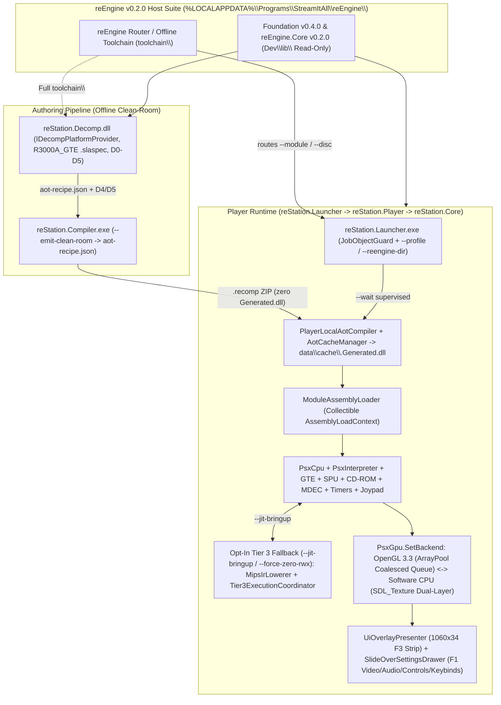
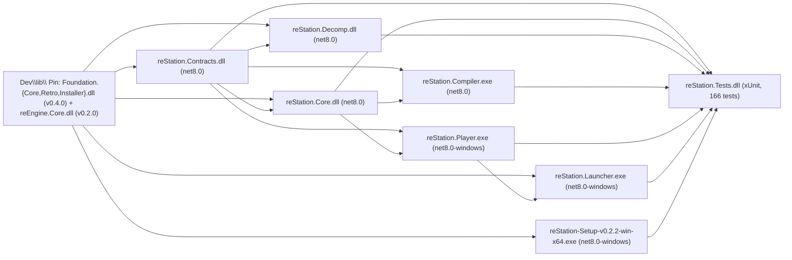

# reStation v0.2.2 — System Architecture & Symbol Map

- **Version:** `v0.2.2` (`Track: 0.2.x` · Backward-Compatible Track: `0.1.x`)
- **Maintained By:** `@devv` (Technical Truth) & `@tessa` (Clarity) · **Enforcer:** `@dean` (Gate 2)
- **Spoke Reference:** [`v0.2.0-ps1-decomp-and-aot.md`](architecture/v0.2.0-ps1-decomp-and-aot.md)

---

## 1. System Context & Runtime Model

`reStation` executes PlayStation 1 (`PS1`) titles cleanly across two strictly decoupled stages: (1) an offline clean-room `.decomp` authoring pipeline (`reStation.Decomp` + `reStation.Compiler`) that turns user-supplied `PS-X EXE`/disc layouts into shareable `aot-recipe.json` + clean `module.recomp.json` metadata (`0` copyrighted ROMs or generated DLLs bundled), and (2) a player-PC runtime (`reStation.Launcher` + `reStation.Player` + `reStation.Core`) that synthesizes `<Game>.Generated.dll` locally inside `<dataDir>\cache\` via `AotCacheManager`, loads it inside a collectible `ModuleAssemblyLoader`, and runs a deterministic `30 Hz` / interpolated sub-tick PS1 frame loop with frame-boundary GPU backend hot-swapping (`Software CPU` <-> `OpenGL 3.3`).

---

## 2. Assembly / `.dll` & Module Dependency Graph

### Dependency Rules (Allowed vs. Forbidden)
- **Allowed:** Pinned `Dev\lib\` SDK binaries (`Foundation.*` `v0.4.0`, `reEngine.Core` `v0.2.0`), unidirectional `Contracts -> Core / Decomp -> Compiler / Player -> Launcher`, isolated `Installer -> Foundation.Installer`.
- **Forbidden:** Cross-repo writes to `Foundation\`, `_DevBible\`, or read-only `Research\*` repos; bundled `*.Generated.dll` or `*.g.cs` inside `.recomp`/`.decomp`; `GPLv3` `ghidra_psx_ldr` or Sony `.gdt`/`.til` headers; any file in `Dev\src\` exceeding `400` total lines (`build_release.ps1` hard gate).

---

## 3. End-to-End Data Flow per Major Pipeline

### A. Clean-Room PS1 `.decomp` Flow (`D0`–`D5`)
1. [`PsxDecompPlatformProvider.RunDecompAsync`](../src/reStation.Decomp/PsxDecompPlatformProvider.cs#L48-L132) loads `module.decomp.json`, runs [`PsxCleanRoomValidator.ValidatePackage`](../src/reStation.Decomp/PsxCleanRoomValidator.cs#L55-L87), and verifies the clean-room SLEIGH extension via [`PsxGteSlaExtension.ValidateSlaSpec`](../src/reStation.Decomp/PsxGteSlaExtension.cs#L89-L105).
2. [`PsxCleanExeAndOverlayLoader.DiscoverProgramLayout`](../src/reStation.Decomp/PsxCleanExeAndOverlayLoader.cs#L111-L154) and [`PsxIsoImageScanner`](../src/reStation.Decomp/PsxIsoImageScanner.cs) parse PS-X EXE + dynamic overlay addresses and provision `ghidra_ext/` + `PsxCleanExeLoader.py` via [`PsxGhidraScriptTemplates`](../src/reStation.Decomp/PsxGhidraScriptTemplates.cs).
3. `D3` [`PsxExportAndAssetPipeline`](../src/reStation.Decomp/PsxExportAndAssetPipeline.cs) normalizes Ghidra C exports and synthesizes deterministic `aot-recipe.json` (`--emit-clean-room` in [`RecompCompilerPipeline`](../src/reStation.Compiler/RecompCompilerPipeline.cs)), while `D4`/`D5` [`PsxParityAndByteMatchVerifier`](../src/reStation.Decomp/PsxParityAndByteMatchVerifier.cs) checks LP32 ABI layouts and MIPS byte parity.

### B. Player-PC Local AOT Cache & Collectible Execution Flow (`data\cache\`)
1. [`Program.MediaGate`](../src/reStation.Player/Program.MediaGate.cs) locates `.recomp` + `aot-recipe.json` and verifies user media in `data\rom\` via [`PlayerMediaResolver.ResolveAndVerifyMedia`](../src/reStation.Core/Aot/PlayerMediaResolver.cs#L101-L214) (calling [`TryFindContainerSliceOffset`](../src/reStation.Core/Aot/PlayerMediaResolver.cs#L215-L243) across `2048`-byte sector then `4`-byte offsets for `<container>#<slice>` overlays).
2. [`PlayerLocalAotCompiler.EnsureCompiledInCacheAsync`](../src/reStation.Core/Aot/PlayerLocalAotCompiler.cs#L71-L161) validates clean-room `.recomp` compliance (`0` bundled `*.Generated.dll`), queries `reEngine.Core.Aot.AotCacheManager`, and on cache miss invokes `reStation.Compiler` ([`DiscOverlaySliceResolver`](../src/reStation.Compiler/DiscOverlaySliceResolver.cs#L13-L78) for recipe `ExeId` ordering + `IOverlayRecompModule` extraction, [`RecompCompilerPipeline.SelectUniqueSeedsForExe`](../src/reStation.Compiler/RecompCompilerPipeline.cs#L303-L324), and [`ModuleManifestEmitter.ResolveGeneratedAssemblySimpleName`](../src/reStation.Compiler/ModuleManifestEmitter.cs#L281-L293) honoring `generatedCacheAssemblyName`) to compile `<Game>.Generated.dll` locally into `<dataDir>\cache\`.
3. [`ModuleAssemblyLoader`](../src/reStation.Player/ModuleAssemblyLoader.cs#L53-L252) attaches `concreteManifest.AotRecipeSpec ??= aotRecipe` and `LoadedFromLocalAotCache = true`, preloads [`CompanionAssembly`](../src/reStation.Player/ModuleAssemblyLoader.cs#L78) (`PreloadCompanionAssembly`) into the collectible `AssemblyLoadContext` (`isCollectible: true`), and clears the companion reference on `Unloading` (`ClearLoadedCompanion`) for zero-leak `WaitForUnload` reclamation. If `--jit-bringup` or `--force-zero-rwx` is active, [`MipsIrLowerer`](../src/reStation.Core/Ir/MipsIrLowerer.cs), [`RamPageEpochTable`](../src/reStation.Core/Jit/RamPageEpochTable.cs), [`Tier3ExecutionCoordinator`](../src/reStation.Core/Jit/Tier3ExecutionCoordinator.cs), and [`JitBringupRecorder`](../src/reStation.Core/Bringup/JitBringupRecorder.cs) (`ExitCode = 5` spin guard) operate as an opt-in diagnostic fallback.

### C. Runtime Frame, `T7` Input & GPU Backend Flow
1. [`ReStationHost`](../src/reStation.Player/ReStationHost.cs) + [`ReStationHost.QuickSave`](../src/reStation.Player/ReStationHost.QuickSave.cs) queue `F5`/`F9` requests cleanly at VBlank boundaries; mid-stack `F9` restores dispatch through [`PsxCpu.DispatchFunction`](../src/reStation.Core/Cpu/PsxCpu.cs#L160-L171) -> [`PsxInterpreter.ResumeFromSnapshot`](../src/reStation.Core/Cpu/PsxInterpreter.cs#L13-L43) whenever `R[31] != ReturnSentinelPc`, while [`PsxCpu.HasCompiledEntry`](../src/reStation.Core/Cpu/PsxCpu.Scheduling.cs#L73-L80) resolves `IRecompCompiledEntryLookup`.
2. [`PsxJoypadPort`](../src/reStation.Core/Hardware/PsxJoypadPort.cs) drives finite `~96`-cycle `/ACK` pulses, `_irqPending` (`0x200`), and DualShock `0x73` packets; [`PsxTimersAndDma`](../src/reStation.Core/Hardware/PsxTimersAndDma.cs) calls `TickTo(_cpu.TotalCycles)` on reads/writes; [`ModernInputController`](../src/reStation.Core/Input/ModernInputController.cs) + [`HostInputMapper`](../src/reStation.Player/HostInputMapper.cs) dispatch `[1st, 2nd, 3rd]` KBM (including SDL3 USB HID Numpad `Num/`..`Num.` + `Ins`/`Home`/`End`/`RAlt` labels in [`KeyBindingsConfig`](../src/reStation.Core/Input/KeyBindingsConfig.cs#L115-L147)) + mouse/wheel (`1001..1007`) + controller (`2001..2032`) + `Schema B` `controllerDpadMode` / `isometricMoveMode` with `!gameplay` Arrow fallback.
3. [`Program.FrameLoop`](../src/reStation.Player/Program.FrameLoop.cs) preserves `float` mouse deltas, commits live `host.SetTargetFps` and [`PsxGpu.SetBackend`](../src/reStation.Core/Gpu/PsxGpu.cs) / [`HostVideoSurface.TrySwitchBackend`](../src/reStation.Player/HostVideoSurface.Switch.cs) swaps at frame boundary (reverting to `software` with banner on GL error), enforces `4:3` default aspect unless enabled + module-approved via `IRecompWidescreenProvider`, and renders the `1060x34` HUD strip (`F3`) or widened `800px` (`actW = 304 px`) 5-column `Action | 1st | 2nd | 3rd | Gamepad` `Keybinds` drawer (`F1`) over GPU-composited layers.

---

## 4. File & Symbol Lookup Registry (`143` Tracked Files — Max `375` Lines)

| File | Lines | CodeSLOC | Primary Exports & Responsibility |
| :--- | ---: | ---: | :--- |
| `Dev/scripts/build_release.ps1` | 361 | 309 | Single-pass `<=400`-line gate, build, Authenticode sign, installer, 6-file `Releases\`, `SharedLibs\`, `Archive\` |
| `Dev/scripts/sanitize_release_docs.ps1` | 126 | 111 | UTF-8 repair, internal-leak sanitizer, `USER_GUIDE` -> `Releases\README.md` compiler |
| `Dev/src/reStation.Compiler/AotRecipeEmitter.cs` | 167 | 138 | `AotRecipeEmitter` clean-room `aot-recipe.json` + clean manifest serializer |
| `Dev/src/reStation.Compiler/DiscExeLoader.cs` | 354 | 307 | `DiscoveredExe` (`IsOverlay`, `ContentSha256Hex`), `DiscExeLoader` ISO/dir EXE + `AotRecipeSpec?` discovery |
| `Dev/src/reStation.Compiler/DiscOverlaySliceResolver.cs` | 170 | 144 | `DiscOverlaySliceResolver` deterministic recipe `ExeId` ordering & `<container>#<slice>` overlay slicing |
| `Dev/src/reStation.Compiler/ExeScanHelpers.cs` | 352 | 312 | `GeneratedFnSpec`, `GeneratedExeSpec`, `ExeScanHelpers` control-flow scanner (`startOffset` `0` for overlays) |
| `Dev/src/reStation.Compiler/FunctionChunkEmitter.cs` | 280 | 256 | `FunctionChunkEmitter` chunked C# + `IOverlayRecompModule` codegen |
| `Dev/src/reStation.Compiler/MipsDecoder.cs` | 129 | 103 | `MipsDecoder` R3000A instruction decoding |
| `Dev/src/reStation.Compiler/MipsEmitHelpers.cs` | 203 | 176 | `MipsEmitHelpers` COP0/COP2/branch emitter helpers |
| `Dev/src/reStation.Compiler/MipsLifter.cs` | 195 | 166 | `LiftedUnit`, `MipsLifter` MIPS-to-C# function lifter (`dynSwitch` delay-slot fix in `v0.2.1`) |
| `Dev/src/reStation.Compiler/MipsLifter.Emit.cs` | 215 | 197 | `MipsLifter` ALU/memory/delay-slot label emission + `ScanRangeFeatures` `fnTargets` guard |
| `Dev/src/reStation.Compiler/ModuleManifestEmitter.cs` | 296 | 265 | `ModuleManifestEmitter`, `ResolveGeneratedAssemblySimpleName` (`generatedCacheAssemblyName` PE parity) + `.rodata` `<NoWarn>` |
| `Dev/src/reStation.Compiler/Program.cs` | 42 | 33 | CLI entry (`--disc`, `--emit-clean-room`, `--execution-tier`, `--profile`) |
| `Dev/src/reStation.Compiler/RecompCompilerPipeline.cs` | 327 | 288 | `RecompCompilerOptions`, `RecompCompileResult`, `RecompCompilerPipeline`, `SelectUniqueSeedsForExe` |
| `Dev/src/reStation.Contracts/GamepadBindingCode.cs` | 187 | 105 | `GamepadBindingCode` (`2001..2032`, `FormatLabel`, SDL button mapping) |
| `Dev/src/reStation.Contracts/IGameFramePatch.cs` | 22 | 6 | `IGameFramePatch` per-call interception hook |
| `Dev/src/reStation.Contracts/IModuleInputProfileProvider.cs` | 136 | 76 | `GameActionDescriptor` (`int[<=3]` KBM/Controller), `IModuleInputProfileProvider` |
| `Dev/src/reStation.Contracts/INativeGameActionHook.cs` | 105 | 55 | `NativeInputModeIds`, `NativeGameActionContext`, `INativeGameActionHook` |
| `Dev/src/reStation.Contracts/IOverlayRecompModule.cs` | 17 | 7 | `IOverlayRecompModule` dynamic overlay RAM address + SHA-256 contract |
| `Dev/src/reStation.Contracts/IPsxRenderBackend.cs` | 52 | 19 | `PsxRenderBackendIds`, `IPsxRenderBackend` |
| `Dev/src/reStation.Contracts/IRecompModule.cs` | 52 | 22 | `IRecompModule`, `IReStationHost` core execution contracts |
| `Dev/src/reStation.Contracts/IRecompWidescreenProvider.cs` | 19 | 5 | `IRecompWidescreenProvider` true widescreen module eligibility hook |
| `Dev/src/reStation.Contracts/IReStationCpu.cs` | 99 | 44 | `IReStationCpu` guest register/memory/GTE interface |
| `Dev/src/reStation.Contracts/IReStationCpuEx.cs` | 29 | 13 | `IReStationCpuEx` sub-tick, `HasCompiledEntry`, `TryAdvanceToNextVBlank` |
| `Dev/src/reStation.Contracts/IReStationDecompProvider.cs` | 237 | 136 | `ReStationExecutionTierModes`, `AotRecipeSpec`, `AotRecipeExecutableSpec`, `IReStationDecompProvider` |
| `Dev/src/reStation.Contracts/IReStationHostEx.cs` | 29 | 13 | `IReStationHostEx` headless/target-FPS/mouse-look host interface |
| `Dev/src/reStation.Contracts/IReStationModuleManifest.cs` | 209 | 139 | `ReStationEngineInfo` (`0.2.2`), `IReStationModuleManifest`, `ReStationModuleManifest` |
| `Dev/src/reStation.Contracts/ISubTickFrameHook.cs` | 25 | 11 | `ISubTickFrameHook` enhanced 60 FPS sub-tick callbacks |
| `Dev/src/reStation.Contracts/PsxTelemetrySnapshot.cs` | 61 | 30 | `PsxTelemetrySnapshot` heartbeat & HUD telemetry snapshot |
| `Dev/src/reStation.Core/Aot/IRecompCompiledEntryLookup.cs` | 22 | 12 | `IRecompCompiledEntryLookup`, `LocalAotLoadOptions` |
| `Dev/src/reStation.Core/Aot/PlayerLocalAotCompiler.cs` | 256 | 217 | `LocalAotEnsureResult`, `LocalAotCompileRequest`, `PlayerLocalAotCompiler` |
| `Dev/src/reStation.Core/Aot/PlayerMediaResolver.cs` | 278 | 233 | `ResolvedPlayerMedia`, `PlayerMediaResolver`, `TryFindContainerSliceOffset` (`data\rom\` + `<container>#<slice>` SHA-256 resolver) |
| `Dev/src/reStation.Core/Audio/PsxSpu.cs` | 321 | 272 | `PsxSpu` 24-voice mixer, unity defaults, SPUCNT gating |
| `Dev/src/reStation.Core/Audio/SpuVoice.cs` | 269 | 214 | `SpuVoice` ADPCM decode + ADSR envelope |
| `Dev/src/reStation.Core/Audio/XaAdpcmDecoder.cs` | 167 | 132 | `XaAdpcmDecoder` CD-ROM XA sector decoding |
| `Dev/src/reStation.Core/Bios/MemCardMcrStore.cs` | 221 | 194 | `MemCardMcrStore` 128 KB `.mcr` persistence |
| `Dev/src/reStation.Core/Bios/PsxBiosHle.cs` | 359 | 319 | `PsxBiosHle` A0/B0/C0 HLE vectors + 4-arg `InitPAD` |
| `Dev/src/reStation.Core/Bios/PsxBiosHle.Events.cs` | 181 | 159 | `PsxBiosHle` events, timers, `PAD_dr` byte-swap fix |
| `Dev/src/reStation.Core/Bringup/JitBringupRecorder.cs` | 248 | 210 | `JitBringupRecorder`, `BringupProfileDocument` (`ExitCode = 5` stall guard) |
| `Dev/src/reStation.Core/CdRom/PsxCdRom.cs` | 234 | 203 | `PsxCdRom` command state machine & sector FIFO |
| `Dev/src/reStation.Core/CdRom/PsxCdRom.Media.cs` | 170 | 149 | `PsxCdRom` `.cue`/`.bin`/`.chd`/`.iso` backing media |
| `Dev/src/reStation.Core/CdRom/PsxCdRomTiming.cs` | 48 | 24 | `PsxCdRomTiming` deterministic sector/seek latency constants |
| `Dev/src/reStation.Core/Core/CliOptions.cs` | 249 | 221 | `CliOptions` parser + sandbox containment + `--jit-bringup` / `--profile` flags |
| `Dev/src/reStation.Core/Core/RecompSettings.cs` | 286 | 251 | `RecompSettings` (`Clamp` preserves consumer `AppId`/`SchemaVersion`), `ModernBindingsJsonConverter`, `IsWidescreen16By9 = false`, `Schema A`/`B` keys |
| `Dev/src/reStation.Core/Core/ReStationLogger.cs` | 143 | 116 | `ReStationLogger` + `TryResolveDevLogsDirectory` (`RS-06`) + `<=15s` heartbeats |
| `Dev/src/reStation.Core/Cpu/PsxCpu.Bus.cs` | 95 | 78 | `PsxCpu` IO/RAM/DMA read-write dispatch partial |
| `Dev/src/reStation.Core/Cpu/PsxCpu.cs` | 300 | 268 | `PsxCpu` R3000A registers, mid-stack `DispatchFunction` resume (`RS-07`), `Break` logging |
| `Dev/src/reStation.Core/Cpu/PsxCpu.Scheduling.cs` | 217 | 192 | `PsxCpu` `HasCompiledEntry` (`IRecompCompiledEntryLookup`), `RunSlice`, VBlank scheduler |
| `Dev/src/reStation.Core/Cpu/PsxInterpreter.cs` | 217 | 202 | `PsxInterpreter.ResumeFromSnapshot` & fallback MIPS step loop |
| `Dev/src/reStation.Core/Cpu/PsxMemoryBus.cs` | 284 | 245 | `PsxMemoryBus` 2 MB KUSEG/KSEG0/KSEG1 + scratchpad |
| `Dev/src/reStation.Core/DiscIngestion/DiscManifest.cs` | 93 | 68 | `DiscManifest` verified ROM metadata |
| `Dev/src/reStation.Core/DiscIngestion/DiscVerifierAndExtractor.cs` | 208 | 178 | `DiscVerifierAndExtractor` SHA-256 + `7z` extraction |
| `Dev/src/reStation.Core/DiscIngestion/Iso9660RawReader.cs` | 271 | 231 | `Iso9660RawReader` Mode 2 Form 1 XA directory parser |
| `Dev/src/reStation.Core/Gpu/IPsxGpuBackendHooks.cs` | 29 | 11 | `IPsxGpuBackendHooks` PGXP + VRAM read/write hooks |
| `Dev/src/reStation.Core/Gpu/OpenGl33Bindings.cs` | 190 | 169 | `OpenGl33Bindings` native GL 3.3 entry points |
| `Dev/src/reStation.Core/Gpu/OpenGl33RenderBackend.cs` | 294 | 258 | `OpenGl33RenderBackend` GPU VRAM/display FBO renderer |
| `Dev/src/reStation.Core/Gpu/OpenGl33RenderBackend.Pipeline.cs` | 275 | 245 | `OpenGl33RenderBackend` alpha overlay (`1060x34` strip / drawer) & aspect quad |
| `Dev/src/reStation.Core/Gpu/OpenGl33RenderBackend.Queue.cs` | 195 | 174 | `OpenGl33RenderBackend` `ArrayPool` off-thread VRAM coalescing queue |
| `Dev/src/reStation.Core/Gpu/OpenGl33RenderBackend.Shaders.cs` | 265 | 236 | `OpenGl33RenderBackend` GLSL 330 shader compilation & FBO setup |
| `Dev/src/reStation.Core/Gpu/PsxGpu.cs` | 370 | 330 | `PsxGpu` GP0/GP1 command processor + `SetBackend` hot-swap + `EffectiveWidescreen` |
| `Dev/src/reStation.Core/Gpu/PsxGpu.Scanout.cs` | 129 | 103 | `PsxGpu` active display origin & scanout crop |
| `Dev/src/reStation.Core/Gpu/PsxPrimitiveDecoder.cs` | 167 | 136 | `PsxPrimitiveDecoder` GP0 polygon/line/rect decoder |
| `Dev/src/reStation.Core/Gpu/SoftwareCpuRasterizer.Scanline.cs` | 220 | 193 | `SoftwareCpuRasterizer` gouraud/textured triangle rasterizer |
| `Dev/src/reStation.Core/Gpu/SoftwareCpuRenderBackend.cs` | 258 | 224 | `SoftwareCpuRenderBackend` 1024x512 VRAM + 15/24-bit scanout |
| `Dev/src/reStation.Core/Gte/PgxpTracker.cs` | 41 | 22 | `PgxpTracker` sub-pixel vertex cache |
| `Dev/src/reStation.Core/Gte/PsxGte.Commands.cs` | 194 | 162 | `PsxGte` RTPS/RTPT/NCLIP/AVSZ math commands |
| `Dev/src/reStation.Core/Gte/PsxGte.cs` | 260 | 207 | `PsxGte` COP2 data/control registers |
| `Dev/src/reStation.Core/Hardware/PsxJoypadPort.cs` | 238 | 206 | `PsxJoypadPort` finite `~96`-cycle `/ACK` pulse, `_irqPending` (`0x200`), DualShock `0x73` |
| `Dev/src/reStation.Core/Hardware/PsxTimersAndDma.cs` | 303 | 261 | `PsxTimersAndDma` DMA + `TickTo` synced `RCnt0..RCnt2` reads/writes |
| `Dev/src/reStation.Core/Input/GlobalControllerProfile.cs` | 120 | 97 | `GlobalControllerProfile` `settings.controls.json` 1:1 pad mapping |
| `Dev/src/reStation.Core/Input/InputScriptRunner.cs` | 200 | 175 | `InputScriptRunner` deterministic headless/`--visible-test` frame scripts |
| `Dev/src/reStation.Core/Input/KeyBindingsConfig.cs` | 203 | 172 | `KeyBindingsConfig` (`4..511` incl. Numpad `84..99` + `73/74/77/230`, `1001..1007` mouse/wheel, `2001..2032` gamepad helpers) |
| `Dev/src/reStation.Core/Input/ModernInputController.cs` | 298 | 257 | `ModernInputController` `int[<=3]` slots, `!gameplay` Arrow fallback, `Schema B` modes |
| `Dev/src/reStation.Core/Ir/MipsIrLowerer.cs` | 237 | 205 | `MipsIrLowerer` guest R3000A basic-block lowering to 16-byte `IrInsn` |
| `Dev/src/reStation.Core/Ir/RecompIrTypes.cs` | 184 | 165 | `IrOp`, `IrInsnFlags`, `IrInsn`, `IrBasicBlock` |
| `Dev/src/reStation.Core/Jit/RamPageEpochTable.cs` | 221 | 168 | `RamPageEpochTable`, `BlockEpochStamp` 4 KB page / 64 B cacheline coherence |
| `Dev/src/reStation.Core/Jit/RyuJitBlockBackend.cs` | 358 | 316 | `RyuJitBlockBackend` dynamic IL basic-block backend |
| `Dev/src/reStation.Core/Jit/ThreadedIrBackend.cs` | 187 | 166 | `ThreadedIrBackend` zero-RWX threaded IR evaluator |
| `Dev/src/reStation.Core/Jit/Tier3ExecutionCoordinator.cs` | 233 | 192 | `Tier3ExecutionCoordinator` RyuJIT + SMC threshold `8` demotion to Threaded-IR |
| `Dev/src/reStation.Core/Mdec/PsxMdec.cs` | 214 | 175 | `PsxMdec` macroblock FIFO & DMA0/1 interface |
| `Dev/src/reStation.Core/Mdec/PsxMdec.Decode.cs` | 210 | 174 | `PsxMdec` IDCT & YUV-to-RGB decode partial |
| `Dev/src/reStation.Core/Saves/QuickSaveManager.cs` | 181 | 151 | `QuickSaveManager` `"RST1"` snapshot save/restore (`SchemaVersion = 1`) |
| `Dev/src/reStation.Core/Saves/QuickSaveTrailer.cs` | 146 | 119 | `QuickSaveTrailer` `"RSTX"` additive state extension blocks |
| `Dev/src/reStation.Decomp/PsxAssetExtractors.cs` | 262 | 214 | `PsxAssetExtractors` TIM/VAB/SEQ extractor into gitignored `<dataDir>\cache\assets\` |
| `Dev/src/reStation.Decomp/PsxCleanExeAndOverlayLoader.cs` | 306 | 238 | `PsxCleanExeAndOverlayLoader` PS-X EXE + overlay + `OfflineToolchainLocator` bridge |
| `Dev/src/reStation.Decomp/PsxCleanRoomValidator.cs` | 154 | 127 | `PsxCleanRoomValidator` rejects ROMs, save states, `ghidra_psx_ldr`, Sony headers, `*.g.cs`/`*.Generated.dll` |
| `Dev/src/reStation.Decomp/PsxDecompPlatformProvider.cs` | 306 | 240 | `PsxDecompPlatformProvider` `MPL-2.0` `IReStationDecompProvider` (`platformId: "ps1"`) |
| `Dev/src/reStation.Decomp/PsxExportAndAssetPipeline.cs` | 237 | 185 | `PsxNormalizedFunction`, `PsxExportAndAssetPipeline` C normalization + `AotRecipeSpec` builder |
| `Dev/src/reStation.Decomp/PsxGhidraScriptTemplates.cs` | 156 | 123 | `PsxGhidraScriptTemplates` clean-room `PsxCleanExeLoader.py` & headless JSON generator |
| `Dev/src/reStation.Decomp/PsxGteSlaExtension.cs` | 257 | 195 | `PsxGteSlaExtension` provisions `R3000A_GTE` `.ldefs`/`.pspec`/`.cspec`/`.slaspec` |
| `Dev/src/reStation.Decomp/PsxIsoImageScanner.cs` | 191 | 161 | `PsxIsoImageScanner` disc BIN/ISO layout scanner |
| `Dev/src/reStation.Decomp/PsxParityAndByteMatchVerifier.cs` | 236 | 182 | `PsxParityAndByteMatchVerifier` `D4` LP32 struct check + `D5` MIPS byte-match round-trip |
| `Dev/src/reStation.Decomp/PsxProgramModels.cs` | 105 | 48 | `PsxExeImage`, `PsxOverlayDescriptor`, `PsxLoadedProgramLayout`, `PsxGhidraHeadlessPlan` |
| `Dev/src/reStation.Decomp/PsxR3000ACodec.cs` | 241 | 199 | `R3000AInsnKind`, `PsxR3000ACodec` clean-room R3000A + COP2 encode/decode |
| `Dev/src/reStation.Decomp/Resources/r3000a_gte.slaspec` | 314 | 261 | Clean-room `MPL-2.0` SLEIGH R3000A + GTE COP2 specification |
| `Dev/src/reStation.Installer/Program.cs` | 271 | 234 | Installer entrypoint (`--profile`, `--reengine-dir`, `--migrate-legacy`, `--confirm-legacy-cleanup`) |
| `Dev/src/reStation.Installer/ReStationInstallerBootstrap.cs` | 269 | 236 | `ReStationInstallerBootstrap` `--uninstall` normalization + fail-closed `--test-mode` |
| `Dev/src/reStation.Installer/ReStationInstallerTheme.cs` | 97 | 84 | `ReStationInstallerTheme` (`AllowAutoStart = false`, zero nested `reEngine-Setup`) |
| `Dev/src/reStation.Installer/ReStationLegacyMigrationHelper.cs` | 302 | 265 | `ReStationLegacyMigrationHelper` opt-in `v0.1.1` ROM/settings rescue & gated cleanup |
| `Dev/src/reStation.Launcher/LauncherArgsHelper.cs` | 227 | 195 | `LauncherArgsHelper` zero-PII `%LOCALAPPDATA%` path resolution & `JobObjectGuard` |
| `Dev/src/reStation.Launcher/Program.cs` | 151 | 132 | Launcher forwarding `--wait`, `--profile`, `--reengine-dir` into `reStation.Player` |
| `Dev/src/reStation.Player/FirstRunMediaGateView.cs` | 92 | 69 | `FirstRunMediaGateView` missing BYO-ROM picker prompt |
| `Dev/src/reStation.Player/FixtureRunnerHost.cs` | 249 | 216 | `FixtureRunnerHost` deterministic fixture + `--visible-test` runner |
| `Dev/src/reStation.Player/HostInputMapper.cs` | 154 | 131 | `HostInputMapper` SDL3 keyboard/mouse/wheel/gamepad dispatcher & context `Esc` |
| `Dev/src/reStation.Player/HostVideoSurface.cs` | 293 | 250 | `HostVideoSurface` SDL3 window + GL 3.3 / GPU `SDL_Texture` Software dual-layer compositing |
| `Dev/src/reStation.Player/HostVideoSurface.Switch.cs` | 99 | 85 | `HostVideoSurface.TrySwitchBackend` live `Software <-> OpenGL 3.3` hot-swap + fallback |
| `Dev/src/reStation.Player/KeybindsDrawerTab.cs` | 300 | 269 | `KeybindsDrawerTab` capture state machine & `Left-Click`/`Right-Click`/`Delete` handlers |
| `Dev/src/reStation.Player/KeybindsDrawerTab.ModernGrid.cs` | 95 | 78 | `KeybindsDrawerTab` scrollable 5-column `Action\|1st\|2nd\|3rd\|Gamepad` matrix renderer (`slotW=96`, `gap=5`, `actW=304`) |
| `Dev/src/reStation.Player/ModuleAssemblyLoader.cs` | 370 | 321 | `ModuleAssemblyLoader` collectible ALC, `CompanionAssembly` preload + `Unloading` clear, `_companionAliases`, `AotRecipeSpec` attach |
| `Dev/src/reStation.Player/PreloadRomDetector.cs` | 89 | 66 | `PreloadRomDetector` `data\rom\` media scanner |
| `Dev/src/reStation.Player/Program.cs` | 299 | 260 | Player startup, CLI dispatch, `--jit-bringup` wiring, media gate launch |
| `Dev/src/reStation.Player/Program.FrameLoop.cs` | 313 | 280 | `Program` main `30 Hz` / sub-tick loop, float mouse, live backend switch, VBlank `F5`/`F9` |
| `Dev/src/reStation.Player/Program.MediaGate.cs` | 304 | 287 | `Program` cold/warm `<dataDir>\cache\` AOT resolution + module activation |
| `Dev/src/reStation.Player/ReStationHost.cs` | 296 | 256 | `ReStationHost` core host implementation |
| `Dev/src/reStation.Player/ReStationHost.QuickSave.cs` | 129 | 105 | `ReStationHost` VBlank-queued `RequestQuickSave`/`QuickLoad` + live `SetTargetFps` |
| `Dev/src/reStation.Player/ReStationHost.SubTick.cs` | 126 | 105 | `ReStationHost` `T:01` marshaled sub-tick render callbacks |
| `Dev/src/reStation.Player/Sdl3Native.cs` | 266 | 214 | `Sdl3Native` P/Invoke bindings for SDL3 window/renderer/textures/gamepad |
| `Dev/src/reStation.Player/Sdl3Native.OpenGl.cs` | 71 | 53 | `Sdl3Native` `SDL_GL_*` context creation & VSync P/Invoke helpers |
| `Dev/src/reStation.Player/SlideOverSettingsDrawer.cs` | 315 | 269 | `SlideOverSettingsDrawer` dirty-cached `F1` drawer (`Video`, `Audio`, `Controls`, `Keybinds`) |
| `Dev/src/reStation.Player/UiOverlayPresenter.cs` | 325 | 286 | `UiOverlayPresenter` `1060x34` compact HUD strip, `250 ms` HUD throttle, `4:3`/`16:9` aspect |
| `Dev/src/reStation.Player/UiPaint.cs` | 96 | 75 | `UiPaint` bitmap UI primitive & pill drawing helpers |
| `Dev/src/reStation.Player/VisibleTestHarness.cs` | 105 | 88 | `VisibleTestHarness` centered topmost GUI harness |
| `Dev/src/reStation.Tests/CliAndSettingsTests.cs` | 367 | 313 | Settings defaults & `Clamp()` preservation, Standard 18/19 keys, CLI containment, `RS-06` `Dev\logs\` test |
| `Dev/src/reStation.Tests/CompilerAndModuleLoaderTests.cs` | 274 | 231 | `--emit-clean-room`, `PlayerLocalAotCompiler`, `AotCacheManager`, collectible unload tests |
| `Dev/src/reStation.Tests/DiscIngestionAndPreloadTests.cs` | 188 | 155 | ISO-9660 extraction & `data\rom\` preload discovery tests |
| `Dev/src/reStation.Tests/InstallerAndSandboxContainmentTests.cs` | 266 | 226 | `AllowAutoStart = false`, `--uninstall` normalization, fail-closed sandbox path checks |
| `Dev/src/reStation.Tests/InstallerMigrationAndLauncherTests.cs` | 134 | 110 | `LauncherArgsHelper` `%LOCALAPPDATA%`, `--migrate-legacy`, `--confirm-legacy-cleanup` tests |
| `Dev/src/reStation.Tests/MultiBindAndSchemaBInputTests.cs` | 147 | 124 | `int[<=3]` slots, wheel `1006..1007`, gamepad `2001..2032`, `!gameplay` Arrow fallback, `Schema B` modes |
| `Dev/src/reStation.Tests/PsxBiosPadAndThreeTierInputTests.cs` | 225 | 181 | `PAD_init`/`PAD_dr` byte swap + 3-tier input profile tests |
| `Dev/src/reStation.Tests/PsxCdRomTimingTests.cs` | 120 | 101 | Deterministic CD-ROM sector/seek cycle tests |
| `Dev/src/reStation.Tests/PsxCpuGteAndMdecTests.cs` | 166 | 129 | CPU instruction, GTE `IR1`/`IR2` unclamped projection & MDEC decode tests |
| `Dev/src/reStation.Tests/PsxDecompAndSlaTests.cs` | 231 | 199 | `.decomp` D0–D5, `R3000A_GTE` `.slaspec`, LP32/byte-match, clean-room & offline toolchain tests |
| `Dev/src/reStation.Tests/PsxSpuAdsrAndXaTests.cs` | 152 | 125 | SPU ADSR, unity volume, XA mute gating tests |
| `Dev/src/reStation.Tests/RenderBackendParityTests.cs` | 129 | 104 | Software vs. GL 3.3 primitive/VRAM parity tests |
| `Dev/src/reStation.Tests/Tier3IrAndJitTests.cs` | 170 | 139 | `MipsIrLowerer`, `RamPageEpochTable`, `ThreadedIrBackend`, `Tier3ExecutionCoordinator` SMC & `JitBringupRecorder` `ExitCode=5` tests |
| `Dev/src/reStation.Tests/V015EngineFixesTests.cs` | 199 | 164 | `v0.1.5` joypad NACK, 4-arg `InitPAD`, SPU gating & overlay emission regression tests |
| `Dev/src/reStation.Tests/Wave2CliAndFixtureTests.cs` | 289 | 252 | Fixture spec & headless/visible runner tests |
| `Dev/src/reStation.Tests/Wave2CoreSeamTests.cs` | 375 | 330 | `v0.1.1` seam, `RSTX` trailer, `memcard`, `ReStationEngineInfo` compatibility tests |
| `Dev/src/reStation.Tests/Wave2LauncherAndGlQueueTests.cs` | 276 | 243 | GL `ArrayPool` coalescing queue, `build_release.ps1` & dual manifest parity tests |
| `Dev/src/reStation.Tests/Wave3Patch021RegressionTests.cs` | 190 | 158 | `v0.2.1` `DEFECT-01` `MipsLifter` `.rodata` delay-slot AOT compile & `DEFECT-03` `RecompSettings` preservation tests |
| `Dev/src/reStation.Tests/Wave3Patch022RegressionTests.cs` | 299 | 264 | `v0.2.2` companion alias ALC + `WaitForUnload`, recipe `ExeId` + `<container>#<slice>` overlay lifting, Numpad/Nav labels & `800px` Keybinds grid tests |
| `Dev/src/reStation.Tests/Wave3PlaytestAndCartridgeTests.cs` | 234 | 202 | Sub-tick `T:01`, PGXP clear, ZIP `.recomp` loading tests |
| `Dev/src/reStation.Tests/Wave3RuntimeFixesTests.cs` | 213 | 175 | `T7` (`RS-07`–`RS-15`) mid-stack `F9`, GL hot-swap fallback, `1060x34` strip, `4:3` aspect, `/ACK` & timer `TickTo` tests |

---

## 5. Settings & Persistence Ownership Map

| Persistence File / Store | Owning Component | Canonical Keys (`Standard 18` / `19`) |
| :--- | :--- | :--- |
| `<dataDir>\settings.json` (`Dev\data\settings.example.json`) | `RecompSettings` + `ReStationLegacyMigrationHelper` | `installProfile`, `reEngineInstallDir`, `suiteInstallDir`, `umbrellaSubpath`, `decompSchemaVersion`, `goalDecompTier`, `executionTierMode`, `backendId`, `resolutionScale`, `isWidescreen16By9`, `frameRateMode`, `targetFps`, `isVsyncEnabled`, `isPgxpEnabled`, `isFpsOverlayEnabled`, `inputProfileMode`, `controlMode`, `modernActionBindings`, `modernControllerBindings`, `controllerDpadMode`, `isometricMoveMode` |
| `<dataDir>\settings.controls.json` | `GlobalControllerProfile` | Global PS1 1:1 scancode bindings |
| `<dataDir>\cache\<moduleId>\<romSha256_16>-reStation-0.2.2-<modVer>\<moduleId>.Generated.dll` | `PlayerLocalAotCompiler` + `AotCacheManager` | Local machine-compiled AOT assemblies + manifest index |
| `<dataDir>\saves\*.rst1` | `QuickSaveManager` + `QuickSaveTrailer` | Version 1 binary snapshot + `"RSTX"` additive sections |
| `<dataDir>\memcards\*.mcr` | `MemCardMcrStore` | Raw 128 KB PS1 memory cards |
| `Dev\logs\` (`RS-06`) & `Sandbox\logs\` | `ReStationLogger` | `runtime.log` (`<=15s` heartbeats), `crashes\crash_*.json`, `screenshots\` |

---

## 6. Failure Modes & Resilience

- **Mid-Stack Quick-Load (`F9`):** When `R[31] != ReturnSentinelPc`, `PsxCpu.DispatchFunction` invokes `PsxInterpreter.ResumeFromSnapshot` directly; `HasCompiledEntry` avoids false positives inside `[TextStart, TextEnd)`.
- **OpenGL Context Creation Failure:** `HostVideoSurface.TrySwitchBackend` preserves window handle, logs exact driver failure, reverts to `software` cleanly, and displays an inline Video-tab warning banner.
- **Joypad / Polled Timer Deadlocks:** `PsxJoypadPort` clears `/ACK` automatically after `96` cycles while keeping `_irqPending` (`0x200`) independent; `PsxTimersAndDma` advances timers before reading/writing `RCnt*`.
- **Unbuilt Offline Ghidra Toolchain:** `PsxDecompPlatformProvider` fails closed on D2 `invokeGhidra=true` (`PSX_GHIDRA_HEADLESS_FAILED`) while allowing D0–D3 recipe synthesis without network calls (`MISSING_OFFLINE_TOOLCHAIN` diagnostic when toolchain missing in `Full`).
- **Clean-Room & Sandbox Escapes:** `PsxCleanRoomValidator` & `SandboxEnvironment.AssertPathContained` throw fail-closed exceptions on path traversal, `ghidra_psx_ldr`, Sony headers, retail media, or `*.g.cs`/`*.Generated.dll`.

---

## 7. Security & Privacy Model

- **Zero-PII Default Path:** User-scope `%LOCALAPPDATA%\Programs\StreamItAll\reEngine\engines\reStation\v0.2.2\` (`LauncherArgsHelper` + `ReStationInstallerTheme`) eliminates hardcoded drive paths or workstation usernames.
- **No Auto-Start / No Telemetry:** `AllowAutoStart = false`; zero background listeners or network sockets.
- **Human-Gated Legacy Cleanup:** Stranded `v0.1.1` cleanup requires explicit `--migrate-legacy` + `--confirm-legacy-cleanup` (or interactive modal `Yes`) and always preserves `data\rom\`.

---

## 8. Testing Strategy Map

- **Unit & Integration Suite (`reStation.Tests.dll`):** Run via `dotnet test Dev\src\reStation.slnx -c Release -p:TreatWarningsAsErrors=true --no-restore` (`166/166` passing across all `21` test files, `0` warnings, `0` skipped, verifying `.decomp` D0–D5, cold/warm AOT cache, recipe `ExeId` ordering + `<container>#<slice>` overlay lifting, `generatedCacheAssemblyName` PE identity + collectible `CompanionAssembly` unload, `MipsLifter` `.rodata` dynamic-switch compilation, `RecompSettings.Clamp()` consumer preservation, Tier 3 IR/JIT/SMC/bringup, installer containment & legacy migration, multi-bind `Schema A`/`B` input + Numpad/Nav labels + widened Keybinds grid, and `T7` runtime fixes).
- **Live GUI Acceptance (`Sandbox\`):** `--visible-test --test-mode --data-dir Sandbox\data --log-dir Sandbox\logs` paired with `--input-script` captures & screenshot inspection (`read_file`) plus 3-tier log sweep.

---

## 9. Design Decisions Log (ADR)

- **ADR-001 (2026-11-15 · v0.2.0) — Player-PC `<dataDir>\cache\` AOT Primary Over Shipped `.Generated.dll`:** Strip `*.Generated.dll` from shareable `.recomp` bundles and compile locally via `AotCacheManager` + collectible `ModuleAssemblyLoader`, keeping distributed packages cleanly separated from ROM/machine artifacts.
- **ADR-002 (2026-11-15 · v0.2.0) — Bespoke `MPL-2.0` `R3000A_GTE` `.slaspec`:** Replaced `GPLv3` `ghidra_psx_ldr` and Sony SDK headers with original clean-room SLEIGH definitions + `PsxCleanRoomValidator`.
- **ADR-003 (2026-11-15 · v0.2.0) — `IRecompWidescreenProvider` in `reStation.Contracts`:** Kept `Foundation\` strictly read-only while honoring `IsWidescreen16By9 = false` (`4:3`) default aspect until both user setting and game module approve `16:9`.
- **ADR-004 (2026-11-15 · v0.2.0) — Dual-Layer Software UI Compositing & `1060x34` Compact Strip:** Decoupled `SDL_Texture` UI overlay blending from CPU pixel compositing and isolated `F3` HUD rendering from full-screen allocations.
- **ADR-005 (2026-11-15 · v0.2.0) — Multi-Bind `Schema A` & `Schema B` Controller/Isometric Modes:** Unified `[1st, 2nd, 3rd]` KBM/wheel/gamepad bindings (`ModernBindingsJsonConverter`) with `!gameplay` Menu Arrow fallback without breaking `v0.1.x` scalar `GameActionDescriptor` signatures.

---

## 10. Zero-Touch Extension Playbooks

1. **Add a `.decomp` Analysis Stage or Asset Extractor:** Add a helper class in `Dev\src\reStation.Decomp\` (<= 400 lines), register it cleanly inside `PsxDecompPlatformProvider` / `PsxAssetExtractors`, and add a corresponding test in `PsxDecompAndSlaTests.cs`.
2. **Add a Game Module Native Hook or True-Widescreen Rule:** Implement `INativeGameActionHook` and/or `IRecompWidescreenProvider` inside the game `.recomp` assembly without editing `reStation.Core` or `Foundation`.
3. **Add a Settings Key:** Add the property on `RecompSettings` (preserving `[JsonExtensionData]` forward/backward compatibility), mirror its default in `Dev\data\settings.example.json`, and expose its control pill inside `SlideOverSettingsDrawer`.
