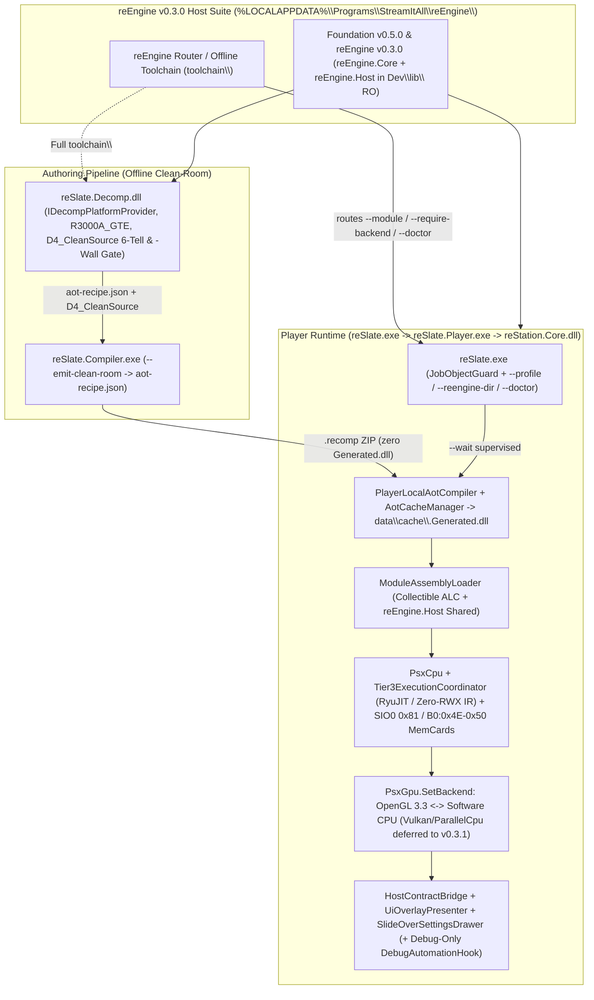
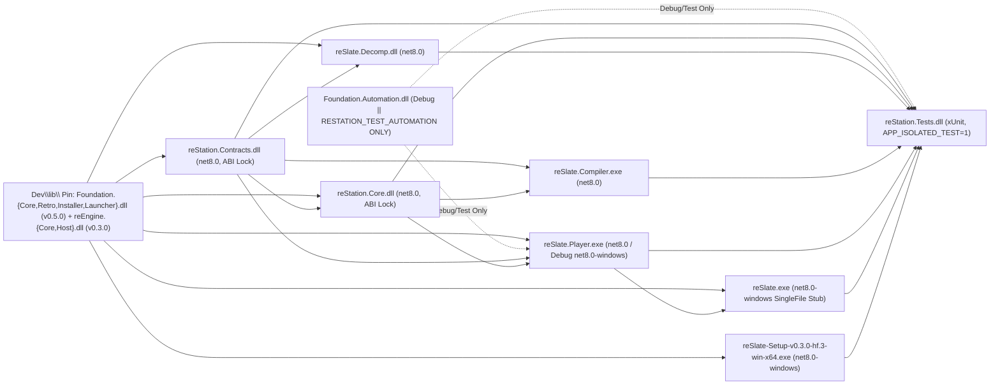

# reSlate — System Architecture & Symbol Map

- **Synced Version:** `0.3.0-hf.3` (`2026-11-19` · Public Beta Hotfix · `appId: "reslate"` · `engineId: "reSlate"` · Track `0.3.x`, Alias-Compatible with `0.2.x` / `0.1.x`; repository path `Personal/reStation`)
- **Scope:** Runtime Context, Assembly Dependency Graph, Execution Pipelines, File Inventory & Data Stores
- **License:** Mozilla Public License Version 2.0 (`MPL-2.0`, root [`LICENSE`](../../LICENSE))

---

## 1. System Context & Runtime Model

`reSlate` is a dedicated static recompilation engine — never a generic interpreter-driven compatibility layer — for `SlateOne` (`MIPS32 R3000A + GTE`) titles, decoupled across two clean-room stages: (1) an offline `.decomp` authoring pipeline (`reSlate.Decomp.dll` + `reSlate.Compiler.exe`) that converts user-supplied `PS-X EXE`/disc layouts into shareable `aot-recipe.json` + `module.recomp.json` metadata (`0` copyrighted ROMs or pre-built generated DLLs), and (2) a player-PC runtime (`reSlate.exe` -> `reSlate.Player.exe` + `reStation.Core.dll`) that compiles `<Game>.Generated.dll` locally inside `<dataDir>\cache\` via `AotCacheManager`, loads it in a collectible `ModuleAssemblyLoader`, executes unlifted/bring-up blocks natively via live `Tier3ExecutionCoordinator` (`RyuJitBlockBackend` primary / Zero-RWX `ThreadedIrBackend` secondary, with `PsxInterpreter` quarantined strictly to `--execution-tier interpreterOracle`), and runs a `60.0 Hz`-locked VBlank/SPU frame loop with `OpenGL 3.3` <-> `Software CPU` swapping (`Vulkan` and `ParallelCpu` explicitly deferred to `v0.3.1`). To keep existing `0.1.x`/`0.2.x` cartridges ABI-compatible, C# namespaces remain `reStation.*` and `reStation.Contracts.dll` / `reStation.Core.dll` retain their assembly names while `EngineAliasCatalog.AreEquivalent` bridges `reSlate` <-> `reStation`.

---

## 2. Assembly / `.dll` & Module Dependency Graph

### Dependency Rules (Allowed vs. Forbidden)
- **Allowed:** Pinned `Dev\lib\` SDK binaries (`Foundation v0.5.0`, `reEngine v0.3.0` including `reEngine.Host.dll`), unidirectional `Contracts -> Core / Decomp -> Compiler / Player -> Launcher`, isolated `Installer -> Foundation.Installer`, and `#if DEBUG || RESTATION_TEST_AUTOMATION` conditional `Foundation.Automation` + `<UseWindowsForms>` in `Player` (100% stripped from `Release`).
- **Forbidden:** Cross-repo writes to sibling `Foundation\`, `reEngine\`, or read-only research repos; bundled `*.Generated.dll` or `*.g.cs` inside `.recomp`/`.decomp`; `GPLv3` loaders or vendor SDK headers (`.gdt`/`.til`); unapproved non-test source files exceeding the `400` code-only SLOC ceiling; `Foundation.Automation.dll` / `System.Windows.Forms` PE references in `Release`; silent interpreter fallback outside `--execution-tier interpreterOracle`; or `AGENTS.md` staged inside `Builds\`/`Portable.zip`.

---

## 3. End-to-End Data Flow per Major Pipeline

### A. Clean-Room `SlateOne` `.decomp` Flow (`D0`–`D5`)
1. [`PsxDecompPlatformProvider.RunDecompAsync`](../src/reStation.Decomp/PsxDecompPlatformProvider.cs#L48-L132) validates `module.decomp.json` + `.slaspec`, runs `DecompD4StrictnessValidator` (`Corpus\tiers\D4_CleanSource\` with `D4_FunctionalRewrite` read-alias), and enforces [`PsxD4CraftsmanshipValidator`](../src/reStation.Decomp/PsxD4CraftsmanshipValidator.cs) across 6 decompiler-tell families + real `-Wall -Wextra -Wno-unused-parameter` `0`-warning checks whenever C sources or `d4_build_report.json` are present (`PSX_D4_CRAFTSMANSHIP_FAILED`).
2. [`PsxCleanExeAndOverlayLoader.DiscoverProgramLayout`](../src/reStation.Decomp/PsxCleanExeAndOverlayLoader.cs#L111-L154) and [`PsxIsoImageScanner`](../src/reStation.Decomp/PsxIsoImageScanner.cs) parse PS-X EXE + dynamic overlay addresses and provision `ghidra_ext/` + cohesive `PsxCleanExeLoader.py` exports (`PsxExportAndAssetPipeline`, `PsxParityAndByteMatchVerifier` `camelCase` `d4b_lockstep_report.json`).

### B. Player-PC Local AOT Cache & Live Tier 3 Execution (`data\cache\`)
1. [`Program.cs`](../src/reStation.Player/Program.cs) parses CLI directly via `CliOptions.Parse(args)`, migrates `<dataDir>\settings.json` to `<dataDir>\config\settings.json` non-destructively via `SettingsMigrationHelper.MigrateForConfigPathIfNeeded`, handles `--doctor` diagnostics and `--require-backend vulkan|parallelCpu` (`ExitCode = 6`), and resolves verified media (`PlayerMediaResolver`).
2. [`PlayerLocalAotCompiler.EnsureCompiledInCacheAsync`](../src/reStation.Core/Aot/PlayerLocalAotCompiler.cs) probes `reSlate.Compiler` -> `reStation.Compiler` to compile `<Game>.Generated.dll` into `<dataDir>\cache\`. [`ModuleAssemblyLoader`](../src/reStation.Player/ModuleAssemblyLoader.cs) shares `"reEngine.Host"`, synchronizes `resolvedTier` onto both `settings.ExecutionTierMode` and `cpu.Tier3Coordinator.ExecutionTierMode`, scopes overlay RAM SHA-256 checks strictly to immutable `.text` when `ITextScopedOverlayRecompModule` is implemented (`PsxCpu.Scheduling`), emits loop back-edge + call-return `MidEntries` (`MipsLifter` / `FunctionChunkEmitter`) for fast AOT `ResumeMidStack()` re-entry, aligns `Pc = canonPc` prior to frame-patch interception (`Call()` / `ResumeMidStack()`), and lets `PsxCpu.Call`/`DispatchFunction` execute compiled AOT first, native `Tier3ExecutionCoordinator` (`RyuJitBlockBackend` / Zero-RWX `ThreadedIrBackend`) second, or fail closed in `staticAotOnly` (`PsxInterpreter` quarantined strictly to `interpreterOracle`). `JitBringupRecorder` writes canonical `isPureStaticReady` (`false` during active bring-up) + `[Obsolete]` `isR4PromotionReady` backward-compat field.

### C. Frame Timing, SIO0 Memory Cards, 3-Tier Input & Host Bridge
1. [`ReStationHost`](../src/reStation.Player/ReStationHost.cs) keeps hardware VBlank and `PsxSpu.RenderFrames(735)` locked at `60.0 Hz` (`44.1 kHz` audio) while [`PsxCdRom`](../src/reStation.Core/CdRom/PsxCdRom.cs) splits `CdlGetlocL` (`0x10`) and `CdlGetlocP` (`0x11` `{ 0x01, 0x01, pm, ps, pf, am, as, af }`) to prevent minute-rollover XA seek loops; [`PsxCpu.Scheduling`](../src/reStation.Core/Cpu/PsxCpu.Scheduling.cs) clamps `minWake = Math.Min(TotalCycles + 64, targetVBlank)` inside `TryAdvanceToNextVBlank()` and tracks `VBlankSequence` cleanly with `IntRP`/`KernelEvent` de-duplication (`PsxBiosHle.Events`); [`PresentationFpsTracker`](../src/reStation.Player/PresentationFpsTracker.cs) + [`Program.FrameLoop.Presentation`](../src/reStation.Player/Program.FrameLoop.Presentation.cs) handle `Original` `30`/`60` FPS decimation, fractional inter-VBlank swap budgets (`120`/`144`/`240`/`Max` when VSync is off), and `IPsxGpuBackendHooks.ReblitPresentedDisplay()` double-buffered OpenGL backbuffer re-blits; [`OpenGl33RenderBackend.Readback`](../src/reStation.Core/Gpu/OpenGl33RenderBackend.Readback.cs) + `PsxGpu.SyncBackendToVramMirror()` marshal owner-thread `_vramFbo` 15-bit readback before QuickSave capture and live backend hot-swaps; [`Program.EventPump`](../src/reStation.Player/Program.EventPump.cs) captures `LT`/`RT` triggers across both Modern and `1:1` controller pills while filtering repeat key events.
2. [`KeyBindingsConfig`](../src/reStation.Core/Input/KeyBindingsConfig.cs) + [`KeybindsDrawerTab.ClassicGrid`](../src/reStation.Player/KeybindsDrawerTab.ClassicGrid.cs) + [`HostInputMapper`](../src/reStation.Player/HostInputMapper.cs) + [`ModernInputController`](../src/reStation.Core/Input/ModernInputController.cs) deliver full KBM + controller rebinding and clearability (`0`) across `Global 1:1`, `Game 1:1`, and `Modern PC` (with unbound-only `L3`/`R3` passthrough, ghost-slot trimming in `RecompSettings.SetModernControllerSlot`, and `NativeGameActionContext` masks).
3. [`SioMemCardProtocol`](../src/reStation.Core/Hardware/SioMemCardProtocol.cs) + [`PsxBiosHle.MemCard`](../src/reStation.Core/Bios/PsxBiosHle.MemCard.cs) + [`PsxBiosHle.Events`](../src/reStation.Core/Bios/PsxBiosHle.Events.cs) + [`MemCardMcrStore`](../src/reStation.Core/Bios/MemCardMcrStore.cs) unify hardware `SIO0 0x81` (`0x52`/`0x57`/`0x53`, explicit dock `0x58..0x5F` NACK, `FLAG 0x08`) and BIOS `B0:0x4E/0x4F/0x50` `_new_card` + `libmcrd` async `OpenCardFile`/`ReadCardFile`/`WriteCardFile`/`FirstFile` `DeliverCardIoEnd` completion over Slot 1+2 `<dataDir>\memcards\` (auto-migrating `<dataDir>\saves\memcard_*.mcr`) with `"MCD2"` `"RSTX"` quick-saves (`QuickSaveTrailer`) and `EnsureKernelTables()` restoring `ToT[10]` DCB pointers (`0x80000150 -> 0x80000600`) across `RestoreSnapshot`.
4. [`HostContractBridge`](../src/reStation.Player/HostContractBridge.cs) exposes `reEngine.Host.Contracts.IHostAutomationTarget` (`HostWidgetBounds`, `F3HudTelemetry`, `HostInputMapper`); in `Debug`/`RESTATION_TEST_AUTOMATION` builds [`DebugAutomationHook`](../src/reStation.Player/DebugAutomationHook.cs) (`30s` STA loopback readiness wait, `15 Hz` telemetry push) + [`DebugAutomationDiagnostics`](../src/reStation.Player/DebugAutomationDiagnostics.cs) (empty default watches; `pad:` / `key:` virtual injection, `audio:wav:` live SPU WAV/RMS tap, `mem:watch:` RAM inspection, & `cpuMs`/`ovHash` telemetry) run `127.0.0.1` loopback automation for [`run_stage2_sandbox_e2e.ps1`](../scripts/run_stage2_sandbox_e2e.ps1), while pure `Release` strips `Foundation.Automation` and rejects `--automation-port` with `ExitCode = 2`.

---

## 4. File & Symbol Lookup Registry (`Dev\src` + `Dev\scripts` Non-Test Files `<= 380` Code SLOC)

All non-test C# and PowerShell source files comply strictly with the `400` code-only SLOC limit (`0` files over `400`). Key `v0.3.0`–`v0.3.0-hf.3` anchors include:

| File | Lines | CodeSLOC | Primary Exports & Responsibility |
| :--- | ---: | ---: | :--- |
| `Dev/scripts/build_release.ps1` | 210 | 175 | Single-pass `<=400` SLOC gate, `Release` build+test, Authenticode sign, installer, `Releases\`, `SharedLibs\reSlate\`, `Archive\` |
| `Dev/scripts/package_helpers.ps1` | 283 | 260 | `Assert-CodeOnlySlocGate`, `Assert-BinaryPurity`, `Assert-InstallerPurity`, `.ready`/manifest staging, 7-file hardlinked `Releases\`, `Portable.zip`, `SharedLibs\reSlate` |
| `Dev/scripts/run_stage2_sandbox_e2e.ps1` | 238 | 218 | 4-step visible Stage 2 Sandbox E2E (`run_sandbox_e2e.py`, visible `Setup Wizard`, visible SDL3 MediaGate & F1/F3 Player, Release `ExitCode=2`) |
| `Dev/scripts/stage2_e2e_helpers.ps1` | 283 | 255 | `Win32VisibleWindow`, `Show-VisibleWindowOnTop`, `Send-WindowClose`, loopback tree/PNG assertions & 4-drive child env |
| `Dev/scripts/sanitize_release_docs.ps1` | 191 | 171 | Relative link rewriter, clean-room trademark scrub outside legal footer, end-user doc sanitization |
| `Dev/src/reStation.Contracts/IReStationModuleManifest.cs` | 206 | 138 | `ReStationEngineInfo` (`AppId="reslate"`, `EngineId="reSlate"`, `0.3.0-hf.3`, `0.3.x`), `EngineAliasCatalog.AreEquivalent` manifest check |
| `Dev/src/reStation.Contracts/IPsxRenderBackend.cs` | 56 | 21 | `PsxRenderBackendIds` (`opengl`, `software`, `v0.3.1`-deferred `vulkan`/`parallelCpu`) |
| `Dev/src/reStation.Core/Bios/MemCardMcrStore.cs` | 375 | 342 | Slot 1+2 128 KB `.mcr` store under `<dataDir>\memcards\`, `<dataDir>\saves\` auto-migration, dirty VBlank debounce, raw bytes |
| `Dev/src/reStation.Core/Bios/PsxBiosHle.MemCard.cs` / `.Events.cs` | 179 / 393 | 156 / 360 | BIOS `B0:0x4E/0x4F/0x50`, `A0:0xAB/0xAC`, async `libmcrd` `DeliverCardIoEnd`, & `EnsureKernelTables()` `ToT[10]` DCB (`0x80000150 -> 0x80000600`) snapshot parity |
| `Dev/src/reStation.Core/Bringup/JitBringupRecorder.cs` | 340 | 285 | `BringupProfileDocument.IsPureStaticReady` + write-never legacy `isR4PromotionReady` read compat, `[JsonIgnore]` `IsBringupCaptureClean` |
| `Dev/src/reStation.Core/Core/CliOptions.cs` | 284 | 258 | Unified CLI (`--require-backend`, `--save-dir`, `--fixture`, `--dump-audio`, `--automation-port/token`, `--doctor`, `--execution-tier`) |
| `Dev/src/reStation.Core/Core/SettingsMigrationHelper.cs` | 104 | 76 | Atomic non-destructive `<dataDir>\settings.json` -> `<dataDir>\config\settings.json` migrator |
| `Dev/src/reStation.Core/CdRom/PsxCdRom.cs` | 238 | 207 | Split `0x10` (`CdlGetlocL`) vs `0x11` (`CdlGetlocP` `{ 0x01, 0x01, pm, ps, pf, am, as, af }`) subchannel reporting |
| `Dev/src/reStation.Core/Cpu/PsxCpu.cs` / `.Scheduling.cs` / `.Snapshot.cs` | 388 / 367 / 47 | 354 / 331 / 39 | Live `Tier3ExecutionCoordinator` dispatch, `Pc` alignment, `ITextScopedOverlayRecompModule` `.text` SHA scope, `VBlankSequence`, static/snapshot split |
| `Dev/src/reStation.Core/Gpu/OpenGl33RenderBackend.Readback.cs` | 115 | 96 | Owner-thread `_vramFbo` 15-bit readback (`SyncBackendToVramMirror()`) for QuickSave & backend hot-swaps |
| `Dev/src/reStation.Core/Hardware/SioMemCardProtocol.cs` | 199 | 178 | Hardware `SIO0 0x81` protocol (`0x52`/`0x57`/`0x53`, `FLAG 0x08`, `0x58..0x5F` dock NACK) wired into `PsxJoypadPort` |
| `Dev/src/reStation.Decomp/PsxD4CraftsmanshipValidator.cs` | 423 | 348 | `D4_CleanSource` 6-tell regex gate, `_01.._NN.c` fragment rejection, `-Wall -Wextra -Wno-unused-parameter` verifier |
| `Dev/src/reStation.Installer/InstallerAutomationHook.cs` | 89 | 70 | `#if DEBUG \|\| RESTATION_TEST_AUTOMATION` WinForms `Wizard_*` IDs + `AutomationLoopbackServer` (Release fails closed `ExitCode=2`) |
| `Dev/src/reStation.Installer/Program.cs` | 400 | 355 | Installer CLI dispatch, interactive WinForms wizard launcher, `ResolveInitialPaths` wiring & post-install actions |
| `Dev/src/reStation.Installer/ReStationInstallPathResolver.cs` | 346 | 282 | HKCU existing `reSlate`/`reEngine`/`reStation` + `LastInstallBaseDir` path & saved profile discovery (rejecting poisoned `reEngine` `Uninstall\reSlate` entries; `SandboxResolution.IsSandboxActive`- & `ShouldSuppressHostMutations`-gated) |
| `Dev/src/reStation.Installer/ReStationInstallerBootstrap.cs` / `ReStationWizardPathNormalizer.cs` | 340 / 313 | 301 / 259 | Strict `product_name`/`appId` `install-manifest.json` verification, `IsReEngineDirectory` guard before direct-install fallback, Setup auto-sort |
| `Dev/src/reStation.Player/Program.cs` / `.EventPump.cs` / `.FrameLoop.cs` / `.FrameLoop.Presentation.cs` / `.MediaGate.cs` | 374 / 247 / 414 / 123 / 229 | 331 / 232 / 377 / 105 / 209 | Direct `CliOptions` entrypoint, `ResolveHostTargetFps` (`Original+30` & `>60/Max` inter-VBlank OpenGL swaps), `PresentationFpsTracker`, live-switch VRAM sync, `60 Hz` SPU lock, `LT`/`RT` trigger capture, `--doctor` |
| `Dev/src/reStation.Player/KeybindsDrawerTab.ClassicGrid.cs` / `PresentationFpsTracker.cs` | 92 / 88 | 76 / 70 | `[Label \| KBM \| Gamepad]` `Global 1:1`/`Game 1:1` slots & rolling 120-frame displayed swap FPS tracker |
| `Dev/src/reStation.Player/HostContractBridge.cs` / `DebugAutomationHook.cs` / `DebugAutomationDiagnostics.cs` | 263 / 306 / 370 | 233 / 272 / 344 | `reEngine.Host.Contracts.IHostAutomationTarget` bridge & `#if DEBUG \|\| RESTATION_TEST_AUTOMATION` `30s`-ready STA loopback + `pad:`/`key:`/`audio:wav:`/`mem:watch:` + `cpuMs`/`ovHash` diagnostics |
| `Dev/src/reStation.Tests/*.cs` (`32` suites) | 120..530 | 101..450 | `281/281` isolated tests passing in both `-c Release` and `-c Debug` (`APP_ISOLATED_TEST=1`, `0` warnings) |

---

## 5. Settings & Persistence Ownership Map

| Persistence File / Store | Owning Component | Schema Keys |
| :--- | :--- | :--- |
| `<dataDir>\config\settings.json` (`Dev\data\settings.example.json`) | `RecompSettings` + `SettingsMigrationHelper` | Auto-migrated from `<dataDir>\settings.json`; `appId` (`"reslate"`), `executionTierMode`, `backendId`, `resolutionScale`, `isWidescreen16By9`, `frameRateMode`, `targetFps`, `isVsyncEnabled`, `isPgxpEnabled`, `isFpsOverlayEnabled`, `keyBindings` (`bindings` + nested `controllerBindings`), `modernActionBindings`, `modernControllerBindings`, `metadataJson` |
| `<dataDir>\settings.controls.json` | `GlobalControllerProfile` | Global PS1 `1:1` KBM + `controllerBindings` |
| `<dataDir>\cache\<moduleId>\<romSha256_16>-reSlate-0.3.0-hf.3-<modVer>\<moduleId>.Generated.dll` | `PlayerLocalAotCompiler` + `AotCacheManager` | Local machine-compiled AOT assemblies + manifest index |
| `<dataDir>\saves\*.rst1` | `QuickSaveManager` + `QuickSaveTrailer` | Version 1 binary snapshot + `"RSTX"` additive sections (incl. `"MCD2"`) |
| `<dataDir>\memcards\memcard_<id>_slot{1,2}.mcr` | `MemCardMcrStore` + `SioMemCardProtocol` | Dual 128 KB PS1 memory cards (non-destructively migrated from `<dataDir>\saves\memcard_*.mcr`) |
| `Dev\logs\` & `<InstallDir>\logs\` | `ReStationLogger` | `runtime.log` (`<=15s` heartbeats), `crashes\crash_*.json`, `screenshots\` |

---

## 6. Failure Modes & Resilience

- **Mid-Stack Quick-Load (`F9`):** Before saving `RST1`, `ReStationHost.SaveQuickSlot` marshals `PsxGpu.SyncBackendToVramMirror()` onto the GL owner thread while `Call()`/`ResumeMidStack()` keep `Pc` aligned before frame patches; on load, when `R[31] != ReturnSentinelPc`, `PsxCpu.DispatchFunction` invokes `PsxCpu.ResumeMidStack` (`MipsLifter` loop back-edge + call-return `MidEntries` return immediately to AOT, falling back to `Tier3ExecutionCoordinator`, or `PsxInterpreter.ResumeFromSnapshot` only under `--execution-tier interpreterOracle`); `HasCompiledEntry` avoids false positives inside `[TextStart, TextEnd)`.
- **OpenGL Context Creation Failure:** `HostVideoSurface.TrySwitchBackend` preserves window handle, logs exact driver failure, reverts to `software` cleanly, and displays an inline Video-tab warning banner.
- **Joypad / Polled Timer Deadlocks:** `PsxJoypadPort` clears `/ACK` automatically after `96` cycles while keeping `_irqPending` (`0x200`) independent; `PsxTimersAndDma` advances timers before reading/writing `RCnt*`.
- **Unbuilt Offline Ghidra Toolchain:** `PsxDecompPlatformProvider` fails closed on D2 `invokeGhidra=true` (`PSX_GHIDRA_BATCH_FAILED`) while allowing D0–D3 recipe synthesis without network calls (`MISSING_OFFLINE_TOOLCHAIN` diagnostic when toolchain missing in `Full`).
- **Clean-Room & Containment Escapes:** `PsxCleanRoomValidator` & `AppEnvironment.AssertPathContained` throw fail-closed exceptions on path traversal, `ghidra_psx_ldr`, vendor SDK headers, retail media, or `*.g.cs`/`*.Generated.dll`.

---

## 7. Security & Privacy Model

- **Zero-PII Default Path:** User-scope `%LOCALAPPDATA%\Programs\StreamItAll\reEngine\engines\reSlate\v0.3.0-hf.3\` (`v0.2.8` under `reStation\`; `LauncherArgsHelper` + `ReStationInstallerTheme`) eliminates hardcoded drive paths or workstation usernames.
- **No Auto-Start / No Telemetry:** `AllowAutoStart = false`; zero background listeners or network sockets.
- **Human-Gated Legacy Cleanup:** Stranded `v0.1.1` cleanup requires explicit `--migrate-legacy` + `--confirm-legacy-cleanup` (or interactive modal `Yes`) and always preserves `data\rom\`.

---

## 8. Testing Strategy Map

- **Unit & Integration Suite (`reStation.Tests.dll`):** Run via `APP_ISOLATED_TEST=1 dotnet test Dev\src\reStation.slnx -c Release -p:TreatWarningsAsErrors=true` AND `-c Debug -p:TreatWarningsAsErrors=true` (`281/281` passing in both configurations across `32` test files, `0` warnings, `0` failures, `0` skipped) + 2-tier log sweep (`%LOCALAPPDATA%\Programs\...\logs\` read-only + `Dev\logs\`).
- **Debug/Test-Only `Foundation.Automation` Stage 2 Sandbox E2E (`v0.3.0`):** `Dev\scripts\run_stage2_sandbox_e2e.ps1` runs `Foundation\Dev\tools\run_sandbox_e2e.py` against the 4-drive Sandbox (`SANDBOX_C_DRIVE`, `SANDBOX_D_DRIVE`, `SANDBOX_REMOVABLE_DRIVE`, `SANDBOX_DISC_DRIVE`, asserting `hostDiffCount == 0`), drives a visible `-p:ReStationTestAutomation=true` Setup Wizard (`InstallerAutomationHook` inside `O:\` sandbox), drives visible SDL3 MediaGate & live `RunHostLoop` F1 Drawer / F3 HUD button interactions + `settings.json` persistence (`DebugAutomationHook` + `SDL3.dll`), and verifies pure `Release` rejects `--automation-port` with `ExitCode = 2` on both `reSlate.Player.exe` (`Assert-BinaryPurity`) and `reSlate-Setup` (`Assert-InstallerPurity`).

---

## 9. Design Decisions Log (ADR)

- **ADR-001 (2026-11-15 · v0.2.0) — Player-PC `<dataDir>\cache\` AOT Primary Over Shipped `.Generated.dll`:** Strip `*.Generated.dll` from shareable `.recomp` bundles and compile locally via `AotCacheManager` + collectible `ModuleAssemblyLoader`, keeping distributed packages cleanly separated from ROM/machine artifacts.
- **ADR-002 (2026-11-15 · v0.2.0) — Bespoke `MPL-2.0` `R3000A_GTE` `.slaspec`:** Replaced `GPLv3` external loaders and vendor SDK headers with original clean-room SLEIGH definitions + `PsxCleanRoomValidator`.
- **ADR-003 (2026-11-15 · v0.2.0) — `IRecompWidescreenProvider` in `reStation.Contracts`:** Kept `Foundation\` strictly read-only while honoring `IsWidescreen16By9 = false` (`4:3`) default aspect until both user setting and game module approve `16:9`.
- **ADR-004 (2026-11-15 · v0.2.0) — Dual-Layer Software UI Compositing & `1060x34` Compact Strip:** Decoupled `SDL_Texture` UI overlay blending from CPU pixel compositing and isolated `F3` HUD rendering from full-screen allocations.
- **ADR-005 (2026-11-15 · v0.2.0) — Multi-Bind `Schema A` & `Schema B` Controller/Isometric Modes:** Unified `[1st, 2nd, 3rd]` KBM/wheel/gamepad bindings (`ModernBindingsJsonConverter`) with `!gameplay` Menu Arrow fallback without breaking `v0.1.x` scalar `GameActionDescriptor` signatures.
- **ADR-006 (2026-11-16 · v0.2.8) — Dynamic `ControlOptions` (`metadataJson`), Hor+ `16:9` Side Wings & Decoupled `60 Hz` VBlank:** Replaced hardcoded pastoral-sim (`MeadowValley BackToEarth`) drawer pills with `IModuleInputProfileProvider.ControlOptions` + `MetadataJsonConverter`, replaced GTE `0.75` squash with unstretched Hor+ `16:9` side wings (`PsxWidescreenGeometry` + `_wideFbo`/`_wideHiBuf` while keeping 24-bit MDEC FMVs at `4:3`), locked outer VBlank cadence to `60.0 Hz`, and implemented BIOS `B0:0x09 CloseEvent` + `ExecOverlay` `IntRP` isolation + bounded SPU stream draining.
- **ADR-007 (2026-11-18 · v0.3.0) — `reSlate` Identity Split & `reEngine.Host v0.3.0` Boundary:** Preserves `reStation.{Contracts,Core}` PE ABI, `reStation.*` namespaces, and repo folder `Personal/reStation` while shipping `reSlate.exe`, `reSlate.Player.exe`, `reSlate.Compiler.exe`, `reSlate.Decomp.dll`, `reSlate-Setup`, `reSlate-v0.3.0-win-x64-Portable.zip`, `engineId: "reSlate"`, `engines\reSlate\`, and `SharedLibs\reSlate\v0.3.0\`; consumes `reEngine.Host.Contracts` (`HostContractBridge` + Debug-only `DebugAutomationHook`) and defers `Vulkan`, `ParallelCpu`, and `ISubTickFrameHook`/`hdpacks\` to `v0.3.1`.
- **ADR-008 (2026-11-18 · v0.3.0) — Live Native AOT/JIT Mandate (`Zero Silent Emulator Fallback`):** Wires `Tier3ExecutionCoordinator` directly into `PsxCpu.Call`/`DispatchFunction` with `PsxMemoryBus.OnRamWriteRange` coherence, fails closed in `staticAotOnly`, quarantines `PsxInterpreter` exclusively to `--execution-tier interpreterOracle`, and emits canonical `isPureStaticReady`.

---

## 10. Zero-Touch Extension Playbooks

1. **Add a `.decomp` Analysis Stage or Asset Extractor:** Add a helper class in `Dev\src\reStation.Decomp\` (<= 400 lines), register it cleanly inside `PsxDecompPlatformProvider` / `PsxAssetExtractors`, and add a corresponding test in `PsxDecompAndSlaTests.cs`.
2. **Add a Game Module Native Hook or True-Widescreen Rule:** Implement `INativeGameActionHook` and/or `IRecompWidescreenProvider` inside the game `.recomp` assembly without editing `reStation.Core` or `Foundation`.
3. **Add a Settings Key:** Add the property on `RecompSettings` (preserving `[JsonExtensionData]` forward/backward compatibility), mirror its default in `Dev\data\settings.example.json`, and expose its control pill inside `SlideOverSettingsDrawer`.
