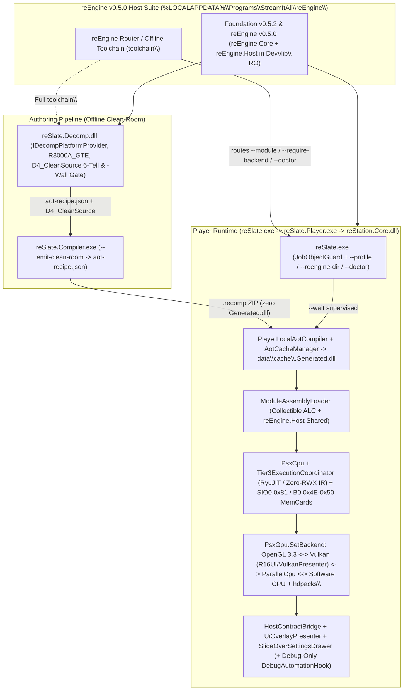
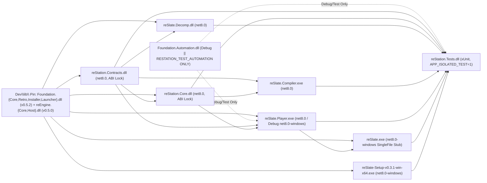

# reSlate — System Architecture & Symbol Map

- **Synced Version:** `0.3.2` (`2026-11-23` · Public Beta · `appId: "reslate"` · `engineId: "reSlate"` · Track `0.3.x`, Alias-Compatible with `0.2.x` / `0.1.x`; repository path `Personal/reStation`)
- **Scope:** Runtime Context, Assembly Dependency Graph, Execution Pipelines, File Inventory & Data Stores
- **License:** Mozilla Public License Version 2.0 (`MPL-2.0`, root [`LICENSE`](../../LICENSE))

---

## 1. System Context & Runtime Model

`reSlate` is a dedicated static recompilation engine — never a generic interpreter-driven compatibility layer — for `SlateOne` (`MIPS32 R3000A + GTE`) titles, decoupled across two clean-room stages: (1) an offline `.decomp` authoring pipeline (`reSlate.Decomp.dll` + `reSlate.Compiler.exe`) that converts user-supplied `PS-X EXE`/disc layouts into shareable `aot-recipe.json` + `module.recomp.json` metadata (`0` copyrighted ROMs or pre-built generated DLLs), and (2) a player-PC runtime (`reSlate.exe` -> `reSlate.Player.exe` + `reStation.Core.dll`) that compiles `<Game>.Generated.dll` locally inside `<dataDir>\cache\` via `AotCacheManager`, loads it in a collectible `ModuleAssemblyLoader`, executes unlifted/bring-up blocks natively via live `Tier3ExecutionCoordinator` (`RyuJitBlockBackend` primary / Zero-RWX `ThreadedIrBackend` secondary, with `PsxInterpreter` quarantined strictly to `--execution-tier interpreterOracle`), and runs a `60.0 Hz`-locked VBlank/SPU frame loop with 4-backend live hot-swapping (`OpenGL 3.3` <-> `Vulkan` <-> `ParallelCpu` <-> `Software CPU`), Enhancement SDK (`ISubTickFrameHook` + path-contained `<dataDir>\hdpacks\`), and Standard 33 QoL (`Fast-Forward` `F6` / unbound `Tab` + `Cutscene Skip` `F7`). To keep existing `0.1.x`/`0.2.x` cartridges ABI-compatible, C# namespaces remain `reStation.*` and `reStation.Contracts.dll` / `reStation.Core.dll` retain their assembly names while `EngineAliasCatalog.AreEquivalent` bridges `reSlate` <-> `reStation`.

---

## 2. Assembly / `.dll` & Module Dependency Graph

### Dependency Rules (Allowed vs. Forbidden)
- **Allowed:** Pinned `Dev\lib\` SDK binaries (`Foundation v0.5.2`, `reEngine v0.5.0` including `reEngine.Host.dll` referenced by `Core`, `Compiler`, and `Player`), unidirectional `Contracts -> Core / Decomp -> Compiler / Player -> Launcher`, isolated `Installer -> Foundation.Installer`, and `#if DEBUG || RESTATION_TEST_AUTOMATION` conditional `Foundation.Automation` + `<UseWindowsForms>` in `Player` (100% stripped from `Release` & `SharedLibs`).
- **Forbidden:** Cross-repo writes to sibling `Foundation\`, `reEngine\`, or read-only research repos; bundled `*.Generated.dll` or `*.g.cs` inside `.recomp`/`.decomp`; `GPLv3` loaders or vendor SDK headers (`.gdt`/`.til`); unapproved non-test source files exceeding the `400` code-only SLOC ceiling; `Foundation.Automation.dll` / `System.Windows.Forms` PE references in `Release` or `SharedLibs`; silent interpreter fallback outside `--execution-tier interpreterOracle`; or `AGENTS.md` staged inside `Builds\`/`Portable.zip`.

---

## 3. End-to-End Data Flow per Major Pipeline

### A. Clean-Room `SlateOne` `.decomp` Flow (`D0`–`D5`)
1. [`PsxDecompPlatformProvider.RunDecompAsync`](../src/reStation.Decomp/PsxDecompPlatformProvider.cs#L48-L132) validates `module.decomp.json` + `.slaspec`, runs `DecompD4StrictnessValidator` (`Corpus\tiers\D4_CleanSource\` with `D4_FunctionalRewrite` read-alias), and enforces [`PsxD4CraftsmanshipValidator`](../src/reStation.Decomp/PsxD4CraftsmanshipValidator.cs) across 6 decompiler-tell families + real `-Wall -Wextra -Wno-unused-parameter` `0`-warning checks whenever C sources or `d4_build_report.json` are present (`PSX_D4_CRAFTSMANSHIP_FAILED`).
2. [`PsxCleanExeAndOverlayLoader.DiscoverProgramLayout`](../src/reStation.Decomp/PsxCleanExeAndOverlayLoader.cs#L111-L154) and [`PsxIsoImageScanner`](../src/reStation.Decomp/PsxIsoImageScanner.cs) parse PS-X EXE + dynamic overlay addresses and provision `ghidra_ext/` + cohesive `PsxCleanExeLoader.py` exports (`PsxExportAndAssetPipeline`, `PsxParityAndByteMatchVerifier` `camelCase` `d4b_lockstep_report.json`); `ExeScanHelpers.LoadFunctionsJson` filters `"program"` functions by executable when present while preserving untagged legacy JSONs.

### B. Player-PC Local AOT Cache & Live Tier 3 Execution (`data\cache\`)
1. [`Program.cs`](../src/reStation.Player/Program.cs) parses CLI directly via `CliOptions.Parse(args)` (`--backend vulkan|parallelCpu|opengl|software`, `--aspect-mode`, `--hd-packs`, `--fast-forward`), migrates `<dataDir>\settings.json` to `<dataDir>\config\settings.json` non-destructively via `SettingsMigrationHelper.MigrateForConfigPathIfNeeded`, runs `--doctor` (`HostBackendProbe.ProbeAll()`), enforces `--require-backend` (`ExitCode = 6` when unavailable/tray-only), and verifies media in $O(1)$ using `AotRecipeExecutableSpec.ContainerOffsetBytes` with sector/4-byte scan fallback (`PlayerMediaResolver` / `DiscOverlaySliceResolver`) plus `<dataDir>\hdpacks\` containment (`ExitCode = 3`).
2. [`PlayerLocalAotCompiler.EnsureCompiledInCacheAsync`](../src/reStation.Core/Aot/PlayerLocalAotCompiler.cs) probes `reSlate.Compiler` -> `reStation.Compiler` (`Publish-SharedLibsSdk` framework-dependent `net8.0` drop with `reEngine.Host.dll`) to compile `<Game>.Generated.dll` into `<dataDir>\cache\` preserving per-EXE `EntryAddresses` (`RecompCompilerPipeline`). [`ModuleAssemblyLoader`](../src/reStation.Player/ModuleAssemblyLoader.cs) shares `"reEngine.Host"`, synchronizes `resolvedTier`, scopes overlay RAM SHA-256 checks strictly to immutable `.text` (`ITextScopedOverlayRecompModule`), emits loop/call `MidEntries`, aligns `Pc = canonPc` (`Call()` / `ResumeMidStack()`), provides bounded `IReStationCpuEx.TryWaitForVBlankCounter` (clamped `< 64`-cycle wait + `TryAdvanceToNextVBlank`), and dispatches AOT first -> native `Tier3ExecutionCoordinator` second (`PsxInterpreter` quarantined to `interpreterOracle`).

### C. Frame Timing, 4-Backend GPU, Enhancement SDK (`hdpacks\`), QoL, SIO0 & 3-Tier Input
1. **4-Backend GPU & Overlay Compositing:** [`VulkanRenderBackend`](../src/reStation.Core/Gpu/VulkanRenderBackend.cs) (`VulkanBindings` + `VulkanDeviceContext` dynamic `vulkan-1.dll`, real `VK_FORMAT_R16_UINT` `1024x512` `VkImage` + canonical `1x` VRAM mirror, `1x..8x` PGXP, Hor+ `16:9` wings, `GP0(E6h)` mask bits, `HdTexturePackStore` override sampling) presents via `reEngine.Host.Rendering.VulkanPresenter` on `SDL_WINDOW_VULKAN` with alpha-composited `UiOverlayPresenter` RGBA and `HostViewportGeometry` aspect/overscan rects; [`ParallelCpuRenderBackend`](../src/reStation.Core/Gpu/ParallelCpuRenderBackend.cs) + [`ParallelBandRasterizer`](../src/reStation.Core/Gpu/ParallelBandRasterizer.cs) execute deterministic `16px` horizontal scanline bands in submission order with VRAM/CLUT barriers (`100%` SHA-256 bit-exact to [`SoftwareCpuRenderBackend`](../src/reStation.Core/Gpu/SoftwareCpuRenderBackend.cs) at `1x`) via `ParallelCpuPresenter`.
2. **Enhancement SDK & Standard QoL:** [`SubTickInterpolationSdk`](../src/reStation.Core/Enhancement/SubTickInterpolationSdk.cs) coordinates `> 60 Hz` / `Max` `ISubTickFrameHook` passes under `SubTickDeadlineCycle` watchdogs; [`HdTexturePackStore`](../src/reStation.Core/Enhancement/HdTexturePackStore.cs) + pure `net8.0` [`MinimalPngDecoder`](../src/reStation.Core/Enhancement/MinimalPngDecoder.cs) resolve `clutSha256Hex` + `rectSha256Hex` overrides via `HdPackResolver` while preserving canonical `1x` VRAM; [`Program.FrameLoop.QoL`](../src/reStation.Player/Program.FrameLoop.QoL.cs) + [`PsxSpu`](../src/reStation.Core/Audio/PsxSpu.cs) deliver audio-safe Fast-Forward (`F6` primary / unbound-`Tab` Std 33 guard, `2x..4x` XA decimation keeping `xaDrops == 0`) and `ISkipCutsceneHook` Cutscene Skip (`F7`).
3. **SIO0 MemCards, 3-Tier Input & Automation:** Hardware `SIO0 0x81` + BIOS `B0:0x4E-0x50` + async `libmcrd` + `ToT[10]` DCB quick-save parity (`MemCardMcrStore`, `QuickSaveTrailer`); full KBM+Controller rebinding across `Global 1:1`, `Game 1:1`, `Modern PC` (`LT`/`RT` triggers, `0` clear); Debug/Test-only `DebugAutomationHook` + `DebugAutomationDiagnostics` (`Release` exits `2` on `--automation-port`).

---

## 4. File & Symbol Lookup Registry (`Dev\src` + `Dev\scripts` Non-Test Files `<= 384` Code SLOC)

All non-test C# and PowerShell source files comply strictly with the `400` code-only SLOC limit (`0` files over `400`, max `384` SLOC). Key `v0.3.1` additions alongside `v0.3.0`–`v0.3.0-hf.3` anchors include:

| File | Lines | CodeSLOC | Primary Exports & Responsibility |
| :--- | ---: | ---: | :--- |
| `Dev/scripts/build_release.ps1` | 219 | 182 | Single-pass `<=400` SLOC gate, `Release` build+test, Authenticode sign, installer, `Releases\`, `SharedLibs\reSlate\`, `Archive\` |
| `Dev/scripts/package_helpers.ps1` | 368 | 339 | `Assert-CodeOnlySlocGate`, `Assert-BinaryPurity`, framework-dependent `Publish-SharedLibsSdk`, `New-EngineManifestJson` (`schemaVersion: 2`), `Portable.zip` |
| `Dev/scripts/run_stage2_sandbox_e2e.ps1` | 268 | 248 | `-t:Rebuild,Publish` test automation build + 4-step visible Stage 2 Sandbox E2E (4-backend swap, `hdpacks\`, `F6`/`F7`, `SharedLibs` compiler smoke, `ExitCode=2`) |
| `Dev/scripts/stage2_e2e_helpers.ps1` | 330 | 299 | `Win32VisibleWindow`, `Show-VisibleWindowOnTop`, preserved Windows OS env vars in `ClearExistingEnv`, loopback UI/tree/PNG assertions |
| `Dev/scripts/sanitize_release_docs.ps1` | 191 | 171 | Relative link rewriter, clean-room trademark scrub outside legal footer, end-user doc sanitization |
| `Dev/src/reStation.Contracts/IReStationModuleManifest.cs` & `ISkipCutsceneHook.cs` | 206 / 18 | 138 / 10 | `ReStationEngineInfo` (`0.3.1`), `EngineAliasCatalog` bidirectional check, opt-in `ISkipCutsceneHook` (`F7`) |
| `Dev/src/reStation.Contracts/IPsxRenderBackend.cs` | 56 | 21 | Live 4-backend `PsxRenderBackendIds` (`opengl`, `vulkan`, `parallelCpu`, `software`) |
| `Dev/src/reStation.Core/Bios/MemCardMcrStore.cs` & `PsxBiosHle.MemCard.cs` | 375 / 179 | 342 / 156 | Slot 1+2 `.mcr`, async `libmcrd` `DeliverCardIoEnd`, `ToT[10]` DCB snapshot parity |
| `Dev/src/reStation.Core/Cpu/PsxCpu.cs` / `.Scheduling.cs` / `.Snapshot.cs` | 388 / 416 / 47 | 354 / 367 / 39 | Live `Tier3ExecutionCoordinator`, `TryWaitForVBlankCounter`, `ITextScopedOverlayRecompModule`, `VBlankSequence` |
| `Dev/src/reStation.Core/Gpu/Vulkan*.cs` | 154..432 | 134..384 | `VulkanBindings`, `VulkanDeviceContext` (`vulkan-1.dll`, `VK_FORMAT_R16_UINT`), `VulkanRenderBackend(.Pipelines)` |
| `Dev/src/reStation.Core/Gpu/ParallelCpuRenderBackend.cs` / `ParallelBandRasterizer.cs` | 285 / 348 | 247 / 314 | Deterministic `16px` horizontal band parallel CPU rasterizer (`100%` SHA-256 bit-exact @ `1x`) + `GP0(E6h)` mask parity |
| `Dev/src/reStation.Core/Enhancement/{MinimalPngDecoder,HdTexturePackStore,SubTickInterpolationSdk}.cs` | 419 / 141 / 99 | 368 / 99 / 68 | Pure `net8.0` PNG decoder, `HdPackResolver` containment store, `ISubTickFrameHook` interpolation SDK |
| `Dev/src/reStation.Core/Audio/PsxSpu.cs` | 433 | 362 | `44.1 kHz` SPU mixer + `SetFastForwardDecimation` / `IsFastForwardDecimationActive` (`xaDrops == 0` under `2x..4x`) |
| `Dev/src/reStation.Player/{PsxDrawerDescriptorProvider,SlideOverSettingsDrawer.Tabs,Program.FrameLoop.QoL}.cs` | 112 / 256 / 282 | 93 / 224 / 238 | Declarative 4-backend/Aspect/Overscan/HD Video tab, QoL System tab, `F6`/`Tab`-guard Fast-Forward & `F7` Cutscene Skip |
| `Dev/src/reStation.Tests/*.cs` (`36` suites) | — | — | `313/313` isolated tests passing in both `-c Release` and `-c Debug` (`APP_ISOLATED_TEST=1`, `0` warnings) |

---

## 5. Settings & Persistence Ownership Map (incl. `@dean` Std 20 §1.4 Exception)

> **Scoped Standard 19 / Standard 20 §1.4 Exception (`ARCHITECTURE.md` Registry Record — Expires at `v0.5.0`):** Approved by Stream (`v0.3.1` Gate 1) to retain single-file `<dataDir>\config\settings.json` (`28 -> 33` camelCase keys) through `v0.4.x` for seamless `0.1.x`–`0.4.x` backward compatibility (`isWidescreen16By9 == true -> aspectRatioMode = "horPlus16By9"`). **Expires at `v0.5.0`** upon `reEngine.Host v0.6.0` adoption, splitting cleanly into domain files (`settings.video.json`, `settings.audio.json`, plus `settings.controls.json` / `settings.packs.json` across `v0.6.0–v0.7.0`) via atomic `.bak` migration.

| Persistence File / Store | Owning Component | Schema Keys |
| :--- | :--- | :--- |
| `<dataDir>\config\settings.json` (`Dev\data\settings.example.json`) | `RecompSettings` + `SettingsMigrationHelper` | Auto-migrated from `<dataDir>\settings.json`; `appId` (`"reslate"`), `executionTierMode`, `backendId` (`opengl\|vulkan\|parallelCpu\|software`), `resolutionScale`, `isWidescreen16By9`, `aspectRatioMode`, `overscanCropPx`, `isHdTexturePackEnabled`, `isFastForwardEnabled`, `fastForwardMultiplier`, `frameRateMode`, `targetFps`, `isVsyncEnabled`, `isPgxpEnabled`, `isFpsOverlayEnabled`, `keyBindings` (`bindings` + `controllerBindings`), `modernActionBindings`, `modernControllerBindings`, `metadataJson` |
| `<dataDir>\hdpacks\hdpack.manifest.json` | `HdTexturePackStore` + `HdPackResolver` | `entries` / `overrides` (`clutSha256Hex`, `rectSha256Hex`, `relativeFilePath`); canonical `1x` VRAM left untouched |
| `<dataDir>\settings.controls.json` | `GlobalControllerProfile` | Global PS1 `1:1` KBM + `controllerBindings` |
| `<dataDir>\cache\<moduleId>\<romSha256_16>-reSlate-0.3.1-<modVer>\<moduleId>.Generated.dll` | `PlayerLocalAotCompiler` + `AotCacheManager` | Local machine-compiled AOT assemblies + manifest index |
| `<dataDir>\saves\*.rst1` & `<dataDir>\memcards\*.mcr` | `QuickSaveManager` + `MemCardMcrStore` | `"RST1"` + `"RSTX"` (`"MCD2"`, `"OVLY"`); dual 128 KB PS1 `.mcr` slots |
| `Dev\logs\` & `<InstallDir>\logs\` | `ReStationLogger` | `runtime.log` (`<=15s` heartbeats), `crashes\crash_*.json`, `screenshots\` |

---

## 6. Failure Modes & Resilience

- **Mid-Stack Quick-Load (`F9`):** Before saving `RST1`, `ReStationHost.SaveQuickSlot` marshals `PsxGpu.SyncBackendToVramMirror()` onto the GL owner thread while `Call()`/`ResumeMidStack()` keep `Pc` aligned before frame patches; on load, when `R[31] != ReturnSentinelPc`, `PsxCpu.DispatchFunction` invokes `PsxCpu.ResumeMidStack` (`MipsLifter` loop back-edge + call-return `MidEntries` return immediately to AOT, falling back to `Tier3ExecutionCoordinator`, or `PsxInterpreter.ResumeFromSnapshot` only under `--execution-tier interpreterOracle`); `HasCompiledEntry` avoids false positives inside `[TextStart, TextEnd)`.
- **OpenGL Context Creation Failure:** `HostVideoSurface.TrySwitchBackend` preserves window handle, logs exact driver failure, reverts to `software` cleanly, and displays an inline Video-tab warning banner.
- **Joypad / Polled Timer Deadlocks:** `PsxJoypadPort` clears `/ACK` automatically after `96` cycles while keeping `_irqPending` (`0x200`) independent; `PsxTimersAndDma` advances timers before reading/writing `RCnt*`.
- **Unbuilt Offline Ghidra Toolchain:** `PsxDecompPlatformProvider` fails closed on D2 `invokeGhidra=true` (`PSX_GHIDRA_BATCH_FAILED`) while allowing D0–D3 recipe synthesis without network calls (`MISSING_OFFLINE_TOOLCHAIN` diagnostic when toolchain missing in `Full`).
- **Clean-Room & Containment Escapes:** `PsxCleanRoomValidator` & `AppEnvironment.AssertPathContained` throw fail-closed exceptions on path traversal, `ghidra_psx_ldr`, vendor SDK headers, retail media, or `*.g.cs`/`*.Generated.dll`.

---

## 7. Security & Privacy Model

- **Zero-PII Default Path:** User-scope `%LOCALAPPDATA%\Programs\StreamItAll\reEngine\engines\reSlate\v0.3.1\` (`v0.2.8` under `reStation\`; `LauncherArgsHelper` + `ReStationInstallerTheme`) eliminates hardcoded drive paths or workstation usernames.
- **No Auto-Start / No Telemetry:** `AllowAutoStart = false`; zero background listeners or network sockets.
- **Human-Gated Legacy Cleanup:** Stranded `v0.1.1` cleanup requires explicit `--migrate-legacy` + `--confirm-legacy-cleanup` (or interactive modal `Yes`) and always preserves `data\rom\`.

---

## 8. Testing Strategy Map

- **Unit & Integration Suite (`reStation.Tests.dll`):** Run via `APP_ISOLATED_TEST=1 dotnet test Dev\src\reStation.slnx -c Release -p:TreatWarningsAsErrors=true` AND `-c Debug -p:TreatWarningsAsErrors=true` (`313/313` passing in both configurations, `0` warnings, `0` failures, `0` skipped) + 2-tier log sweep (`%LOCALAPPDATA%\Programs\...\logs\` read-only + `Dev\logs\`).
- **Debug/Test-Only `Foundation.Automation` Stage 2 Sandbox E2E (`v0.3.1`):** `Dev\scripts\run_stage2_sandbox_e2e.ps1` rebuilds with `"-t:Rebuild,Publish"` for `-p:ReStationTestAutomation=true`, preserves OS known-folder env vars, verifies `Foundation\Dev\tools\run_sandbox_e2e.py` (`hostDiffCount == 0`), drives the visible `Setup Wizard`, drives visible SDL3 MediaGate & live `RunHostLoop` F1 Drawer (`OpenGL 3.3`/`Vulkan`/`ParallelCpu`/`Software`, `HD Texture Packs`, `Aspect Mode`, `Overscan Crop`, `Fast-Forward (F6)`, `Skip Cutscene (F7)`) & `settings.json` persistence, tests `SharedLibs\reSlate\v0.3.1\reSlate.Compiler` (`--help` via both EXE & `dotnet`), and verifies pure `Release` rejects `--automation-port` (`ExitCode = 2`).

---

## 9. Design Decisions Log (ADR)

- **ADR-001 (2026-11-15 · v0.2.0) — Player-PC `<dataDir>\cache\` AOT Primary Over Shipped `.Generated.dll`:** Strip `*.Generated.dll` from shareable `.recomp` bundles and compile locally via `AotCacheManager` + collectible `ModuleAssemblyLoader`, keeping distributed packages cleanly separated from ROM/machine artifacts.
- **ADR-002 (2026-11-15 · v0.2.0) — Bespoke `MPL-2.0` `R3000A_GTE` `.slaspec`:** Replaced `GPLv3` external loaders and vendor SDK headers with original clean-room SLEIGH definitions + `PsxCleanRoomValidator`.
- **ADR-003 (2026-11-15 · v0.2.0) — `IRecompWidescreenProvider` in `reStation.Contracts`:** Kept `Foundation\` strictly read-only while honoring `IsWidescreen16By9 = false` (`4:3`) default aspect until both user setting and game module approve `16:9`.
- **ADR-004 (2026-11-15 · v0.2.0) — Dual-Layer Software UI Compositing & `1060x34` Compact Strip:** Decoupled `SDL_Texture` UI overlay blending from CPU pixel compositing and isolated `F3` HUD rendering from full-screen allocations.
- **ADR-005 (2026-11-15 · v0.2.0) — Multi-Bind `Schema A` & `Schema B` Controller/Isometric Modes:** Unified `[1st, 2nd, 3rd]` KBM/wheel/gamepad bindings (`ModernBindingsJsonConverter`) with `!gameplay` Menu Arrow fallback without breaking `v0.1.x` scalar `GameActionDescriptor` signatures.
- **ADR-006 (2026-11-16 · v0.2.8) — Dynamic `ControlOptions` (`metadataJson`), Hor+ `16:9` Side Wings & Decoupled `60 Hz` VBlank:** Replaced hardcoded pastoral-sim (`MeadowValley BackToEarth`) drawer pills with `IModuleInputProfileProvider.ControlOptions` + `MetadataJsonConverter`, replaced GTE `0.75` squash with unstretched Hor+ `16:9` side wings (`PsxWidescreenGeometry` + `_wideFbo`/`_wideHiBuf` while keeping 24-bit MDEC FMVs at `4:3`), locked outer VBlank cadence to `60.0 Hz`, and implemented BIOS `B0:0x09 CloseEvent` + `ExecOverlay` `IntRP` isolation + bounded SPU stream draining.
- **ADR-007 (2026-11-18 · v0.3.0) — `reSlate` Identity Split & `reEngine.Host v0.3.0` Boundary:** Preserves `reStation.{Contracts,Core}` PE ABI, `reStation.*` namespaces, and repo folder `Personal/reStation` while shipping `reSlate.exe`, `reSlate.Player.exe`, `reSlate.Compiler.exe`, `reSlate.Decomp.dll`, `reSlate-Setup`, `reSlate-v0.3.0-win-x64-Portable.zip`, `engineId: "reSlate"`, `engines\reSlate\`, and `SharedLibs\reSlate\v0.3.0\`; consumes `reEngine.Host.Contracts` (`HostContractBridge` + Debug-only `DebugAutomationHook`) and defers `Vulkan`, `ParallelCpu`, and `ISubTickFrameHook`/`hdpacks\` to `v0.3.1`.
- **ADR-008 (2026-11-18 · v0.3.0) — Live Native AOT/JIT Mandate (`Zero Silent Emulator Fallback`):** Wires `Tier3ExecutionCoordinator` directly into `PsxCpu.Call`/`DispatchFunction` with `PsxMemoryBus.OnRamWriteRange` coherence, fails closed in `staticAotOnly`, quarantines `PsxInterpreter` exclusively to `--execution-tier interpreterOracle`, and emits canonical `isPureStaticReady`.
- **ADR-009 (2026-11-20 · v0.3.1) — Shared `reEngine.Host v0.5.0` 4-Backend GPU, Enhancement SDK, Std 19 Compat Exception & Framework-Dependent `SharedLibs`:** Implements live `Vulkan` (`R16UI` VRAM + `VulkanPresenter`) and deterministic `16px`-band `ParallelCpu` (`100%` SHA-256 bit-exact @ `1x` + `ParallelCpuPresenter`), `MinimalPngDecoder` + `HdTexturePackStore` (`ExitCode = 3` containment, `1x` VRAM untouched), `SubTickInterpolationSdk`, `ISkipCutsceneHook` (`F7`), audio-safe Fast-Forward (`F6` / unbound `Tab`), `IReStationCpuEx.TryWaitForVBlankCounter`, $O(1)$ `ContainerOffsetBytes` & per-EXE `EntryAddresses`, framework-dependent `SharedLibs` Compiler/Player staging (`schemaVersion: 2`), and Stream/`@dean`-approved `Std 20 §1.4` single-file `settings.json` (`28 -> 33` keys) compatibility exception.
- **ADR-010 (2026-11-20 · `/scope` `v0.4.0–v5.0.0` Horizon) — Native GPU Parity, `reEngine.Host` Consolidation & Tiered SLOC Partitioning:** Scopes `reSlate`'s Windows Gold path across `v0.4.0` (Pure-Static `R3` Promoter `BringupRecipeMerger` + `PureStaticOverlayPromoter`, Port 1+2 analog/rumble `PsxJoypadPort.Commands` lifting `!port2`, `CueTocParser`/`CddaStreamer`/`PsxSpu.Mixer` before FF decimation, Unified Multi-Disc Virtual Volume `disc_volume.json` w/ `0` swap prompts + `"DISC"` `"RSTX"`, `--save-dir` routing, and GitHub Polish/`pages.yml`) $\rightarrow$ `v0.5.0` (Native 3D `D3d12RenderBackend*` + native GPU shader `VulkanRenderBackend` parity replacing current CPU-band Vulkan rasterization per `R05 §1`, retiring interim `reSlate.Player` SDL3/surface files [`-1,564` SLOC] onto `reEngine.Host v0.6.0` via `IHostGpuSurfaceCallbacks` + `D3d12Presenter`/`VulkanPresenter` readback + `UseCustomOverlayLayer` + `IHostSessionControl.TryRumble`, live `SDL_GetAudioStreamQueued` `audioFillPct` telemetry fix, and expiring the single-file `settings.json` exception onto domain configs) $\rightarrow$ `v0.6.0` (Standalone Raw-Media Tier 3 JIT Boot `RawMediaSessionBootstrap`, retiring `SlideOverSettingsDrawer` [`-1,453` SLOC] onto `reEngine.Host v0.7–v0.8` 10-Rail UX, full `128 KB` `.mcr`-coherent Quick-Save 1-Step Undo, canonical `isLookYInverted`, and 8-file Dual-Installer) $\rightarrow$ `v0.7.0` (`assets.catalog`/Dumper/`hd_recipe`/`subtitle_recipe`/`.re*` VBlank swap + Release-clean `ResearchInspector` decoupled from `#if DEBUG` automation + `HostRuntimeApiServer`) $\rightarrow$ `v1.0.0` (`2+` Lockstep Gold) $\rightarrow$ `v2.0–v5.0` (`4 KB` XOR/LZ4 `StateRingBuffer` + `(baseSha256, patchSha256)` cache keys + rollback resimulation), keeping every new `.cs`/`.ps1` unit `<= 350` code SLOC.

---

## 10. Zero-Touch Extension Playbooks

1. **Add a `.decomp` Analysis Stage or Asset Extractor:** Add a helper class in `Dev\src\reStation.Decomp\` (<= 400 lines), register it cleanly inside `PsxDecompPlatformProvider` / `PsxAssetExtractors`, and add a corresponding test in `PsxDecompAndSlaTests.cs`.
2. **Add a Game Module Native Hook or True-Widescreen Rule:** Implement `INativeGameActionHook` and/or `IRecompWidescreenProvider` inside the game `.recomp` assembly without editing `reStation.Core` or `Foundation`.
3. **Add a Settings Key:** Add the property on `RecompSettings` (preserving `[JsonExtensionData]` forward/backward compatibility), mirror its default in `Dev\data\settings.example.json`, and expose its control pill inside `SlideOverSettingsDrawer`.
