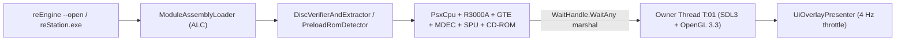

# reStation — System Architecture

**Synced Version:** `0.1.3` (`2026-11-14`)  
**Owner:** `reStation` Engine (`@devv` / `@dean`)

---

## 1. Purpose & Platform Separation
`reStation` isolates **PlayStation 1 (`PS1`) platform engineering** from individual game modules (`<Game>Recomp`). Games publish slim `.recomp` assemblies containing clean-room lifted C# code, disc SHA-256 checksums, save-state fixture specs, and optional per-game frame patches (`IGameFramePatch`), while `reStation` supplies:
- **Shared Foundation Reuse:** Built directly on `Foundation.Core`, `Foundation.Retro` (`MediaContainerExtractor`, `SaveStateFixtureRunner`, `IVisibleTestHarness`), `Foundation.Launcher` (`RootLauncherHost`), and `Foundation.Installer` (`StandardInstallerHost`), plus `reEngine.Core` (`RecompPackageReader`, `ReEngineBootstrapHelper`).
- **`reEngine` Router & Side-by-Side History:** Publishes immutable SDK/runtime drops to `<SHARED_LIBS_ROOT>\reStation\v<Ver>\`, deploys side-by-side under `<reEngineRoot>\engines\reStation\v<Ver>\`, auto-bootstraps `reEngine` during installation, auto-discovers user media in gitignored `data\rom\` preloads, and permits additive non-breaking `PATCH+1` drops from child `<Game>Recomp` runs.

---

## 2. Solution & Tier A Layout (`Dev\src\reStation.slnx`)
All `.cs` and `.ps1` files obey the `<= 400 LOC` ceiling (`<= 350 LOC` target; `<= 320 LOC` per lifted `.g.cs` chunk), Zero-PII `<PathMap>` Release builds (`net8.0` / `net8.0-windows`), and `<TreatWarningsAsErrors>true</TreatWarningsAsErrors>`:

| Project | Target | Responsibility |
| :--- | :--- | :--- |
| [`reStation.Contracts`](Dev/src/reStation.Contracts/reStation.Contracts.csproj) | `net8.0` | Locked ABI (`IReStationCpu`, `IReStationCpuEx` incl. `TryAdvanceToNextVBlank`, `IRecompModule`, `IOverlayRecompModule`, `IReStationHost`, `IReStationHostEx` incl. `IsEnhancedFrameRateEnabled`, `IGameFramePatch`, `ISubTickFrameHook` incl. `TryInterceptSubTickCall`/`OnAfterCall`, `IPsxRenderBackend`, `PsxTelemetrySnapshot`). |
| [`reStation.Core`](Dev/src/reStation.Core/reStation.Core.csproj) | `net8.0` | Zero-SDL3 / zero-WinForms PS1 hardware runtime (`Core`, `Cpu`, `Gte`, `Hardware`, `CdRom`, `Bios`, `Audio`, `Mdec`, `Gpu` + `OpenGl33RenderBackend.Queue`, `DiscIngestion`, `Saves` + `QuickSaveTrailer`, `Input`). |
| [`reStation.Compiler`](Dev/src/reStation.Compiler/reStation.Compiler.csproj) | `net8.0` | PS-X EXE + disc media (`SYSTEM.CNF`) lifter (unlimited module count) emitting chunked C# (`PartNNN.g.cs`), `IRecompGameModule` wrappers, Standard 18 `module.recomp.json`, and `--compile-dll`. |
| [`reStation.Player`](Dev/src/reStation.Player/reStation.Player.csproj) | `net8.0-windows` | SDL3/OpenGL 3.3 Core host (`ReStationHost` `IReStationHostEx`), `AssemblyLoadContext` module loader, `PreloadRomDetector`, first-run gate, `F1` drawer, `F3` HUD, `--preload-media`/`--wait`, `--fixture` & `--visible-test`. |
| [`reStation.Launcher`](Dev/src/reStation.Launcher/reStation.Launcher.csproj) | `net8.0-windows` | Root `reStation.exe` launcher embedding `Foundation.Launcher.dll` + `Foundation.Core.dll`, [`LauncherArgsHelper`](Dev/src/reStation.Launcher/LauncherArgsHelper.cs) (`--wait`, `--preload-media` resolution), and `JobObjectGuard` child supervision. |
| [`reStation.Installer`](Dev/src/reStation.Installer/reStation.Installer.csproj) | `net8.0-windows` | 4-pillar signed zero-PII setup EXE (`reStation-Setup-v$(Version)-win-x64.exe`, `AllowAutoStart = false`), compressed `.dll.gz` dependencies, conditional `payload.zip` + `reEngine` bootstrapper, `--test-mode` isolation. |
| [`reStation.Tests`](Dev/src/reStation.Tests/reStation.Tests.csproj) | `net8.0-windows` | Deterministic xUnit verification suite (`130` executions passing under `/warnaserror`, `0` failed, `0` skipped). |

---

## 3. PS1 Hardware Runtime Subsystems (`reStation.Core`)

### 3.1 CPU, Memory Bus, GTE, Timers/DMA & BIOS HLE (`Cpu/`, `Gte/`, `Hardware/`, `Bios/`)
- **CPU & Bus (`PsxMemoryBus`, `PsxCpu`, `PsxCpu.Scheduling`, `PsxInterpreter`):** Models 2 MB main RAM, 1 KB scratchpad, MMIO dispatch (`TimersAndDma`, `Gpu`, `CdRom`, `Spu`, `Mdec`, `PsxJoypadPort`), COP0 (`SR.IsC` cache isolation, exceptions, IRQ), dynamic `List<IRecompModule>` module slots, `IOverlayRecompModule` RAM SHA-256 (`0x8019F07C`) overlay disambiguation with cached invalidation via `PsxMemoryBus.NotifyRamWriteRange`, `InSubTickRender` write guard on `Write8/16/32` and `WriteIo32` (permitting RAM, scratchpad, GP0/GP1, DMA2/DPCR only), `PsxCpu.Call` sub-tick interception (`TryInterceptSubTickCall`) & `finally` post-call `OnAfterCall`, `TryAdvanceToNextVBlank()`, `SkipPolygonRasterization`, `PsxBiosHle.ExecOverlay` `FramePatch?.Reset()`, R3000A interpreter fallback (`ResumeFromSnapshot`), and `OnVBlankFrame` coroutine parking.
- **GTE & PGXP (`PsxGte`, `PsxGte.Commands`, `PgxpTracker`):** Implements `RTPS`, `RTPT`, `NCLIP`, `MVMVA`, `OP`, `NCS..DPCT`, `AVSZ3/4`, UNR `Divide`, overflow `FLAG`, unclamped `SetIr(i, mac, false)` for `IR1`/`IR2` during `RTPS`/`RTPT` (`lm` applied strictly to `IR3`), and per-frame `Pgxp.ClearFrame()` + subpixel `1/w` + XY PGXP tracking.
- **BIOS HLE & Memory Cards (`PsxBiosHle`, `PsxBiosHle.Events`, `MemCardMcrStore`):** Generalized A0/B0/C0 vectors, syscalls `1–3`, event timers, pad polling, `NotifyRamWriteRange` notifications on bulk RAM mutations, and Zero-PII 128 KB `.mcr` stores keyed by disc `SerialNumber` / `ModuleId`.

### 3.2 Hardware-Timed 2x CD-ROM (`CdRom/`, `KFR-PARITY-01`)
- [`PsxCdRomTiming.ComputeReadLatencyCycles`](Dev/src/reStation.Core/CdRom/PsxCdRomTiming.cs) enforces exact PS1 clock (`33,868,800 Hz`) cadence: **`225,792` cycles/sector** at `2x` (`150 sectors/s`, `(mode & 0x80) != 0`), **`451,584` cycles/sector** at `1x` (`75 sectors/s`), and accelerated **`32,768` cycles/sector** strictly for non-XA Form1 data sectors when `!isXaOrForm2 && !isRawMdec && shouldFastLoadData`.
- `PsxCdRom` + `PsxCdRom.Media` + `Iso9660RawReader` apply a Mode2 raw offset `0x12` subheader guard (`HasStreamingSubmode`), stream `18 * 128B` Form2 XA sectors directly to `PsxSpu.SubmitXaSectors`, route `2340B` raw MDEC sectors, and expose rolling `CdSectorsPerSec` telemetry.

### 3.3 SPU ADSR/XA Audio, MDEC & Disc/Save/Input (`Audio/`, `Mdec/`, `DiscIngestion/`, `Saves/`, `Input/`, `KFR-PARITY-02`)
- **SPU (`SpuVoice`, `XaAdpcmDecoder`, `PsxSpu`):** 24 voices over 512 KB SPU RAM with 4-stage ADSR (`Off`, `Attack`, `Decay`, `Sustain`, `Release`) at `44.1 kHz` where `KeyOff()` decays cleanly to `Envelope == 0` -> `Phase = Off`, `Active = false`. `XaAdpcmDecoder` retains persistent filter memory (`Old1L/Old2L/Old1R/Old2R`) across consecutive sectors with exact `3:7` (`18.9 kHz`) and `6:7` (`37.8 kHz`) resampling. `PsxSpu` owns a `32,768`-frame XA queue and **`Foundation.Core.AudioRingBuffer(65_536, 2)`**, reporting `XaDrops`, `OutputOverflows`, `AudioFillRatio`, `AudioUnderruns`, and `ActiveVoiceCount` with a 32-frame zero-ramp underrun guard.
- **MDEC (`PsxMdec`, `PsxMdec.Decode`):** DMA0/DMA1 FIFO, table uploads, zig-zag RLE, dequantization, 2-pass fixed-point IDCT, and YUV conversion to mono4/mono8/RGB24/RGB15 with `MacroblocksPerSec` telemetry.
- **Disc Ingestion (`DiscManifest`, `Iso9660RawReader`, `DiscVerifierAndExtractor`):** Parses `.iso` (2048B) / `.bin` (2352B) / `.cue`, extracts `.chd`/`.7z`/`.zip` via `Foundation.Retro.MediaContainerExtractor` (`ToolsBaseDirectory` containing `7z.exe`/`7z.dll`), enforces `SandboxEnvironment.AssertPathContained` against Zip-Slip, verifies `RequiredDiscChecksums` SHA-256 + byte lengths, and persists `gamedata\disc_manifest.json` (`sha256Hex`).
- **Saves & Input (`QuickSaveManager`, `QuickSaveTrailer`, `KeyBindingsConfig`, `ModernInputController`):** Atomic `"RST1"` v1 GZip slot `.tmp` + move snapshots with optional EOF-anchored `"RSTX"` trailer chunks (`"BIOS"`, `"OVLY"`) framed in [`QuickSaveTrailer`](Dev/src/reStation.Core/Saves/QuickSaveTrailer.cs) (`OpenBoundedGzipPayload`) + `[SAVE]` logging, plus WASD + mouse-look / classic controller mapping.

### 3.4 Pluggable GPU Renderers (`Gpu/`, `KFR-PARITY-03`)
- [`PsxGpu`](Dev/src/reStation.Core/Gpu/PsxGpu.cs) & [`PsxGpu.Scanout.cs`](Dev/src/reStation.Core/Gpu/PsxGpu.Scanout.cs) maintain the `1024x512` 15-bit VRAM mirror, decode GP0 (`0x02` guarded against `SkipPolygonRasterization`, `0x1F`, `0x20–0x7F`, `0x80`/`0xA0`/`0xC0`, `0xE1–0xE6`) and GP1 display commands, track `FrameDrawOps` / `LastDrawnX` / `LastDrawnY` / `HasLastDrawnOrigin` for sub-tick `PresentFrame(preferLastDrawnOrigin: true)`, invoke `Pgxp.ClearFrame()` per frame, tick `564,480`-cycle VBlanks, and drive any `IPsxRenderBackend` + `IPsxGpuBackendHooks` (`AttachPgxp`, `SetTextureWindow`, `TryReadVramRect`, `RenderUiOverlay`).
- [`OpenGl33RenderBackend`](Dev/src/reStation.Core/Gpu/OpenGl33RenderBackend.cs) (default, `--backend opengl`) binds pure `delegate* unmanaged[Stdcall]` entry points via `OpenGl33Bindings.Initialize(Func<string, IntPtr>)` (zero SDL3 dependency in `Core`), drains queued off-thread ops in [`OpenGl33RenderBackend.Queue.cs`](Dev/src/reStation.Core/Gpu/OpenGl33RenderBackend.Queue.cs), batches `12,288`-vertex VBO draws with GLSL `#version 330 core` PGXP `1/w` and 4/8/15-bit CLUT decode into scaled FBOs, blits centered `4:3` / `16:9` aspect viewports over an opaque black FBO `0` clear, and composites `UiOverlayPresenter` pixels via hardware alpha-blended `_overlayTex` quads (`RenderUiOverlay`, `4 Hz` HUD throttle when drawer closed, `_overlayTex` disposed cleanly in `Dispose()`).
- [`SoftwareCpuRenderBackend`](Dev/src/reStation.Core/Gpu/SoftwareCpuRenderBackend.cs) provides a deterministic `1x–8x` PGXP scanline rasterizer oracle (`--backend software`, headless & fixture baseline).

---

## 4. Compiler, Player Host & Verification Flow (`Compiler`, `Player`, `Launcher`, `Installer`)
1. **Static Lifter (`reStation.Compiler`):** `DiscExeLoader` / `ExeScanHelpers` discover `SYSTEM.CNF` + unlimited PS-X EXE overlays, functions, and jump tables; `MipsDecoder` / `MipsLifter` flatten R3000A + GTE ops against `IReStationCpu`; `FunctionChunkEmitter` splits lifted methods into `<= 320 LOC` `PartNNN.g.cs` + `DispatchNN.g.cs`; `ModuleManifestEmitter` defaults to `0.1.3`, generates `<PascalId>GameModule : IRecompGameModule`, Zero-PII `<PathMap>` `.csproj`, Standard 18 `module.recomp.json`, and optional `--compile-dll`.
2. **Runtime Host (`reStation.Player`):** `ReStationHost` (`IReStationHostEx`) + [`ReStationHost.SubTick.cs`](Dev/src/reStation.Player/ReStationHost.SubTick.cs) connect `PsxCpu` + Standard 15 `ReStationLogger` (`yyyy-MM-ddTHH:mm:ss.fffZ [v0.1.3]`) + `CrashBundleService` + `reStation.Emu` coroutine + `WaitHandle.WaitAny` `T:01` marshaling for `PollSubTickLook()` and `PresentSubTickFrame()` (`Program.FrameLoop.cs` eliminates sub-tick double-wait/double-present); `ModuleAssemblyLoader` loads unpacked `.recomp.dll` or native in-memory ZIP `.recomp` cartridges; `HostVideoSurface` initializes OpenGL 3.3 Core (logging `[WARN] [GL_FALLBACK] reason=headless` in `--headless`) and synchronizes `Backend.Resize`; `PreloadRomDetector` resolves root paths via `RecompPackageReader.ResolveModuleRootDirectory`; `FixtureRunnerHost` fails safely on corrupt `"RST1"` saves; `VisibleTestHarness` records real `Stopwatch` timings.
3. **Launcher, Installer & Packaging (`reStation.Launcher`, `reStation.Installer`, `Dev\scripts\`):** `Launcher` runs clean-root with `--wait` `JobObjectGuard` supervision; `ReStationInstallerBootstrap` normalizes base-dir `--uninstall` paths (`<root>`, `<root>\reEngine`) to the side-by-side leaf and enforces fail-closed `--test-mode` containment; [`build_release.ps1`](Dev/scripts/build_release.ps1) + [`sanitize_release_docs.ps1`](Dev/scripts/sanitize_release_docs.ps1) bundle `app\LICENSE` (`MPL-2.0`), omit engine `data\rom\`, and sanitize all `Installers\`/`Releases\` markdown docs.

---

## 5. Execution Model, `T:01` Thread Affinity & Module Isolation

- **Module Isolation (`AssemblyLoadContext`):** `ModuleAssemblyLoader` loads either unpacked `<Game>.recomp.dll` manifests (`module.recomp.json`) or single-file ZIP `.recomp` archives (`MemoryStream` + `ZipArchive`) inside an isolated collectible/scoped `AssemblyLoadContext`. Shared ABI interfaces (`reStation.Contracts`, `reStation.Core`, `Foundation.Core`, `Foundation.Retro`) resolve from the host engine load context (`<Private>false</Private>` in compiled modules) so interface casts across `IRecompGameModule` and `IReStationHostEx` retain exact runtime type identity.
- **Main-Thread SDL/OpenGL Ownership (`T:01`):** `Program.FrameLoop.cs` and `ReStationHost.SubTick.cs` keep the SDL3 window and OpenGL 3.3 Core context bound exclusively on owner thread `T:01`. Off-thread sub-tick callbacks (`PollSubTickLook()`, `PresentSubTickFrame()`) marshal onto `T:01` via `WaitHandle.WaitAny` while GPU draw primitives queue through `OpenGl33RenderBackend.Queue.cs` and compose HUD telemetry via `_overlayTex` (`GL_RGBA8`, centered `4:3`/`16:9` aspect letterboxing, throttled to `4 Hz` when the `F1` drawer is closed).
- **Audio & Frame Timing Synchronization:** `HighResFramePacer` (`Foundation.Retro`) anchors host presentation cadence while `PsxSpu` mixes 24 ADSR voices and 32,768-frame XA-ADPCM streams into `AudioRingBuffer` (`WavCaptureWriter` / `RgbaPngWriter` capture deterministic fixture frames in `--headless`).

---

## 6. Installer, Sandboxing & Side-by-Side Release Topology

| Layer | Responsibility | Key Files & Boundaries |
| :--- | :--- | :--- |
| **Bootstrap Router** | Resolves `reEngine` side-by-side root (`engines\reStation\v0.1.3\`), normalizes `--uninstall` base dirs, skips informational flags | `ReStationInstallerBootstrap.cs`, `reEngine.Core` (`NoInlining` + `AssemblyResolve`) |
| **Installer Host** | Extracts staged `app\` + root launcher payload, registers uninstall entries, strips `--autostart*` (`AllowAutoStart = false`) | `Program.cs`, `ReStationInstallerTheme.cs`, `Foundation.Installer` |
| **Clean-Room Boundaries** | Enforces fail-closed `SandboxEnvironment.AssertPathContained` on disc extract, preload ROMs, saves, `.mcr`, and `--install-dir` | `DiscVerifierAndExtractor`, `PreloadRomDetector`, `QuickSaveManager`, `FixtureRunnerHost` |
| **Portable Staging** | Publishes non-single-file win-x64 binaries + `app\LICENSE` (`MPL-2.0`) + `LICENSE-7ZIP.txt`; omits module `data\rom\.keep` | `Dev\scripts\build_release.ps1` -> `Builds\v0.1.3\` (max-2 pruned) |
| **End-User Bundles** | Signs installer EXE (`CertThumbprint`), verifies 0 PII (`audit_installer.ps1`), sanitizes UTF-8 release docs, creates `.7z` | `Installers\`, `Releases\{v0.1.3,Latest}\`, `Dev\scripts\sanitize_release_docs.ps1` |
| **Downstream SDK** | Publishes immutable contracts/compiler drop + `engine.manifest.json` + `sdk-manifest.json` + root `LICENSE` & `README.md` | `<SHARED_LIBS_ROOT>\reStation\{v0.1.3,Latest}\` |

- **Zero-Daemon Compliance:** Neither `reStation.exe` nor `reStation-Setup-v0.1.3-win-x64.exe` creates Windows services, scheduled tasks, or Startup registry entries; `--wait` child lifetime supervision uses temporary Windows `JobObjectGuard` handles scoped strictly to the running process tree.
- **Engine vs. Game Module Split:** `reStation` owns reusable hardware/compiler/host assemblies and legal attribution (`app\LICENSE`); copyrighted or user-supplied disc media belongs exclusively inside each downstream `.recomp` game module's gitignored `data\rom\` folder.

---

## 7. Hardware Pipeline, Save Framing & Diagnostics Flow

- **CPU, GTE & Bus Determinism:** `PsxCpu` coordinates MIPS R3000A (`MipsDecoder` / `MipsLifter` compiled `.recomp` slices plus `PsxInterpreter` fallback), `PsxGte` (`IR1`/`IR2` `lm: false` transform fidelity + `PgxpTracker` subpixel geometry), `PsxTimersAndDma` (`OT` / `DMA0–6`), and `PsxBiosHle` (`bu00:` memory-card syscalls into isolated `MemCardMcrStore` `.mcr` files and `ExecOverlay` `FramePatch.Reset()` hooks).
- **CD-ROM, MDEC & SPU Pipeline:** `PsxCdRom` + `Iso9660RawReader` + `PsxCdRomTiming` enforce real `1x`/`2x` (`75`/`150` sectors/s, Form1/Form2 XA subheader) stream pacing, feeding compressed video macroblocks into `PsxMdec` (`15`/`24`-bit RGB) and CD-XA / voice streams into `PsxSpu` (`24` ADSR voices + `XaAdpcmDecoder` `32,768`-frame FIFO).
- **Save-State Framing (`"RST1"` + `"RSTX"`):** `QuickSaveManager` preserves frozen `"RST1"` schema v1 GZip machine snapshots written atomically via `.tmp` swap, while `QuickSaveTrailer` appends optional EOF-anchored `"RSTX"` chunks (`"BIOS"` timers/events + `"OVLY"` module overlay bytes) without breaking v1 loaders.
- **3-Tier Telemetry & Fault Resilience:** `ReStationLogger` wraps `CappedSharedLogSink` (`4 MiB` `runtime.log` + `200`-line ring buffer) stamped `yyyy-MM-ddTHH:mm:ss.fffZ [v0.1.3] [PID:<pid>/T:<tid:D2>]`, emits `<= 15s` `[HEARTBEAT]` rows via `PsxTelemetrySnapshot.ToHeartbeatLine()`, logs single-shot `[WARN] [GL_FALLBACK] reason=headless` when headless, and hands unhandled faults to `CrashBundleService` (`schemaVersion: 1` JSON dumps under `<logDir>\crashes\`).
- **Compiler & Verification Harness:** `RecompCompilerPipeline` splits lifted game code into `<= 320 LOC` `PartNNN.g.cs` / `DispatchNN.g.cs` files with deterministic Zero-PII `<PathMap>` settings; `FixtureRunnerHost` and `VisibleTestHarness` execute headless and live SDL/GL verification sweeps with `Stopwatch` timings and PNG/WAV parity outputs.

---

## 8. Companion Modules & Clean-Room Boundaries
- **Upstream Platform Contract (`Foundation` & `reEngine`):** `reStation` consumes `Foundation` (`v0.3.1` + `Foundation.Retro` `v0.1.1`) and `reEngine.Core` (`v0.1.3`) strictly read-only via `Dev\lib\` SDK drops, keeping shared `Foundation` repositories untouched mid-task.
- **Lifted `.recomp` Game Repositories:** Child modules (`CrownDepthsRecomp`, `MeadowValley-Recomp`) compile against `SharedLibs\reStation\v0.1.3\` (`<Private>false</Private>`), place user disc images solely under their own gitignored `data\rom\` directory, and ship optional per-game timing/camera patches via `IGameFramePatch`.
- **Clean-Room Research Boundary (`Tier R`):** Hardware timings (`1x`/`2x` CD-ROM latency, GTE saturation/rounding, MDEC, ADSR/XA) are verified strictly against `reStation`'s own xUnit parity fixtures (`130` cases) and read-only research documentation without copying any third-party emulator source or copyrighted binary assets.
- **File Size & Code Modularity Invariant:** Every `.cs` source file in `Dev\src\` and `.ps1` release script in `Dev\scripts\` adheres to the `<= 400` code-only LOC ceiling (using clean helper splits such as `ReStationHost.SubTick.cs`, `OpenGl33RenderBackend.Queue.cs`, `PsxGpu.Scanout.cs`, and `sanitize_release_docs.ps1`).
- **Dual-Track Git + Archive Hygiene:** Root Git tracks `.gitignore`, `.gitattributes`, Root Quartet, `AGENTS.md`, `LICENSE`, `*.state`, and `Dev\` (ignoring `Builds\`, `Installers\`, `Releases\`, `Sandbox\`, and `Dev\assets\bootstrap\*.exe`), while `build_release.ps1` emits reproducible `Archive\reStation-v0.1.3-src.7z` snapshots containing `LICENSE`.
- **Installer Bootstrap Isolation:** `Program.cs` unpacks embedded `.dll.gz` dependencies (`Foundation.Core`, `Foundation.Installer`, `reEngine.Core`) via `AssemblyResolve` prior to `[MethodImpl(MethodImplOptions.NoInlining)]` JIT entry, ensuring `--version`, `--help`, `--verify`, and `--uninstall` paths run deterministically with zero eager assembly-load failures.
- **Upgrade & Rollback Preservation:** Side-by-side layout keeps `<reEngineRoot>\engines\reStation\v0.1.0\`, `v0.1.1\`, `v0.1.2\`, and `v0.1.3\` isolated on disk so existing `<Game>Recomp` modules remain pinned to their validated runtime track while newer modules opt into `0.1.3`.
- **Launcher Process Supervision & CLI Parity:** `reStation.Launcher` resolves `app\reStation.Player.exe` with embedded `Foundation.Core`/`Foundation.Launcher` assembly resolution, maintains parent `--wait` lifetimes via `[MethodImpl(MethodImplOptions.NoInlining)]` `JobObjectGuard`, and enforces identical `--help`/`--version` CLI output across `reStation.exe` and `app\reStation.Player.exe`.
