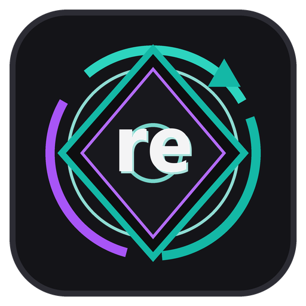

<div align="center">



# reSlate

**Clean-room SlateOne (PS1 / MIPS32 R3000A) static recompilation engine and local AOT compiler — never an emulator.** It turns shareable `.recomp` cartridges and your own legally dumped disc media into locally compiled native `.NET 8.0` assemblies with hardware rendering, enhancement hooks, and persistent Slot 1+2 `.mcr` saves.

[](https://github.com/StreamItAllGit/reSlate/actions/workflows/ci.yml) [](https://streamitallgit.github.io/reSlate/) [](https://github.com/StreamItAllGit/reSlate/releases)  
    

**Active Release (`v0.3.3` Public Beta -> `v0.4.0`):** `reSlate v0.3.3` adds responsive UI-pumped cold archive ingestion (`< 5s` first window with `Esc` cancel), safe orphaned nameless `.mcr` block auto-backup and reclaim, zero-allocation `ParallelBandRasterizer` / stream-hashed ISO-9660 ingest / cached `PsxSpu` scales, pre-1.0 UI version visibility, a stripped release runtime, and public GitHub CI, Pages, and Project Charter documentation on top of `v0.3.2` (`Foundation v0.5.2` + `reEngine.Host v0.5.0`).

</div>

---

## 1-Minute Quickstart

1. **Install or Extract:** Download **`reSlate-Setup-v0.3.3-win-x64.exe`** (or **`reSlate-v0.3.3-win-x64-Portable.zip`**) from [GitHub Releases](https://github.com/StreamItAllGit/reSlate/releases), or launch directly via [reEngine](https://github.com/StreamItAllGit/reEngine).
2. **Add Your Clean-Room Module & Disc Media:** Point `reSlate` at a clean-room `.recomp` cartridge and your own legally dumped optical/archive image (`.chd`, `.bin`+`.cue`, `.iso`, `.7z`, `.zip`).
3. **Compile Locally & Play:** On first launch, `reSlate.Compiler` builds `<Game>.Generated.dll` locally under `<dataDir>\cache\` and boots straight into native hardware rendering.

```powershell
# Launch a clean-room .recomp module with user-supplied disc media
reSlate.exe --module .\modules\sample-module\module.recomp.json --disc "D:\Media\GameDisc.chd" --backend vulkan

# Run non-interactive verification checks and multi-backend diagnostics
reSlate.exe --verify --frames 240 --data-dir .\tmp-data --log-dir .\tmp-logs
reSlate.exe --doctor --data-dir .\tmp-data --log-dir .\tmp-logs
```

> **Note — Formerly `reStation`:** The repository directory (`Personal/reStation`), solution file (`Dev\src\reStation.slnx`), and contract/core assemblies (`reStation.Contracts.dll`, `reStation.Core.dll`, `reStation.*` namespaces) intentionally keep their original `reStation` names so `0.1.x`–`0.3.x` cartridges remain binary-compatible while shipped binaries, manifests, and packages use `reSlate`.

---

## About

> **Beta (Pre-1.0):** `reSlate` (`v0.3.3`) is an active pre-1.0 public beta release targeting `v1.0.0` Windows desktop General Availability (`opengl`, `vulkan`, `directx`, `parallelCpu`) alongside long-horizon `v2.0.0–v5.0.0` cross-platform, creator, remix, and connected milestones.

`reSlate` decouples clean-room `SlateOne` (`MIPS32 R3000A` + `GTE` COP2) reverse engineering from end-user gameplay—operating strictly as a **static AOT recompiler**, native Tier 3 Shared-IR/RyuJIT runtime translator, and clean-room HLE hardware runtime (**never an emulator**). Launched on demand by [reEngine](https://github.com/StreamItAllGit/reEngine) with zero background daemons (`AllowAutoStart = false`), it turns clean `.recomp` recipes and verified user-supplied media (`data\rom\`) into locally compiled native `.NET 8.0` assemblies (`<dataDir>\cache\<Game>.Generated.dll`).

`reSlate v0.3.3` runs on `Foundation v0.5.2` and `reEngine v0.5.0` (`suiteId: "reEngine"`, `schemaVersion: 2` manifests, `%LOCALAPPDATA%\Programs\StreamItAll\reEngine\engines\reSlate\v0.3.3\`, and framework-dependent `SharedLibs\reSlate\v0.3.3\`). Bidirectional `reSlate` / `reStation` alias resolution keeps `0.1.x`–`0.3.x` modules binary-compatible.

## Key Features

- **4 Live Render Backends (`OpenGL 3.3`, `Vulkan`, `ParallelCpu`, `Software CPU`):** Frame-boundary hot-swapping across hardware `Vulkan` (`VK_FORMAT_R16_UINT` `1024x512` `VkImage` + `VulkanPresenter` compositing, `[VK_FALLBACK]` auto-revert), zero-allocation deterministic `16px`-band `ParallelCpu` (`100%` SHA-256 bit-exact to `Software` at `1x` across `1`/`4`/`16` threads), `OpenGL 3.3 Core`, and `Software CPU`, with `GP0(E6h)` mask bits, `1x`–`8x` PGXP, canonical `1x` `GP0(C0h)` VRAM preservation, `--require-backend` (`ExitCode = 6`), and `--doctor` diagnostics.
- **Responsive Cold-Archive Ingest & Pre-1.0 Version Visibility:** Opens the interactive player window before `.7z`/`.zip`/`.chd` extraction begins, pumping live progress inside `FirstRunMediaGateView` with `Esc`/window-close cancellation while preserving `ExitCode = 3` / `4` safety, and surfaces the active `v<Version>` clearly in the `F1` drawer header, `F3` HUD, and an unobtrusive main-UI tag.
- **Enhancement SDK, `<dataDir>\hdpacks\`, Aspect Modes & Overscan Crop:** `SubTickInterpolationSdk` (`ISubTickFrameHook` `> 60 Hz` / `Max` interpolation locking VBlank/SPU at `60.0 Hz`), pure `.NET 8.0` PNG decoding (`MinimalPngDecoder`) + path-contained `<dataDir>\hdpacks\` overrides (`ExitCode = 3` on escape), `HostViewportGeometry` aspect modes (`Native PAR`, `4:3`, `Square Int`, `Native Fit`, `16:9 Hor+`), and `0–16px` `F1` Overscan Crop.
- **Audio-Safe `Fast-Forward` (`F6`) & Opt-In `Cutscene Skip` (`F7`):** `F6` toggles `2x`/`3x`/`4x` speed (with `Tab` auxiliary hold active only when `Tab` is unbound in both Modern PC and active `1:1` profiles) alongside cached-scale SPU ring decimation keeping `xaDrops == 0`; `F7` triggers module-implemented `ISkipCutsceneHook` at safe frame boundaries.
- **Clean-Room `.decomp`, $O(1)$ Local AOT Cache & Safe `.mcr` Repair:** `MPL-2.0` SLEIGH `R3000A + GTE` specification, `-Wall -Wextra -Wno-unused-parameter` (`0` warnings) & 6-tell craftsmanship validation, $O(1)$ stream-hashed ISO/container verification + per-EXE `entryAddresses` hints, live CoreCLR RyuJIT & Zero-RWX `ThreadedIrBackend` (`interpreterOracle` quarantined), Slot 1+2 `.mcr` persistence (`data\memcards\`) with automatic `.bak-<timestamp>` backup and safe reclaim of orphaned nameless blocks, `F5`/`F9` quick-saves, and minimized zero-automation pure `Release` binaries (`ExitCode = 2` on `--automation-port`).

## Compatible Ecosystem

- **[reEngine](https://github.com/StreamItAllGit/reEngine)** — Multi-engine desktop router, unified `reEngine.Host` SDL3/GPU host layer, and local module hub that launches `reSlate` on demand.
- **[reSlate Documentation Site](https://streamitallgit.github.io/reSlate/)** — Published GitHub Pages manuals covering the User Guide, Architecture, Interfaces, Operations, and Project Charter.

## Getting Started

### Prerequisites

- **Windows 10 / 11 (`win-x64`)**
- **.NET 8.0 SDK / Desktop Runtime** *(the signed Setup EXE bundles required runtime libraries; portable ZIP, `SharedLibs` SDK, and source builds require .NET 8.0)*

### Releases & Downloads

Every `0.x` beta release is published on [GitHub Releases](https://github.com/StreamItAllGit/reSlate/releases) (`--prerelease`) in 7-file distributions alongside Discord Dev Updates:

- **`reSlate-Setup-v0.3.3-win-x64.exe`** — Signed per-user setup wizard (`Lightweight` player + local AOT or `Full` offline `.decomp` toolchain integration, resolving existing `reSlate`/`reEngine`/`reStation` installs cleanly to `%LOCALAPPDATA%\Programs\StreamItAll\reEngine\engines\reSlate\v0.3.3\` with `.ready` and `suiteId: "reEngine"`).
- **`reSlate-v0.3.3-win-x64-Portable.zip`** — Standalone portable bundle containing staged binaries, `.ready` marker, license notices, and sanitized docs with zero setup executable inside.

<details>
<summary>Developer verification, CLI overrides, exit codes, and sandbox testing flags</summary>

```powershell
# Run the isolated unit test suite in both Release and Debug with warnings treated as errors
$env:APP_ISOLATED_TEST = "1"
dotnet test Dev\src\reStation.slnx -c Release -p:TreatWarningsAsErrors=true
dotnet test Dev\src\reStation.slnx -c Debug -p:TreatWarningsAsErrors=true

# Install silently via the Setup executable into an isolated test root
reSlate-Setup-v0.3.3-win-x64.exe --profile Lightweight --reengine-dir "%LOCALAPPDATA%\Programs\StreamItAll\reEngine" --silent
```

| CLI Flag | Purpose |
| :--- | :--- |
| `--module <path>` | Load an unpacked `.recomp` folder, `module.recomp.json`, or single-file ZIP `.recomp` cartridge. |
| `--disc <path>` / `--preload-media <path>` | Verify and extract BYO optical/archive media (`.iso`, `.bin`+`.cue`, `.chd`, `.7z`, `.zip`). |
| `--backend <opengl\|vulkan\|parallelCpu\|software>` | Select active render backend (`opengl`, `vulkan`, `parallelCpu`, or `software`). |
| `--require-backend <id>` | Fail closed (`ExitCode = 6`) if the requested backend cannot initialize (or when paired with `--tray-only` for non-`software` backends). |
| `--scale <1\|2\|4\|8>` | Set internal rendering scale (`1x`, `2x`, `4x`, or `8x`). |
| `--aspect-mode <mode>` | Select `nativePar`, `fourByThree`, `squareInteger`, `nativeFit`, or `horPlus16By9`. |
| `--hd-packs [on\|off]` / `--fast-forward [on\|off]` | Enable or disable clean-room `<dataDir>\hdpacks\` texture overrides and `2x–4x` Fast-Forward. |
| `--fps-mode <original\|enhanced>` / `--target-fps` / `--vsync` | Run `Original (60/30)` cadence or `Enhanced FPS` (`60–240+ Hz` / `unlocked`). |
| `--execution-tier <mode>` / `--jit-bringup` / `--force-zero-rwx` | Select `staticAotOnly`, `aotWithJitFallback` (default), `aotWithThreadedIr`, `jitBringup`, or quarantined `interpreterOracle`. |
| `--verify` / `--doctor` / `--tray-only` / `--wait` | Run health checks, multi-backend `--doctor` probes, offscreen tray checks, or synchronous wait mode. |
| `--fixture` / `--dump-screenshot` / `--dump-audio` | Run synthetic fixture diagnostics or write frame PNG / audio WAV captures. |
| `--data-dir` / `--config` / `--log-dir` / `--save-dir` | Redirect writable runtime storage, `config/settings.json`, logs, and save directory (`--save-dir` router hook completes in `v0.4.0`). |
| `--automation-port` / `--automation-token` | `Debug` and test-automation builds only (`Release` builds omit automation and fail closed with `ExitCode = 2`). |

**Exit Codes:** `0` Success · `1` Runtime or `--verify` fault · `2` CLI error / disallowed Release automation flag · `3` Path containment / `hdpacks\` reparse fault · `4` Disc/archive verification error · `5` `--jit-bringup` spin watchdog · `6` Unavailable or `--tray-only`-incompatible `--require-backend` · `130` Cancelled (`SIGINT`).

</details>

## Project Structure

- `Dev/` — `.NET 8.0` solution (`Dev\src\reStation.slnx`), tests, build/sanitization/E2E scripts, IDE workspace (`Dev\reStation.code-workspace`), and technical manuals (`Dev\docs\`)
- `Builds/` — Local compiled staging builds (`v<Version>\`)
- `Releases/` — 7-file versioned distribution bundles (`Setup.exe`, `Portable.zip`, docs, checksums)
- `Archive/` — Compressed source history snapshots

## Documentation

- [Project Charter](Dev/docs/CHARTER.md) — Core identity, clean-room boundaries, and engineering trade-off rules
- [Features](FEATURES.md) — Current capabilities and source mapping
- [Roadmap](ROADMAP.md) — Active `v0.3.3` completion status, `v0.4.0–v1.0.0` Desktop Gold path, and loose `v2.0.0–v5.0.0` milestones
- [Changelog](CHANGELOG.md) — Version history ledger
- [Security Policy](SECURITY.md) — Supported tracks, containment boundaries, and vulnerability reporting
- [Contributing](CONTRIBUTING.md) — Local test setup, PR checklist, and clean-room rules
- [User Guide](Dev/docs/USER_GUIDE.md) — End-user installation, 4-backend video/Enhancement/QoL controls, and troubleshooting (ships as `Releases\README.md`)
- [Architecture](Dev/docs/ARCHITECTURE.md) — Assembly graph, data flows, file index, and design decisions
- [Interfaces](Dev/docs/INTERFACES.md) — Public `.NET` contracts, CLI surface, and manifest schemas
- [Operations](Dev/docs/OPERATIONS.md) — Build, framework-dependent `SharedLibs`, sandbox verification, logs, and release procedures

## Code Signing Policy

Free code signing provided by [SignPath.io](https://signpath.io/), certificate by [SignPath Foundation](https://signpath.org/).

- **Authors:** Repository contributors and maintainers ([`@StreamItAllGit`](https://github.com/StreamItAllGit))
- **Reviewers:** Repository maintainers ([`@StreamItAllGit`](https://github.com/StreamItAllGit))
- **Approvers:** Repository owners ([`@StreamItAllGit`](https://github.com/StreamItAllGit))
- **Privacy Policy:** This program will not transfer any information to other networked systems unless specifically requested by the user or the person installing or operating it.

## License & Legal

Distributed under the **Mozilla Public License 2.0 (`MPL-2.0`)** ([LICENSE](LICENSE)). Embedded container extraction helpers (`7z.exe` / `7z.dll`) are licensed under `LGPL-2.1+` (`LICENSE-7ZIP.txt` in `app\`). See [SECURITY.md](SECURITY.md) for containment guarantees and private vulnerability reporting.

**Clean-Room Policy & Non-Affiliation Disclaimer:** `reSlate` distributes zero copyrighted game assets, PlayStation (`PS1`) BIOS ROMs, or Sony proprietary code. End users provide their own legally dumped disc media for use with clean-room `.recomp` modules. *PlayStation*, *PS1*, *DualShock*, and *PocketStation* are registered trademarks of Sony Interactive Entertainment Inc.; `reSlate` is an independent clean-room project with zero affiliation or endorsement.
