# reStation — Roadmap & Milestones

**Current Active Version:** `0.1.0`  
**Lifecycle State:** `active.state`  
**Last Updated:** 2026-11-13

---

## 1. North Star Goal
Deliver the canonical, clean-room **PS1 Static Recompilation Engine, Shared-IR Runtime JIT Binary Translator & Clean-Room HLE Runtime** (`reStation`) under [`reEngine`](<PROJECTS_ROOT>/Personal/reEngine/README.md) (`engines\reStation\v<Ver>\` + immutable `SharedLibs\reStation\v<Ver>\` history)—not a generic compatibility emulator. `reStation` powers slim `<Game>Recomp` modules with native C# `60–240+ Hz` interpolation, widescreen, mouse-look, PGXP, and HD hooks while guaranteeing:
1. **`v1.0.0` Going Gold (`win-x64`):** Full 4-Tier execution (`Hooks/HLE -> Static AOT -> Shared-IR RyuJIT + --jit-bringup + Zero-RWX Threaded-IR -> [WARN] Interpreter`), automated `R3 -> R4` static promotion (`isR4PromotionReady == true`), and **3 mandatory production render backends (`"opengl"`, `"vulkan"`, `"parallelCpu"`)** verified bit-exact / `PSNR >= 38 dB` against `"software"` oracle.
2. **`v2.0.0` Full-Stack 10-Platform Compatibility North Star:** Full CoreCLR RyuJIT across Desktop, SteamOS Deck, macOS (`MoltenVK`), and Android, plus graceful Reduced-Capacity Mode (pre-linked Static `.recomp` + Zero-RWX Threaded-IR cache + `parallelCpu`/native GPU) across `ios-arm64`, `browser-wasm`, `switch`, `xbox`, and `playstation`.

---

## 2. Shipped Baseline (`0.1.0` — Modular Engine Extraction & PS1 Parity Foundation)
- [x] Tier A 6-folder scaffold, `active.state`, `AGENTS.md`, Root Quartet, Manual Shelf, and original `.svg`/`.png`/`.ico` logo bundle.
- [x] Consume `Foundation` (`v0.3.1` / `Foundation.Retro` `v0.1.1`) SDK binaries (`MediaContainerExtractor`, `HighResFramePacer`, `AudioRingBuffer`, `WavCaptureWriter`, `RgbaPngWriter`, `IVisibleTestHarness`, `Foundation.Installer`).
- [x] Extract reusable R3000A CPU, COP0, GTE, MDEC, 2x CD-ROM (`150 sectors/s`), ADSR SPU/XA mixer, `reStation.Compiler` (`<= 320 LOC` chunks), and `.recomp` module ABI (`IRecompGameModule` / `IReStationCpu`) into `reStation`.
- [x] Implement `IPsxRenderBackend` (`IRecompRenderBackend`) with `OpenGL 3.3 Core` hardware renderer + `SoftwareCpu` oracle fallback (`1x`–`8x` PGXP).
- [x] Ship signed `reEngine` side-by-side installer (`reStation-Setup-v0.1.0-win-x64.exe`, `AllowAutoStart = false`), `SharedLibs\reStation\v0.1.0\`, `87/87` xUnit tests (`0` warnings), and 5/5 `Sandbox\` Acceptance Gates `PASS` ([`0.1.0.20261113-213430.-.sandbox-verify.md`](Dev/docs/reports/0.1.0.20261113-213430.-.sandbox-verify.md)).
- [ ] Downstream Consumer Integration (`0.1.x` follow-on in `CrownDepthsRecomp`): Wire `CrownDepthsRecomp` (`v0.1.3`) against `SharedLibs\reStation\v0.1.0\` and verify `OPEN.EXE`, `GAME.EXE`, `END.EXE`, and multi-scene save-state PNG/WAV parity.

---

## 3. Upcoming Milestones

```mermaid
flowchart LR
    V01["v0.1.0 (Shipped)\nModular PS1 AOT + GL33/SW"] --> V02["v0.2.0\nShared IR + RyuJIT + --jit-bringup"]
    V02 --> V03["v0.3.0\nVulkan + ParallelCpu + Overrides SDK"]
    V03 --> V04["v0.4.0\nR3->R4 Static Promoter & Multi-Title"]
    V04 --> V10["v1.0.0 (GOLD win-x64)\n3 Backends: GL + VK + ParallelCpu"]
    V10 --> V11["v1.1.0\nLinux / macOS MoltenVK / SteamOS"]
    V11 --> V12["v1.2.0\nAndroid RyuJIT & iOS Zero-RWX"]
    V12 --> V13["v1.3.0\nbrowser-wasm Cooperative Pump"]
    V13 --> V14["v1.4.0\nConsole Targets (Switch/Xbox/PS)"]
    V14 --> V20["v2.0.0 (NORTH STAR)\n10-Platform Golden Parity"]
```

### `v0.2.0` — Shared MIPS$\rightarrow$IR Frontend, Collectible RyuJIT (`4 KB`/`64B` Epochs) & `--jit-bringup`
- **Cornerstone Goal:** Slot Tier 3 dynamic translation cleanly into [`PsxCpu.Call`](Dev/src/reStation.Core/Cpu/PsxCpu.cs#L154-L176) without breaking `0.1.x` ABI contracts, proving both CoreCLR RyuJIT (`DynamicMethod`) and Zero-RWX `ThreadedIrBackend` in CI.
- **Planned Deliverables (`7` slices, `<= 270 LOC` each):**
  - [ ] `Core/Ir/RecompIrTypes.cs` & `MipsIrLowerer.cs`: Unmanaged `16-byte` `IrInsn` + `IrBasicBlock` CFG reusing `MipsDecoder` (branch delay & load-delay semantics).
  - [ ] `Core/Jit/RamPageEpochTable.cs`: `512`-page (`4 KB`) epoch table + `64-byte` sub-page cacheline bitmasks; replace raw `Bus.Ram` bulk writes (`LoadExecutableIntoRam`, `ZeroRam`/`FillRam`/`CopyRam`, `ReadSnapshotState`) with `InvalidateRamRange`, hook BIOS `A0:44h` (`FlushCache`), track branch + delay-slot page spans across `KUSEG`/`KSEG0`/`KSEG1` mirrors, and lift `PsxCpu.ModuleSlotCount` (`12`) to dynamic lookup.
  - [ ] `Core/Jit/RyuJitBlockBackend.cs`, `ThreadedIrBackend.cs` (`--force-zero-rwx` / `isDynamicCodeSupported == false`), and `Tier3ExecutionCoordinator.cs` (bounded `16,384`-block collectible LRU cache + `> 8` hot-SMC demotion).
  - [ ] `Core/Bringup/JitBringupRecorder.cs`: `--jit-bringup` raw-disc profiler writing clean-room structural `bringup.profile.json` keyed by `(codeSha256_64, entryPc, byteLen, overlayId)` (zero retail bytes) with a `5,644,800`-cycle non-VBlank watchdog (`ExitCode = 3`).
- **Empirical `Sandbox\` Verification Gate:**
  - Raw verified disc runs `>= 1,500` frames via `--test-mode --headless --jit-bringup`, emitting atomic `bringup.profile.json` (`jitDispatchCount > 0`, `0` crashes).
  - Adversarial torture suite confirms: (a) SMC + DMA3 + BIOS `memcpy` invalidates `KSEG0`/`KSEG1` mirrored `4 KB` pages on the very next dispatch; (b) branch at `0x8004FFFC` + delay slot at `0x80050000` invalidates when page `0x80050` mutates; (c) `1,000` overlay swaps hold JIT memory flat; (d) synthetic MMIO infinite loop exits cleanly (`ExitCode = 3`) with hot-PC telemetry; (e) `--force-zero-rwx` passes via `ThreadedIrBackend`.

### `v0.3.0` — Mandatory `Vulkan` + `ParallelCpu` Renderers & Interpolation / HD Override SDK
- **Cornerstone Goal:** Deliver the remaining two mandatory `v1.0.0` render backends (`"vulkan"` and `"parallelCpu"`) alongside `"opengl"` and `"software"`, plus reusable enhancement SDK hooks.
- **Planned Deliverables (`8` slices, `<= 280 LOC` each):**
  - [ ] `VulkanBindings.cs`, `VulkanDeviceContext.cs`, `VulkanRenderBackend.cs`, `VulkanRenderBackend.Pipelines.cs`: Explicit Vulkan 1.2 + SPIR-V backend with `R16UI` VRAM, PGXP perspective UVs, `GP0(E6h)` mask bits, `GP0(C0h)` readback, and headless ICD / Lavapipe / `--require-backend` handling (fixing `--headless` GPU bypass).
  - [ ] `ParallelCpuRenderBackend.cs` & `ParallelBandRasterizer.cs`: Multithreaded `"parallelCpu"` rasterizer partitioning `hiVram` into disjoint scanline bands/tiles replayed in strict GP0 submission order with full worker barriers on VRAM transfers and overlapping `(TexPage, CLUT)` render-to-texture bounds.
  - [ ] `SubTickInterpolationSdk.cs` (`ISubTickFrameHook`) & `HdTexturePackStore.cs` (`<dataDir>\hdpacks\` content-addressed texture overrides).
- **Empirical `Sandbox\` Verification Gate:**
  - Multi-scene `--fixture` runs across `"software"`, `"parallelCpu"` (`1`, `4`, `16` threads), `"opengl"`, and `"vulkan"` at `1x` and `4x` PGXP: **`1x` `"parallelCpu"` vs. `"software"` MUST be `100%` bit-exact (`SHA-256` match across `50` consecutive runs)** including semi-transparency, `GP0(E6h)`, and `GP0(C0h)` readbacks; `"opengl"` and `"vulkan"` MUST score **`PSNR >= 38.0 dB`**.
  - Headless `--backend vulkan` passes via ICD/Lavapipe, logs `[VK_FALLBACK]` gracefully when no ICD is present, and exits `4` when `--require-backend vulkan` is passed without an ICD.

### `v0.4.0` — Automated `R3 -> R4` Static C# Promoter & `uStation` Delegation Sync
- **Cornerstone Goal:** Graduate `--jit-bringup` traces into `100%` static AOT `.recomp` assemblies (`jitDispatchCount == 0 && interpreterFallbackCount == 0`) and prove multi-title + `uStation` integration.
- **Planned Deliverables (`5` slices, `<= 260 LOC` each):**
  - [ ] `BringupProfileMerger.cs`, `IrToCSharpEmitter.cs`, `OverlayModuleEmitter.cs` (`IOverlayRecompModule` hash-verified dynamic overlay slots), `OverlayDispatchTable.cs`, and `PromotionAuditGate.cs` (`isR4PromotionReady` verification).
  - [ ] Synchronous `--wait` child exit propagation (`reEngine -> reStation.exe -> reStation.Player.exe`) + `--save-dir` passthrough for `uStation` sessions.
- **Empirical `Sandbox\` Verification Gate:**
  - Promote `bringup.profile.json` overlays via `reStation.Compiler` into `<= 320 LOC` static C# chunks; execute `1,500+` frames across `>= 2` PS1 titles (`CrownDepthsRecomp` + second title) asserting **`jitDispatchCount == 0` AND `interpreterFallbackCount == 0` (`isR4PromotionReady == true`)** in `100%` of heartbeats, `150 sectors/s` 2x CD timing, ADSR `KeyOff -> 0`, and `0` audio underruns.

### `v1.0.0` — Going Gold (`win-x64` Tri-Backend PS1 Recomp Engine)
- **Cornerstone Goal:** Golden-Master `win-x64` `reStation` certification (`compatibleEngineTrack: "1.x"` with backward compatibility for `"0.1.x".."0.4.x"` modules) on explicit Stream approval.
- **Mandatory Ship Criteria:**
  - Ships all **3 production render backends (`"opengl"`, `"vulkan"`, `"parallelCpu"`)** + deterministic `"software"` test oracle.
  - Full 4-Tier execution stack (`Hooks/HLE -> Static AOT -> Shared-IR RyuJIT + --jit-bringup + Zero-RWX Threaded-IR -> [WARN] Interpreter`).
- **Empirical `Sandbox\` Verification Gate:**
  - `0` warnings, `100%` unit + multi-scene fixture pass across all 4 backends, `jit=0, interp=0` on promoted `R4` modules (`OPEN.EXE` / `GAME.EXE` / `END.EXE` + overlays), `60`/`144`/`Max` Enhanced FPS preserving `30 Hz` physics ticks, `--visible-test` PNG showcase pass, signed zero-PII installer (`AllowAutoStart = false`), and `0` `[ERROR]`/`[FATAL]` across all 3 log roots.

### `v1.1.0` — Desktop & Handheld Expansion (`linux-x64`, `osx-arm64`, `steamos-deck`)
- **Cornerstone Goal:** Portable POSIX/Apple host parity eliminating Windows-only `comdlg32`, `SDL3.dll` hardcoding, and `IntPtr`-offset `SDL_DropEvent` reads.
- **Planned Deliverables (`<= 270 LOC` slices):**
  - [ ] RID-aware `Sdl3Native` (`libSDL3.so`, `libSDL3.dylib`), `SDL_ShowOpenFileDialog`, 32/64-bit-safe event structs, Linux/SteamOS `Vulkan` + `OpenGL`, macOS `MoltenVK` + `allow-jit` signing, and `1280x800` gamepad `F1` drawer navigation.
- **Empirical `Sandbox\` Verification Gate:**
  - Multi-scene fixture suite (`PSNR >= 38 dB` on GL/Vulkan/MoltenVK, bit-exact `ParallelCpu` vs `SoftwareCpu`) + controller-only `F1` drawer + `<= 15s` heartbeats on Linux, macOS, and Steam Deck.

### `v1.2.0` — Mobile & Zero-RWX Threaded-IR Activation (`linux-bionic-arm64`, `ios-arm64`)
- **Cornerstone Goal:** Validate full ARM64 RyuJIT on Android alongside `RECOMP_ZERO_RWX` NativeAOT Reduced-Capacity Mode on iOS.
- **Planned Deliverables (`<= 270 LOC` slices):**
  - [ ] Android RyuJIT + Vulkan 1.1 / `ParallelCpu` + SAF disc reader + responsive touch controls (`390x844` / `844x390`).
  - [ ] `RECOMP_ZERO_RWX` compile profile excluding `System.Reflection.Emit`, pre-linking `IRecompStaticModuleRegistry` modules, and routing Tier 3 through `ThreadedIrBackend`.
- **Empirical `Sandbox\` Verification Gate:**
  - Verify `0` `System.Reflection.Emit` / `RWX` symbols on `ios-arm64` NativeAOT binary, bit-exact fixture parity via `ThreadedIrBackend` + `ParallelCpu`, and clean dual-orientation mobile touch overlay geometry.

### `v1.3.0` — WebAssembly Runtime (`browser-wasm`)
- **Cornerstone Goal:** Run PS1 `.recomp` modules smoothly inside modern browsers without main-thread deadlocks or OOM crashes.
- **Planned Deliverables (`<= 270 LOC` slices):**
  - [ ] Refactor `ReStationHost` onto a cooperative `StepSingleVBlank()` pump (zero blocking `SemaphoreSlim.Wait()`), stream disc sectors via OPFS/IndexedDB, cap `hiVram` scale (`<= 2x/4x`), and auto-scale `ParallelCpu` workers by `crossOriginIsolated`.
- **Empirical `Sandbox\` Verification Gate:**
  - Headless Chromium CDP test verifies sustained `60 FPS` playback both with COOP/COEP (`SharedArrayBuffer` multi-worker) and without (`1`-worker safe fallback, `0` tab hangs, `< 512 MB` heap).

### `v1.4.0` & `v2.0.0` — Console HALs & 10-Platform Golden Parity (`switch`, `xbox`, `playstation`)
- **Cornerstone Goal (`v2.0.0` North Star):** Ship `reStation` across all 10 `hostRid` platforms (`win-x64`, `linux-x64`, `osx-arm64`, `steamos-deck`, `linux-bionic-arm64`, `ios-arm64`, `browser-wasm`, `switch`, `xbox`, `playstation`), delivering full CoreCLR RyuJIT where permitted and Reduced-Capacity Static `.recomp` + Zero-RWX Threaded-IR + `ParallelCpu`/platform GPU everywhere else.
- **Empirical `Sandbox\` Verification Gate:**
  - `100%` Golden-Master PNG/WAV save-state parity across all 10 platform harnesses + binary-portable `.rst1` / `.mcr` save roundtrips between desktop, mobile, browser, and console targets.

---

## 4. Completed Milestones
- `0.1.0` (`2026-11-13`) — Shipped modular PS1 static recompilation engine, `reStation.Compiler` (`--compile-dll`), `reStation.Player` (`OpenGL 3.3 Core` + `SoftwareCpu`), BYO-media & `data\rom\` preload, `F1`/`F3`/`F5`/`F9` + `.mcr` persistence (`T1`–`T8`, `8/8`), `87/87` xUnit tests (`0` warnings), signed `reEngine` side-by-side installer (`reStation-Setup-v0.1.0-win-x64.exe`, `AllowAutoStart = false`), 6-file `Releases\` bundle, immutable `SharedLibs\reStation\v0.1.0\`, and 5/5 `Sandbox\` Gates `PASS` ([`0.1.0.2026-11-13.md`](Dev/docs/plans/0.1.0.2026-11-13.md) | [`0.1.0.20261113-213430.-.sandbox-verify.md`](Dev/docs/reports/0.1.0.20261113-213430.-.sandbox-verify.md)).

---

## 5. Icebox & Cutting-Room Floor
- Companion sibling per-architecture engines spawned strictly on-demand at `R1+` consuming identical `Foundation.Retro` + `reEngine` contracts (`re64` for N64, `reCube` for GC/Wii, `rePS2` for PS2, `reAdvance` for GBA, and optional `reNes` / `reSnes` / `reBoy` for banked 8/16-bit pre-`R4` tracks).
