# reSlate — Roadmap & Milestones

**Current Active Version:** `0.3.1` *(Public Pre-1.0 Beta — `310/310` Dual Release & Debug Tests Passing, Shared `reEngine.Host v0.5.0` GPU Backends, Enhancement SDK & Standard QoL)*  
**Next Target Milestone:** `0.4.0` *(Pure-Static Overlay Promoter, Analog Gamepad Rumble, Redbook CD-DA, `.m3u` Lid-Swap & `--save-dir` Routing)*  
**Lifecycle State:** [`active.state`](active.state)  
**Last Updated:** `2026-11-20`

---

## 1. North Star Goal
Deliver the canonical, clean-room **SlateOne (`MIPS32 R3000A + GTE`) Static Recompilation Engine, `.decomp` Lifter, Player-PC Local AOT Compiler & Native RyuJIT / Shared-IR Translator** (**`reSlate`**, formerly `reStation`, repository path `Personal/reStation`) under `reEngine` (`%LOCALAPPDATA%\Programs\StreamItAll\reEngine\engines\reSlate\v<Ver>\` + immutable downstream SDK drops) — **strictly a native static recompilation stack, never a generic compatibility interpreter**:
1. **`v0.3.0`–`v0.3.1` Public Beta (`--prerelease`):** Complete the clean-room `reSlate` identity cutover preserving `reStation.{Contracts,Core}` ABI for `0.1.x`/`0.2.x` cartridges; align with `Foundation v0.5.2` + `reEngine v0.5.0` (`reEngine.Host`, `EngineAliasCatalog`, `suiteId: "reEngine"`, `schemaVersion: 2` manifests); wire `Tier3ExecutionCoordinator` native RyuJIT/Zero-RWX IR directly into `PsxCpu` (quarantining `PsxInterpreter` strictly to `--execution-tier interpreterOracle`); ship all 4 live render backends (`OpenGL 3.3`, hardware `Vulkan`, deterministic `16px`-band `ParallelCpu`, `Software CPU`), `ISubTickFrameHook` + path-contained `<dataDir>\hdpacks\`, audio-safe `Fast-Forward` (`F6` / unbound `Tab`), opt-in `Cutscene Skip` (`F7`), $O(1)$ `containerOffsetBytes` / per-EXE `entryAddresses`, and framework-dependent `SharedLibs` Compiler SDKs.
2. **`v0.4.0` Pure-Static Overlay Promoter, Analog Rumble & Multi-Disc:** Graduate `--jit-bringup` profiles into `100%` pure-static overlay C# chunks (`isPureStaticReady == true`) alongside Port 1+2 analog gamepad (`0x42–0x4D`) + rumble, multi-track `.cue`/`.chd` Redbook CD-DA, fail-closed `.m3u` `ShellOpen` disc swap, and `--save-dir` router delegation.
3. **`v1.0.0` Going Gold (`win-x64` — Pure-Static Execution -> Enhanced Release Candidate -> Confirmed Gold):** Certify full 4-tier native static recompilation, **3 mandatory production render backends (`opengl`, `vulkan`, `parallelCpu`)** verified against `software`, full controller/CD-DA/multi-disc support, `100%` static C# promotion of dynamic overlays (`jitDispatchCount == 0 && threadedIrDispatchCount == 0 && interpreterFallbackCount == 0`, `isPureStaticReady == true`), and signed-off human playthrough certification (`isHumanPlaytestSignedOff == true`) across **`CrownDepths ForsakenIsle (SlateOne) 02` (`SLUS-00158`) and at least one overlay-heavy track such as `MeadowValley BackToEarth (SlateOne) 04` (`SLUS-01115`)**.
4. **`v2.0.0` 10-Platform Compatibility North Star (`v1.1.0`–`v2.0.0`):** Scale static AOT + optional Shared-IR RyuJIT + graceful Reduced-Capacity Mode (pre-linked static overlays + Zero-RWX `ThreadedIrBackend` + `ParallelCpu`/native GPU/Metal) across Windows, Linux, macOS (`MoltenVK`/Metal), SteamOS Deck, Android, iOS, WebAssembly, and consoles, paired with committed tick-end clean-room achievements.
5. **Governance & Zero-Asset CI:** Major/minor promotions and Gold sign-off require explicit maintainer approval (`isPublicRepo: true`, `requireHumanReviewBeforePush: false` per [`active.state`](active.state)). Active `v0.3.1` config/manifest keys (`isHdTexturePackEnabled`, `isFastForwardEnabled`, `fastForwardMultiplier`, `aspectRatioMode`, `overscanCropPx`, `clutSha256Hex`, `rectSha256Hex`, `containerOffsetBytes`, `entryAddresses`) remain synchronized with the canonical schema registry, and automated CI uses strictly zero-asset synthetic fixtures (`data\rom\` stays local and gitignored).

---

## 2. Active In-Dev Milestone (`0.4.0` — Pure-Static Overlay Promoter, Analog Rumble, CD-DA, `.m3u` Lid-Swap & `--save-dir`)
*(Any `0.3.x` hotfixes or `v0.3.2` patch maintenance before `v0.4.0` stay strictly targeted and backward-compatible with `reStation.{Contracts,Core}`.)*
- [ ] **Pure-Static Overlay Promoter (`reSlate.Compiler` & `PsxCpu`):** Graduate `--jit-bringup` traces into `100%` static AOT overlays (`jitDispatchCount == 0 && threadedIrDispatchCount == 0 && interpreterFallbackCount == 0`, `isPureStaticReady == true`).
- [ ] **Dual-Motor Analog Gamepad (`0x42–0x4D`) & SDL3 Rumble:** Add Port 1+2 analog stick (`0x73`) + rumble feedback across controller tiers.
- [ ] **Redbook CD-DA, Fail-Closed `.m3u` `ShellOpen` & `--save-dir` Routing:** Stream multi-track `.cue`/`.chd` CD-DA audio, implement fail-closed `.m3u` multi-disc lid swaps pinned to Disc-1 `ModuleId`, add `"RSTX"` trailer extensions, and complete `--save-dir` router delegation.

---

## 3. Upcoming Milestones

```mermaid
flowchart LR
    V02["v0.1.0–v0.2.8 (Shipped)\n.decomp + Local AOT + Hor+ 16:9 + Keybinds"] --> V03["v0.3.0–v0.3.0-hf.3 (Shipped)\nreSlate + Live Tier 3 JIT/IR + Cards/Cadence"]
    V03 --> V031["v0.3.1 (Shipped Beta)\nVulkan + ParallelCpu + Enhancement SDK + QoL"]
    V031 --> V04["v0.4.0 (Next)\nPure-Static Overlay Promoter + Analog Rumble/CD-DA/.m3u"]
    V04 --> V10["v1.0.0 (GOLD win-x64)\nTri-Backend + 2-Title Certified Gold"]
    V10 --> V11["v1.1.0\nLinux / macOS MoltenVK / SteamOS"]
    V11 --> V12["v1.2.0\nAndroid RyuJIT & iOS Zero-RWX"]
    V12 --> V13["v1.3.0\nbrowser-wasm Cooperative Pump"]
    V13 --> V14["v1.4.0\nConsole Static Registries"]
    V14 --> V20["v2.0.0 (NORTH STAR)\n10-Platform Parity + Achievements"]
```

### `v1.0.0` — Windows Desktop Going Gold (`win-x64`)
- **Cornerstone Goal:** Explicit human-approved Gold certification delivering all 3 production render backends (`opengl`, `vulkan`, `parallelCpu`) + `software` parity backend, full 4-tier execution, pure-static overlay completion (`isPureStaticReady == true`), signed human playthrough sign-off (`isHumanPlaytestSignedOff == true`) across `CrownDepths ForsakenIsle (SlateOne) 02` (`SLUS-00158`) and `MeadowValley BackToEarth (SlateOne) 04` (`SLUS-01115`), clean 7-file GA distribution, and `compatibleEngineTrack: "1.x"` alongside `"supportedEngineTracks": ["0.1.x", "0.2.x", "0.3.x", "0.4.x", "1.x"]`.

### `v1.1.0`–`v2.0.0` — Cross-Platform, WASM, Console HALs & First-Party Achievements
- **`v1.1.0`:** `linux-x64`, `osx-arm64` (`MoltenVK`), `steamos-deck` controller-first UI.
- **`v1.2.0`:** Android (`linux-bionic-arm64`) RyuJIT & iOS (`ios-arm64`) pre-linked Zero-RWX NativeAOT.
- **`v1.3.0`:** Cooperative `browser-wasm` `StepSingleVBlank()` pump + OPFS media streaming.
- **`v1.4.0` & `v2.0.0`:** Console HAL adapters + **Committed Tick-End Clean-Room Achievement Evaluator** (`InSubTickRender == false`, zero third-party network calls).

---

## 4. Completed Milestones
- [x] **`0.3.1` (`2026-11-20`):** Shipped `RS-304` hardware `Vulkan` (`VK_FORMAT_R16_UINT` `1024x512` `VkImage` + `VulkanPresenter` + `[VK_FALLBACK]` / `--require-backend` `ExitCode = 6`), `RS-305` deterministic `16px`-band `ParallelCpu` (`100%` SHA-256 bit-exact with `Software` at `1x` across `1`/`4`/`16` threads and `50` consecutive runs), `RS-306` Enhancement SDK (`SubTickInterpolationSdk` + pure `.NET 8.0` `MinimalPngDecoder` + `<dataDir>\hdpacks\` containment `ExitCode = 3`, canonical `1x` VRAM preserved), Aspect Modes (`Native PAR`, `4:3`, `Square Int`, `Native Fit`, `16:9 Hor+` + automatic `isWidescreen16By9 -> horPlus16By9` migration) & `0–16px` Overscan Crop, Standard QoL (`F6` / guarded `Tab` `Fast-Forward` `2x..4x` keeping `xaDrops == 0`, `F7` `ISkipCutsceneHook` `Cutscene Skip`), `IReStationCpuEx.TryWaitForVBlankCounter` tight-loop `VSync(n)` parity, $O(1)$ `containerOffsetBytes` & per-EXE `entryAddresses` / `"program"` `functions.json` filtering, `Foundation v0.5.2` + `reEngine v0.5.0` `-hf.<n>` SemVer & `schemaVersion: 2` / `"suiteId": "reEngine"` parity, framework-dependent `SharedLibs` compiler SDK (`--help` EXE+DLL verified), and **`310/310`** dual Release & Debug `/warnaserror` tests (`0` warnings). ([Notes](CHANGELOG.md#031---2026-11-20))
- [x] **`0.3.0-hf.3` (`2026-11-19`):** Split `CdlGetlocL` (`0x10`) vs `CdlGetlocP` (`0x11`) subchannel layout to fix XA minute-rollover seek loops, added owner-thread OpenGL `_vramFbo` readback (`OpenGl33RenderBackend.Readback.cs` + `PsxGpu.SyncBackendToVramMirror()`) for non-black QuickSave/QuickLoad & live backend hot-swaps, synchronized `Call()`/`ResumeMidStack()` `Pc` before frame-patch interception, scoped overlay SHA-256 verification to immutable `.text` (`ITextScopedOverlayRecompModule`) with `MipsLifter` loop/call `MidEntries` AOT re-entry, and appended `cpuMs`/`ovHash` to `Diag_Telemetry` across `281/281` Release & Debug `/warnaserror` tests (`0` warnings). ([Notes](CHANGELOG.md#030-hf3---2026-11-19))
- [x] **`0.3.0-hf.2` (`2026-11-19`):** Fixed `TryAdvanceToNextVBlank()` `< 64`-cycle `Math.Clamp` `ArgumentException`, unlocked `Original + 30` decimation & inter-VBlank `60–240+ / Max` presentation pacing while locking `60 Hz` VBlank & `735`-sample SPU audio, enabled full controller + `LT`/`RT` trigger rebinding & `0` clearability across all 3 tiers, stripped ghost Modern slots, clarified `"VSync (Caps to Monitor Hz)"`, exported `NativeGameActionContext` masks, fixed `libmcrd` async `DeliverCardIoEnd` & `ToT[10]` DCB snapshot parity, and added `DebugAutomationDiagnostics` across `277/277` tests. ([Notes](CHANGELOG.md#030-hf2---2026-11-19))
- [x] **`0.3.0-hf.1` (`2026-11-18`):** Fixed Setup `reEngine`-root collision in `HasDirectInstallation`, `NormalizeWizardStationInstallDir`, and `DiscoverExistingInstall` so upgrades always resolve to `engines\reSlate\v<Ver>\` rather than overwriting `reEngine.exe` (`268/268` tests). ([Notes](CHANGELOG.md#030-hf1---2026-11-18))
- [x] **`0.3.0` (`2026-11-18`):** Launched `reSlate v0.3.0` Public Beta (`StreamItAllGit/reSlate`) with `reSlate` binary/path cutover preserving `reStation.{Contracts,Core}` ABI, `reEngine.Host.Contracts` alignment, live Tier 3 RyuJIT & Zero-RWX IR (`interpreterOracle` quarantine + `isPureStaticReady`), unified `SIO0 0x81` / BIOS `_new_card` Slot 1+2 `.mcr` persistence, `60 Hz` SPU lock, `D4_CleanSource` 6-tell/`-Wall` craftsmanship gate, `ReStationInstallPathResolver`, Debug/Test-only loopback UI automation (`ExitCode = 2` in `Release`), `266/266` tests, and 7-file `Portable.zip` + signed installer distribution. ([Notes](CHANGELOG.md#030---2026-11-18))
- [x] **`0.2.8` (`2026-11-16`):** Module-declared `ControlOptions` (`metadataJson`), unstretched Hor+ `16:9` side wings (`4:3` MDEC FMVs), decoupled `60 Hz` VBlank loop, BIOS `CloseEvent` reuse, `ExecOverlay` isolation, bounded SPU audio drain, and `184/184` passing tests. *(Shipped as `reStation`.)*
- [x] **`0.2.0`–`0.2.7` (`2026-11-15`):** Clean-room `MPL-2.0` `.decomp` provider (`r3000a_gte.slaspec`), player-PC `<dataDir>\cache\` AOT with `<container>#<slice>` overlays, Tier 3 Shared-IR/RyuJIT/`ThreadedIrBackend`, user-scope suite installer (`AllowAutoStart = false`), 3-tier `Keybinds` drawer, `IntRP` priority chains, and `IRecompQuickSaveProvider` (`161`–`180` tests).
- [x] **`0.1.0`–`0.1.5` (`2026-11-13`–`2026-11-14`):** Modular `R3000A` engine, `OpenGL 3.3` + `Software`, 2x CD-ROM, SPU unity/ADSR/XA mixer, ZIP `.recomp` cartridges, and 3-tier rebindable input. *(See [CHANGELOG.md](CHANGELOG.md) for detailed entries.)*

---

## 5. Icebox
- **Generic Compatibility Interpreter Drift:** Never boot arbitrary unverified ISOs as a generic compatibility interpreter (`--jit-bringup` remains a developer clean-room profiler).
- **Vendor BIOS ROMs:** Zero copyrighted BIOS dumps (`reSlate` stays 100% clean-room HLE).
- **Niche Peripherals Beyond Dual Gamepads:** 8-player multitaps, lightguns, mouse peripherals, and serial link cables stay outside `v1.0.0`.
- **In-Player Library Browser:** Owned exclusively by `reEngine`; `reSlate.Player` remains a lean single-session host.
- **Standalone Native Ports:** Live outside `reSlate` and `reEngine` as completely independent native applications without `R3000A` runtime layers.
