# reStation — Roadmap & Milestones

**Current Active Version:** `0.2.6-hf.1` *(pre-1.0 `0.2.x` track)*  
**Lifecycle State:** [`active.state`](active.state)  
**Last Updated:** `2026-11-15`

---

## 1. North Star Goal
Deliver the canonical, clean-room **PS1 Static Recompilation Engine, `.decomp` Lifter, Player-PC Local AOT Compiler & Optional Shared-IR/RyuJIT Binary Translator** (`reStation`) under `reEngine` (`%LOCALAPPDATA%\Programs\StreamItAll\reEngine\engines\reStation\v<Ver>\` + immutable `SharedLibs\reStation\v<Ver>\` history)—not a generic compatibility emulator. `reStation` powers slim game modules with native C# `60–240+ Hz` interpolation, widescreen, mouse-look, PGXP, and HD hooks while keeping `reEngine` as the multi-title Library Shelf & Engine Manager and `reStation.Player` as the lean single-session host:
1. **`v1.0.0` Going Gold (`win-x64`):** Full 4-Tier execution (`Hooks/HLE -> Local <dataDir>\cache\ Static AOT -> Opt-In Shared-IR RyuJIT + --jit-bringup + Zero-RWX Threaded-IR -> [WARN] Interpreter`), **3 mandatory production render backends (`"opengl"`, `"vulkan"`, `"parallelCpu"`)** verified bit-exact / `PSNR >= 38 dB` against `"software"`, **Core PS1 Title Essentials** (Port 1+2 DualShock `0x42–0x4D` + rumble, unified `SIO0` `0x81`/BIOS `.mcr` Slot 1+2, multi-track `.cue`/`.chd` Redbook CD-DA, `.m3u` `ShellOpen` lid-swap), and automated Tier 3 $\rightarrow$ `100%` static C# recompilation of runtime overlays (`jitDispatchCount == 0 && threadedIrDispatchCount == 0 && interpreterFallbackCount == 0`, setting `isR4PromotionReady == true`) certified on **`CrownDepthsRecomp` (`SLUS-00158`) plus at least one overlay-heavy decompilation track (`MeadowValley: Back to Nature` `SLUS-01115` or `Tekken 3` `SLUS-00402`)**.
2. **`v2.0.0` Full-Stack 10-Platform Compatibility North Star (`v1.1.0–v2.0.0`):** Full CoreCLR RyuJIT across Desktop, SteamOS Deck, macOS (`MoltenVK`), and Android, plus graceful Reduced-Capacity Mode (pre-linked Static `.recomp` + Zero-RWX Threaded-IR cache + `parallelCpu`/native GPU) across `ios-arm64`, `browser-wasm`, `switch`, `xbox`, and `playstation`.
3. **Human Promotion, Schema & Zero-Asset CI Governance:** Every `MINOR` transition (`0.3.0`, `0.4.0`) and the `0.4.x -> 1.0.0` Gold promotion require **explicit approval from Stream**. All new manifest, telemetry, and settings keys undergo schema validation at plan lock before coding (`settings.json`). Automated xUnit CI uses **100% zero-asset synthetic MIPS/overlay fixtures**; real discs run strictly locally from gitignored `data\rom\`.

---

## 2. Active Track (`0.2.6-hf.1` Active Release $\rightarrow$ Next Minor: `v0.3.0`)
- [x] Tier A 5-folder scaffold, `active.state`, `AGENTS.md`, Root Quartet, Manual Shelf, and original `.svg`/`.png`/`.ico` logo bundle (`v0.1.0`).
- [x] Consume `Foundation` (`v0.3.1` -> `v0.4.1-hf.1`) and `reEngine` (`v0.1.0` -> `v0.2.1-hf.1`) SDK binaries (`MediaContainerExtractor`, `HighResFramePacer`, `AudioRingBuffer`, `WavCaptureWriter`, `RgbaPngWriter`, `AppEnvironment`, `InstallerRuntimeContext`, `Foundation.Installer`, `AotCacheManager`, `IDecompPlatformProvider`).
- [x] Reusable R3000A CPU, COP0, GTE, MDEC, 2x CD-ROM (`150 sectors/s`), ADSR SPU/XA mixer, `reStation.Compiler`, `.recomp` ABI, `OpenGL 3.3 Core` (`ArrayPool` FIFO queue) <-> `SoftwareCpu` (`SDL_Texture` composite) live frame-boundary swap, `"RST1"` + `"RSTX"` quick-saves, and native ZIP `.recomp` cartridges (`v0.1.0`–`v0.2.0`).
- [x] **Clean-Room `MPL-2.0` `.decomp`, Player-PC `<dataDir>\cache\` AOT & Opt-In Tier 3 IR/JIT (`v0.2.0`, `v0.2.1`–`v0.2.2` `PATCH+1`):** Shipped `reStation.Decomp` (`platformId: "ps1"`, PS-X EXE + overlay Ghidra loader, R3000A + GTE `.slaspec`, C/asset normalizer, `D4`/`D5` verifiers, `0` `GPLv3`/Sony headers), local `<dataDir>\cache\` AOT + collectible `ModuleAssemblyLoader`, and opt-in `Core\Ir\`, `Core\Jit\`, `Core\Bringup\` (`--jit-bringup`, `--force-zero-rwx`, `ExitCode = 5`). In `v0.2.2`, added `DiscOverlaySliceResolver` (`<container>#<slice>` verified SHA-256 slice discovery and recipe `ExeId` ordering + `SelectUniqueSeedsForExe`), `ModuleManifestEmitter.ResolveGeneratedAssemblySimpleName` (`generatedCacheAssemblyName` PE parity for thin-shell `.recomp` archives), `PlayerMediaResolver.TryFindContainerSliceOffset`, and `ModuleAssemblyLoader.CompanionAssembly` preload + collectible `Unloading` `ClearLoadedCompanion` + `AotRecipeSpec` attachment.
- [x] **User-Scope Suite Installer, Runtime Stability (`RS-07`–`RS-16`) & Multi-Bind Input (`v0.2.0`, `v0.2.1`–`v0.2.2` `PATCH+1`):** Deployed per-user under `%LOCALAPPDATA%\Programs\StreamItAll\reEngine\engines\reStation\v0.2.2\` (`--profile Lightweight|Full`, `--reengine-dir`, opt-in `--migrate-legacy`, `AllowAutoStart = false`), fixed mid-stack `F9` unwind, finite joypad `/ACK` + polled timer sync, compact `1060x34` `F3` HUD strip, `4:3` default + `IRecompWidescreenProvider`, `float` mouse deltas, and `Schema A`/`B` 3-slot KBM + `2001..2032` controller bindings (`161/161` baseline tests in `v0.2.0`, `163/163` in `v0.2.1` with `MipsLifter` `.rodata` + `RecompSettings.Clamp()` fixes, and `166/166` passing unit tests under `/warnaserror` in `v0.2.2` with USB HID Numpad `Num/`..`Num.` / `Ins` / `Home` / `End` / `RAlt` labels and widened `800px` `actW = 304 px` Keybinds Modern Grid with `"Gamepad"` header; `@dean` Gate 2 `PASS`, signed installer/SDK packaging + `audit_installer.ps1` `0` findings).
- [x] **Runtime/Launcher `--jit-bringup` `ExitCode = 5` Preservation (`v0.2.3` `PATCH+1`):** Added `Program.ResolveLoopExitCode` + `LauncherArgsHelper.SyncWaitFlags` (`167/167` passing `/warnaserror` Release tests); cleared `@dean` Gate 2 `PASS` and packaged via `build_release.ps1 -Version 0.2.3` (`audit_installer.ps1` `0` findings) to `%LOCALAPPDATA%\Programs\StreamItAll\reEngine\engines\reStation\v0.2.3\` + `SharedLibs\reStation\v0.2.3\`.
- [x] **Setup Wizard Auto-Sort & `reEngine.Core` Sync (`v0.2.4` `PATCH+1`):** Added `ReStationWizardPathNormalizer` + `InstallerWizardAutoSortTests` (`170/170` passing `/warnaserror` Release tests) so generic parent folder selections sort into `<parent>\reEngine\engines\reStation\v0.2.4\` without altering explicit CLI `--install-dir` paths.
- [x] **O(1)-Stack CPU Tail-Jump Trampoline & Keybinds `F3` HUD Strip Clamp (`v0.2.5` `PATCH+1`):** Added iterative tail-jump trampoline dispatch across `PsxCpu`, `PsxCpu.Scheduling`, and `PsxInterpreter` (`0xC00000FD` stack overflow fix), clamped `UiOverlayPresenter` `Keybinds` HUD strip `maxW = 452` (`<= 466` px), and added `CpuTailJumpTrampolineTests` (`173/173` passing `/warnaserror` Release tests).
- [x] **Boot-Crash & Cold-AOT Hotfix (`v0.2.6` `PATCH+1`):** Fixed post-ingestion `data\gamedata` (`\app` fallback) media lookup in `PlayerMediaResolver`, intermediate 2x CD-ROM sector wakeups inside `PsxCpu.Scheduling.TryAdvanceToNextVBlank()`, `VBCSCompiler` pipe isolation (`--disable-build-servers -p:UseSharedCompilation=false -nodeReuse:false`), live SDL splash UI event pumping during first-run AOT compile (`Program.MediaGate.LoadGameModuleWithUiPump`), `aotWithJitFallback` entry fallback (`ModuleAssemblyLoader.Fallback`), and portable `engine.manifest.json` staging (`176/176` passing `/warnaserror` Release tests via `Hotfix026RegressionTests`).
- [x] **Production-Only Runtime Surface & `APP_ISOLATED_TEST=1` Scrub (`v0.2.6-hf.1` Hotfix):** Removed retired test/script/harness CLI flags, local test staging directories, and standalone visual/fixture/script runner classes; migrated onto `Foundation v0.4.1-hf.1` (`AppEnvironment`, `UiPresentationMode.TrayOrBackground`, `InstallerRuntimeContext`) + `reEngine v0.2.1-hf.1`; retained production flags (`--data-dir`, `--config`, `--log-dir`, `--port`, `--verify`, `--tray-only`, `--dry-run`) and Tier A 5-folder structure; and refactored CLI/installer tests into `InstallerAndCliTests.cs` under `APP_ISOLATED_TEST=1`.

---

## 3. Upcoming Milestones

```mermaid
flowchart LR
    V01["v0.1.0..0.1.5 (Shipped)\nModular PS1 + Pad/SPU + Overlays"] --> V02["v0.2.0..v0.2.6-hf.1 (Active)\n.decomp + Local AOT + Overlays + Keybinds"]
    V02 --> V03["v0.3.0\nVulkan + ParallelCpu + Overrides SDK"]
    V03 --> V04["v0.4.0\nStatic Overlay Promoter + PS1 Essentials"]
    V04 --> V10["v1.0.0 (GOLD win-x64)\nTri-Backend + 2-Title Cert"]
    V10 --> V11["v1.1.0\nLinux / macOS MoltenVK / SteamOS"]
    V11 --> V12["v1.2.0\nAndroid RyuJIT & iOS Zero-RWX"]
    V12 --> V13["v1.3.0\nbrowser-wasm Cooperative Pump"]
    V13 --> V14["v1.4.0\nConsole Targets (Switch/Xbox/PS)"]
    V14 --> V20["v2.0.0 (NORTH STAR)\n10-Platform Golden Parity"]
```

### `v0.3.0` — Mandatory `Vulkan` + `ParallelCpu` Renderers & Interpolation / HD Override SDK
- **Cornerstone Goal:** Deliver the remaining two mandatory `v1.0.0` render backends (`"vulkan"` and `"parallelCpu"`) alongside `"opengl"` and `"software"`, decouple offscreen `--tray-only` GPU testing, and ship reusable enhancement SDK hooks.
- **Planned Deliverables (`10` slices, `<= 270 LOC` each):**
  - [ ] Extract `GpuCommandQueue.cs` from `PsxGpu.cs` & `VideoDrawerTab.cs` from `SlideOverSettingsDrawer.cs` to preserve `< 400 LOC` file health.
  - [ ] `VulkanBindings.cs`, `VulkanDeviceContext.cs`, `VulkanRenderBackend.cs`, `VulkanRenderBackend.Pipelines.cs`: Explicit Vulkan 1.2 + SPIR-V backend with `R16UI` VRAM, PGXP perspective UVs, `GP0(E6h)` mask bits, `GP0(C0h)` `1x` VRAM readback, real offscreen GPU/ICD verification (removing `SDL_VIDEODRIVER=dummy` bypass + updating `--verify` to exercise `--backend`), and `--require-backend <id>` failing closed with **`ExitCode = 6`** when hardware/ICD is unavailable.
  - [ ] `ParallelCpuRenderBackend.cs` & `ParallelBandRasterizer.cs`: Multithreaded `"parallelCpu"` rasterizer partitioning `hiVram` into disjoint scanline/tile regions replayed in strict GP0 submission order with full worker barriers on VRAM transfers and overlapping `(TexPage, CLUT)` render-to-texture bounds.
  - [ ] `SubTickInterpolationSdk.cs` (`ISubTickFrameHook : IGameFramePatch` blocking non-GPU MMIO writes while `InSubTickRender == true`, locking `PsxSpu` stepping to `60 Hz` VBlanks, and reading `GP0(0xC0)` from `1x` native VRAM) & `HdTexturePackStore.cs` (`<dataDir>\hdpacks\` keyed by schema-registered `(texPage, clutSha256Hex, rectSha256Hex)` alongside `isHdTexturePackEnabled`).
- **Verification Gates (`0.3-A`..`0.3-E`):**
  - **`0.3-A` Parallel Determinism:** `1x` `"parallelCpu"` (`1`, `4`, `16` threads) vs `"software"` is **`100%` bit-exact (`SHA-256` match across `50` consecutive runs)** including semi-transparency, `GP0(E6h)`, and `GP0(C0h)` readbacks.
  - **`0.3-B` Real Offscreen GL/Vulkan Parity:** Both `"opengl"` and `"vulkan"` score **`PSNR >= 38.0 dB`** vs `"software"` at `1x` and `4x` PGXP in real offscreen GPU contexts (`0` dummy-driver skip).
  - **`0.3-C` `--require-backend` Guard (`ExitCode = 6`):** Without an ICD, `--backend vulkan --require-backend` exits **`6`**, whereas omitting `--require-backend` logs `[VK_FALLBACK]` gracefully.
  - **`0.3-D` Decoupled `60 Hz`/`144 Hz` Cadence:** `ISubTickFrameHook` preserves exact `30 Hz` simulation state hashes and `44.1 kHz` WAV duration (`xaDrops = 0`, `audioUnderruns = 0`, `0` audio pitch drift).
  - **`0.3-E` Responsive UI:** `VideoDrawerTab` passes zero-overlap layout inspection across desktop and mobile viewports.

### `v0.4.0` — Pure-Static Overlay Promoter, Core PS1 Title Essentials & Router Session Bridge
- **Cornerstone Goal:** Graduate `--jit-bringup` traces into `100%` static AOT `.recomp` assemblies (`jitDispatchCount == 0 && threadedIrDispatchCount == 0 && interpreterFallbackCount == 0`, setting `isR4PromotionReady == true`), ship Core PS1 Title Essentials, and prove two-title static parity + `reEngine` delegation.
- **Planned Deliverables (`<= 270 LOC` slices each):**
  - [ ] **Static Overlay Promoter:** `BringupProfileMerger.cs`, `IrToCSharpEmitter.cs`, `OverlayModuleEmitter.cs` (`IOverlayRecompModule : IRecompModule` verifying `(LoadRamAddress, ContentSha256)` + unbroken `PageEpochTable` epoch for shared-address overlays like `0x800B7E20` / `0x800B8D58`), `OverlayDispatchTable.cs`, `PromotionAuditGate.cs`, and migrating `ModuleManifestEmitter` onto `IReStationHost` (building atop `v0.1.5`'s direct `IOverlayRecompModule` emission).
  - [ ] **Port 1+2 DualShock & Unified `.mcr` Cards:** Split `PsxJoypadPort.cs` into `DualShockPadDevice.cs` (`0x41` + `0x73`/`0x42–0x4D` config/analog + SDL3 rumble), `GamepadPortRouter.cs`, `SioMemCardProtocol.cs` (`0x81` `R/W/ID`), and `PsxBiosHle.PadAndCard.cs` (unifying `SIO0` `0x81` with BIOS `bu00:`/`bu10:` atop the `v0.1.5` `B0:0x12` `InitPAD` / `B0:0x15` `PAD_init` split over one debounced atomic `MemCardMcrStore` Slot 1+2 pinned to `ModuleId`). Extends the shipped `"RSTX"` trailer (`"BIOS"`/`"OVLY"`) with `"JIT2"`, `"JPD2"`, `"CDDA"`, and `"DISC"` chunks while preserving `"RST1"` v1 compatibility.
  - [ ] **Multi-Track Redbook CD-DA Audio:** App-local `CueTrackLayout.cs`, `PsxCdRom.Redbook.cs` (`CdlPlay`/`CdlPause`/`CdlDemute`/`GetlocP`), and `PsxSpu.ExternalAudio.cs` (with a `Foundation.Retro` promotion proposal logged for cross-engine reuse).
  - [ ] **Fail-Closed `.m3u` Multi-Disc Swap, 5-Tab UI & `--save-dir` Bridge:** App-local `M3uPlaylistResolver.cs` (`<= 16` discs, fail-closed containment & SHA verification), `PsxCdRom.LidSwap.cs` (`ShellOpen` $\rightarrow$ `0x02` `Complete`), `ControlsDrawerTab.cs`, `DiscDrawerTab.cs` (completing all 5 tabs of `SlideOverSettingsDrawer`), plus `--save-dir` passthrough alongside shipped `v0.1.1` `--preload-media`/`--wait` (registering `padPort1Type`, `padPort2Type`, `isRumbleEnabled`, `cddaVolume`, `activeDiscIndex`, `discCount`, and `supportedEngineTracks`).
- **Verification Gates (`0.4-A`..`0.4-D`):**
  - **`0.4-A` Two-Title & Shared-Address Overlay Certification:** Zero-asset synthetic CI swaps `OVL_A` $\leftrightarrow$ `OVL_B` at `0x800B7E20` (plus SMC epoch fallback), AND local `data\rom\` runs (`1,500+` frames) pass on **`CrownDepthsRecomp` (`SLUS-00158`) plus at least one overlay-heavy decompilation track (`MeadowValley: BTN` `SLUS-01115` or `Tekken 3` `SLUS-00402`)** asserting **`jitDispatchCount == 0 && threadedIrDispatchCount == 0 && interpreterFallbackCount == 0` (`isR4PromotionReady == true`)**.
  - **`0.4-B` DualShock & Unified `.mcr` Persistence:** Port 1+2 `0x42–0x4D` analog + rumble handshake passes, `SIO0` `0x81` writes read back seamlessly via BIOS `bu00:`/`bu10:` in Slot 1+2 `.mcr`, and `"RST1"` + `"RSTX"` quick-saves roundtrip cleanly.
  - **`0.4-C` CD-DA & `.m3u` Lid-Swap:** Multi-track `.cue`/`.chd` `CdlPlay` outputs verified `44.1 kHz` WAV frames (`xaDrops = 0`, `audioUnderruns = 0`), and `.m3u` Disc 1 $\rightarrow$ Disc 2 `ShellOpen` keeps `.mcr` Slot 1+2 pinned to `ModuleId`.
  - **`0.4-D` `reEngine` Bridge & 5-Tab UI:** `--save-dir` + `--wait` propagates exact exit codes (`0..6, 130`), kills child trees in `<= 3s` (`JobObjectGuard`), leaves `HKCU`/host installs untouched under `APP_ISOLATED_TEST=1`, and passes 5-tab `F1` drawer layout checks.

### `v1.0.0` — Going Gold (`win-x64` Tri-Backend PS1 Recomp Engine)
- **Cornerstone Goal:** Golden-Master `win-x64` `reStation` certification on **explicit Stream approval** after `CrownDepthsRecomp` (`SLUS-00158`) passes Gate #1 + a second proving ground passes Gate #2, publishing `compatibleEngineTrack: "1.x"` alongside canonical `"supportedEngineTracks": ["0.1.x", "0.2.x", "0.3.x", "0.4.x", "1.x"]` in `engine.manifest.json` so all `0.x` `.recomp` modules launch side-by-side without rebuilding.
- **Mandatory Ship Criteria:**
  - Ships all **3 production render backends (`"opengl"`, `"vulkan"`, `"parallelCpu"`)** + deterministic `"software"` test oracle.
  - Full 4-Tier execution stack (`Hooks/HLE -> Local Static AOT -> Shared-IR RyuJIT + --jit-bringup + Zero-RWX Threaded-IR -> [WARN] Interpreter`).
  - Ships Core PS1 Title Essentials (Port 1+2 DualShock + rumble, unified `SIO0`/BIOS `.mcr` Slot 1+2, multi-track CD-DA, `.m3u` `ShellOpen` lid-swap) while keeping `reStation.Player` strictly a lean single-session host.
- **Verification Gates (`1.0-A`..`1.0-C`):**
  - **`1.0-A` Full Tri-Backend & Two-Title Sign-Off:** `0` compiler/linter warnings, `100%` zero-asset xUnit + render verification across `"opengl"`, `"vulkan"`, `"parallelCpu"`, and `"software"`, `jitDispatchCount == 0 && threadedIrDispatchCount == 0 && interpreterFallbackCount == 0` (`isR4PromotionReady == true`) across `CrownDepthsRecomp` + promoted overlay title (`60`/`144`/`Max` FPS preserving `30 Hz` physics & `60 Hz` SPU).
  - **`1.0-B` Clean-Room Packaging & Presentation:** Signed zero-PII `reStation-Setup-v1.0.0-win-x64.exe` (`AllowAutoStart = false`, zero audit findings), 6-file `Releases\` bundle, immutable `SharedLibs\reStation\v1.0.0\` (`+ Latest\`), and `Archive\reStation-v1.0.0-src.7z`.
  - **`1.0-C` Zero-Defect 2-Tier Log Audit:** `0` `[WARN]`/`[ERROR]`/`[FATAL]` across both log roots (`%LOCALAPPDATA%\Programs\...\logs\` and `Dev\logs\`), confirmed by `@inspecter` QA report and `@dean` Gate 2 sign-off.

### `v1.1.0` — Desktop & Handheld Expansion (`linux-x64`, `osx-arm64`, `steamos-deck`)
- **Cornerstone Goal:** Portable POSIX/Apple host parity eliminating Windows-only `comdlg32`, `SDL3.dll` hardcoding, and `IntPtr`-offset `SDL_DropEvent` reads.
- **Planned Deliverables (`<= 270 LOC` slices):**
  - [ ] RID-aware `Sdl3Native` (`libSDL3.so`, `libSDL3.dylib`), `SDL_ShowOpenFileDialog`, 32/64-bit-safe event structs, Linux/SteamOS `Vulkan` + `OpenGL`, macOS `MoltenVK` + `allow-jit` signing, and `1280x800` gamepad `F1` drawer navigation.
- **Verification Gate:**
  - Multi-scene render parity (`PSNR >= 38 dB` on GL/Vulkan/MoltenVK, bit-exact `ParallelCpu` vs `SoftwareCpu`) + controller-only `F1` drawer + `<= 15s` heartbeats on Linux, macOS, and Steam Deck.

### `v1.2.0` — Mobile & Zero-RWX Threaded-IR Activation (`linux-bionic-arm64`, `ios-arm64`)
- **Cornerstone Goal:** Validate full ARM64 RyuJIT on Android alongside `RECOMP_ZERO_RWX` NativeAOT Reduced-Capacity Mode on iOS.
- **Planned Deliverables (`<= 270 LOC` slices):**
  - [ ] Android RyuJIT + Vulkan 1.1 / `ParallelCpu` + SAF disc reader + responsive touch controls across portrait and landscape orientations.
  - [ ] `RECOMP_ZERO_RWX` compile profile excluding `System.Reflection.Emit`, pre-linking `IRecompStaticModuleRegistry` modules, and routing Tier 3 through `ThreadedIrBackend`.
- **Verification Gate:**
  - Verify `0` `System.Reflection.Emit` / `RWX` symbols on `ios-arm64` NativeAOT binary, bit-exact verification parity via `ThreadedIrBackend` + `ParallelCpu`, and clean dual-orientation mobile touch overlay geometry.

### `v1.3.0` — WebAssembly Runtime (`browser-wasm`)
- **Cornerstone Goal:** Run PS1 `.recomp` modules smoothly inside modern browsers without main-thread deadlocks or OOM crashes.
- **Planned Deliverables (`<= 270 LOC` slices):**
  - [ ] Refactor `ReStationHost` onto a cooperative `StepSingleVBlank()` pump (zero blocking `SemaphoreSlim.Wait()`), stream disc sectors via OPFS/IndexedDB, cap `hiVram` scale (`<= 2x/4x`), and auto-scale `ParallelCpu` workers by `crossOriginIsolated`.
- **Verification Gate:**
  - Automated browser test verifies sustained `60 FPS` playback both with COOP/COEP (`SharedArrayBuffer` multi-worker) and without (`1`-worker safe fallback, `0` tab hangs, `< 512 MB` heap).

### `v1.4.0` & `v2.0.0` — Console HALs, 10-Platform Parity & First-Party Achievement Engine (`switch`, `xbox`, `playstation`)
- **Cornerstone Goal (`v2.0.0` North Star):** Ship `reStation` across all 10 `hostRid` platforms (`win-x64`, `linux-x64`, `osx-arm64`, `steamos-deck`, `linux-bionic-arm64`, `ios-arm64`, `browser-wasm`, `switch`, `xbox`, `playstation`), delivering full CoreCLR RyuJIT where permitted and Reduced-Capacity Static `.recomp` + Zero-RWX Threaded-IR + `ParallelCpu`/platform GPU everywhere else, alongside the **Committed-Tick First-Party `.recomp` Achievement Evaluator** (`IRecompAchievementProvider` evaluated strictly at committed `30 Hz`/`60 Hz` tick-end with `InSubTickRender == false`, zero RetroAchievements/`rcheevos` calls).
- **Planned Deliverables (`v2.0.0`, schema-locked before coding):**
  - [ ] Implement deterministic RAM-watch predicate evaluation (`IRecompAchievementProvider`, `manifestType: "recomp-achievements"`, `executableId`, `ramAddress`, `comparisonOperator`, `isDeltaValue`, `requiredHitCount`) isolated from `InSubTickRender` smoothing frames.
- **Verification Gate:**
  - `100%` Golden-Master PNG/WAV save-state parity across all 10 platform harnesses + binary-portable `.rst1`/`.rstx`/`.mcr` save roundtrips between desktop, mobile, browser, and console targets + zero duplicate achievement triggers under `60–240+ Hz` interpolation.

---

## 4. Completed Milestones
- `0.2.0` (`2026-11-15`) — Shipped clean-room `MPL-2.0` PS1 `.decomp` (`reStation.Decomp` `IDecompPlatformProvider`, PS-X EXE + overlay Ghidra loader, R3000A + GTE COP2 `.slaspec`, C/asset normalizer, `D4`/`D5` verifiers, zero `GPLv3` `ghidra_psx_ldr` or Sony `.gdt`/`.til`); local `<dataDir>\cache\` AOT (`PlayerLocalAotCompiler` + `AotCacheManager` + collectible `ModuleAssemblyLoader`, zero `*.Generated.dll` in `.recomp`); opt-in Tier 3 IR/RyuJIT/Threaded-IR fallback (`Core\Ir\`, `Core\Jit\`, `Core\Bringup\` `--jit-bringup`/`--force-zero-rwx`, `ExitCode = 5`); user-scope `%LOCALAPPDATA%\Programs\StreamItAll\reEngine\engines\reStation\v0.2.0\` 4-pillar installer (`--profile Lightweight|Full`, `--reengine-dir`, opt-in `--migrate-legacy`, zero nested `reEngine-Setup`, `AllowAutoStart = false`); `T7` runtime & UI fixes (`RS-07`–`RS-16`: mid-stack `F9` unwind, finite `/ACK` pulse + `0x200` IRQ + DualShock `0x73`, `TickTo` timer sync, live `Software <-> OpenGL 3.3` hot-swap + fallback banner, `1060x34` compact HUD strip + GPU-composited Software drawer, `4:3` default + `IRecompWidescreenProvider`, `float` mouse deltas, `Schema A/B` 3-slot KBM + `2001..2032` controller bindings, scrollable `760px` 5-column `Keybinds` drawer, `F1 -> Controls` selectors, `Dev\logs\` support); `161/161` passing xUnit tests (`0` warnings, `0` skipped); Release Gate `PASS`; `audit_installer.ps1` (`0` findings); `SharedLibs\reStation\v0.2.0\` (`SupportedEngineTracks: ["0.2.x", "0.1.x"]`); and 2-tier log verification ([`0.2.0.2026-11-15.md`](Dev/docs/plans/0.2.0.2026-11-15.md)):
  - [x] `reStation.Decomp` (`platformId: "ps1"`), `reStation.Compiler` local `<dataDir>\cache\` AOT (`isCollectible: true` `ModuleAssemblyLoader`), suite installer (`engines\reStation\v0.2.0`), `IRecompWidescreenProvider` + `RS-07`–`RS-16` playtest/joypad/GL/HUD/controller fixes (`0.2.0.2026-11-15.md`).
  - [x] `Core/Ir/RecompIrTypes.cs` & `MipsIrLowerer.cs`: Unmanaged `16-byte` `IrInsn` + `IrBasicBlock` CFG reusing `MipsDecoder` (branch delay & load-delay semantics).
  - [x] `Core/Jit/RamPageEpochTable.cs`: `512`-page (`4 KB`) epoch table + `64-byte` sub-page cacheline bitmasks; replace raw `Bus.Ram` bulk writes (`DMA2`, `DMA3`, `DMA6`, `LoadExecutableIntoRam`, `ZeroRam`/`FillRam`/`CopyRam`, `ReadSnapshotState`) with `InvalidateRamRange`, hook BIOS `A0:44h` (`FlushCache`), and track branch + delay-slot page spans across `KUSEG`/`KSEG0`/`KSEG1` mirrors.
  - [x] `Core/Jit/RyuJitBlockBackend.cs`, `ThreadedIrBackend.cs` (`--force-zero-rwx` / `isDynamicCodeSupported == false`), and `Tier3ExecutionCoordinator.cs` (bounded `16,384`-block collectible LRU cache + `> 8` hot-SMC demotion).
  - [x] `Core/Bringup/JitBringupRecorder.cs`: `--jit-bringup` raw-disc profiler writing clean-room structural `bringup.profile.json` keyed by `(codeSha256Hex, entryPc, codeSizeBytes, overlayId)` + `indirectJumpTargets` (zero retail bytes) with a `5,644,800`-cycle non-VBlank spin watchdog exiting **`ExitCode = 5`**.
- `0.1.5` (`2026-11-14`) — Added `PsxJoypadPort` digital non-`0x42` DualShock probe NACK, separated 4-arg `B0:0x12` `InitPAD` from `B0:0x15` `PAD_init` (with P2 `0xFFFF` flush, `ExecOverlay` save/restore, and `"BIOS"` RSTX `v1` compat), initialized `PsxSpu` unity reset defaults (`0x3FFF`/`0x7FFF`/`0xC001`) + `SPUCNT` (`bit 15/14/0`) / CD Audio (`0x1B0/0x1B2`) / sweep-protected Main Vol (`0x180/0x182`) XA gating, emitted `IOverlayRecompModule` directly in `reStation.Compiler` via `GeneratedExeSpec`, added `PsxCpu.Break` `exe`/`ra` logging, kept `reEngine` pinned at `v0.1.3`, passed `138/138` xUnit tests (`0` warnings), Release Gate `PASS`, `audit_installer.ps1` (`0` findings), and `SharedLibs\reStation\v0.1.5\` ([`0.1.5.2026-11-14.md`](Dev/docs/plans/0.1.5.2026-11-14.md)).
- `0.1.4` (`2026-11-14`) — Fixed `PsxBiosHle` (`B0:0x15`/`0x16`) halfword byte-swap + Port-2 active-LOW masking (`SwapPadBytes`), shipped 3-tier keyboard/mouse controls (`Global 1:1` `settings.controls.json`, `Game 1:1`, `IModuleInputProfileProvider` `Modern PC`), OpenGL 3.3 live rendering, `134/134` tests (`0` warnings), Release Gate `PASS`, `audit_installer.ps1` (`0` findings), and `SharedLibs\reStation\v0.1.4\` ([`0.1.4.2026-11-14.md`](Dev/docs/plans/0.1.4.2026-11-14.md)).
- `0.1.3` (`2026-11-14`) — Normalized `--uninstall` base directories to `engines\reStation\v0.1.3\` (`ReStationInstallerBootstrap`), bundled `MPL-2.0` `LICENSE`, omitted engine `data\rom\.keep`, added `## License & Legal` to `README.md`/`USER_GUIDE.md`, scrubbed `AGENTS.md`, added UTF-8 fail-fast `sanitize_release_docs.ps1` synced onto `reEngine v0.1.3`, passed `130/130` tests (`0` warnings), Release Gate `PASS`, and `audit_installer.ps1` (`0` findings) ([`archive\0.1.3.2026-11-14.md`](Dev/docs/plans/archive/0.1.3.2026-11-14.md)).
- `0.1.2` (`2026-11-14`) — Fixed `T:01` OpenGL/SDL sub-tick marshaling, `IR1`/`IR2` GTE `lm: false` transform collapse, `Pgxp.ClearFrame()` + `LastDrawnX/Y`, `< 8 ms` `RenderUiOverlay` (`4 Hz` HUD throttle + centered letterbox), native ZIP `.recomp` cartridge loading + parent `data\rom\` via `reEngine v0.1.2`, max-2 unpacked `Releases\`, `129/129` tests (`0` warnings), and `SharedLibs\reStation\v0.1.2\` ([`archive\0.1.2.2026-11-14.md`](Dev/docs/plans/archive/0.1.2.2026-11-14.md)).
- `0.1.1` (`2026-11-14`) — Shipped additive Wave 2 engine seams (`IReStationCpuEx`, `IReStationHostEx`, `ISubTickFrameHook`, `IsSubTickRenderGuard`, `IOverlayRecompModule` `0x8019F07C` SHA-256 disambiguation, unlimited module/EXE loading, Mode2 `0x12` guard, off-thread `OpenGl33RenderBackend.Queue.cs`, EOF `"RSTX"` trailer `"BIOS"`/`"OVLY"` chunks), router CLI bridge (`--preload-media`, `--wait` + `JobObjectGuard`, `--version` parity), clean log/heartbeat/GL-fallback hygiene, `125/125` passing test executions (`87` test methods / `11` files, `0` warnings), signed `reStation-Setup-v0.1.1-win-x64.exe` (`AllowAutoStart = false`), and `SharedLibs\reStation\v0.1.1\` (`"supportedEngineTracks": ["0.1.x"]`) ([`archive\0.1.1.2026-11-13.md`](Dev/docs/plans/archive/0.1.1.2026-11-13.md)).
- `0.1.0` (`2026-11-13`) — Shipped modular PS1 static recompilation engine, `reStation.Compiler` (`--compile-dll`), `reStation.Player` (`OpenGL 3.3 Core` + `SoftwareCpu`), BYO-media & `data\rom\` preload, `F1`/`F3`/`F5`/`F9` + `.mcr` persistence (`T1`–`T8`, `8/8`), `87/87` xUnit tests (`0` warnings), signed `reEngine` side-by-side installer (`reStation-Setup-v0.1.0-win-x64.exe`, `AllowAutoStart = false`), 6-file `Releases\` bundle, and immutable `SharedLibs\reStation\v0.1.0\` ([`archive\0.1.0.2026-11-13.md`](Dev/docs/plans/archive/0.1.0.2026-11-13.md)).

---

## 5. Icebox & Cutting-Room Floor
- **Locked `reStation` Non-Goals (Anti-Feature-Creep Boundary):**
  1. **Generic Compatibility Emulator Creep:** Never boot unverified arbitrary ISOs as an end-user emulator (`--jit-bringup` stays strictly a clean-room developer profiler).
  2. **Retail Sony BIOS ROMs:** Zero copyrighted BIOS dumps (`SCPH1001.BIN`, etc.); `reStation` remains 100% clean-room HLE.
  3. **Niche Peripherals Out of `v1.0.0`:** Multitap (8-player), GunCon / Konami Justifier lightguns, PS1 Mouse, Serial I/O Link Cable, and PocketStation (`v1.0.0` ships Standard Digital + DualShock on Ports 1–2 only).
  4. **In-Player Multi-Title Library Browser:** Owned exclusively by `reEngine`; `reStation.Player` remains a lean single-session host.
  5. **Standalone Full Native Ports:** Once a title graduates past 100% static `.recomp` module promotion (`isR4PromotionReady == true`) into a zero-emulation native C# port, it ships as its own standalone EXE/installer outside `reStation` and `reEngine`.
- **Companion Sister Engines (Spawned Strictly On-Demand):** Per-architecture static recompilation sibling engines consuming identical `Foundation.Retro` + `reEngine` contracts (`re64` for N64, `reCube` for GC/Wii, `rePS2` for PS2, `reAdvance` for GBA, and optional `reNes` / `reSnes` / `reBoy` for banked 8/16-bit tracks).
