# reSlate — Roadmap & Milestones

**Current Active Version:** `0.3.0` *(Public Pre-1.0 Beta — `266/266` Dual Release & Debug Tests Passing, Stage 2 Sandbox Verified & Live on [GitHub](https://github.com/StreamItAllGit/reSlate) / [Google Drive](https://drive.google.com/drive/folders/13tsUPvPsycAB1HFL_eUukCBATe3vEWhG))*  
**Next Target Milestone:** `0.3.1` *(Shared `reEngine.Host` `Vulkan`, `ParallelCpu` & Enhancement SDK)*  
**Lifecycle State:** [`active.state`](active.state)  
**Last Updated:** `2026-11-18`

---

## 1. North Star Goal
Deliver the canonical, clean-room **SlateOne (`MIPS32 R3000A + GTE`) Static Recompilation Engine, `.decomp` Lifter, Player-PC Local AOT Compiler & Native RyuJIT / Shared-IR Translator** (**`reSlate`**, formerly `reStation`, repository path `Personal/reStation`) under `reEngine` (`%LOCALAPPDATA%\Programs\StreamItAll\reEngine\engines\reSlate\v<Ver>\` + immutable downstream SDK drops) — **strictly a native static recompilation stack, never a generic compatibility interpreter**:
1. **`v0.3.0` Public-Ready Beta (`--prerelease`, `requireHumanReviewBeforePush: true`):** Complete the clean-room `reSlate` identity cutover (`reSlate.exe`, `reSlate.Player.exe`, `reSlate.Compiler.exe`, `reSlate.Decomp.dll`, `reSlate-Setup`, `reSlate-v0.3.0-win-x64-Portable.zip`, `appId: "reslate"`, `engineId: "reSlate"`, `.ready` marker, bidirectional `reSlate`/`reStation` alias resolution preserving `reStation.{Contracts,Core}` ABI for `0.1.x`/`0.2.x` cartridges); align with `reEngine v0.3.0` (`reEngine.Host.Contracts` + synthetic `HostInputMapper`); wire `Tier3ExecutionCoordinator` native RyuJIT/Zero-RWX IR directly into `PsxCpu` (quarantining `PsxInterpreter` strictly to `--execution-tier interpreterOracle`); canonicalize `data\config\settings.json` + Slot 1+2 `data\memcards\`; fix memory card `SIO0 0x81` / BIOS `B0:0x4E..0x50` `_new_card` + `VSync(n)`/`TargetFps` `44.1 kHz` `60 Hz` SPU lock + single-edge menu input; implement canonical `isPureStaticReady` (+ `[Obsolete]` `isR4PromotionReady` read-alias) and the clean-source 6-tell / `-Wall -Wextra -Wno-unused-parameter` decompilation verifier; pass Debug/Test-only `Foundation.Automation` Stage 2 4-Drive Sandbox E2E (`0` Release automation bits / `ExitCode = 2`); scrub repository history and trademarks (`requireHumanReviewBeforePush: true`); and launch across 4 release channels.
2. **`v0.3.1` Shared `reEngine.Host` GPU (`Vulkan`), `ParallelCpu` & Enhancement SDK:** Once upstream `reEngine.Host` consolidates console-agnostic multi-backend GPU (`OpenGL`, `DirectX`, `Vulkan`, `CPU`, `CPU Parallel`), multi-device input, native audio, and `hdpacks\` layers, plug in SlateOne `Vulkan` (`R16UI` VRAM, PGXP, `ExitCode = 6`), deterministic `ParallelCpu` (`1x` SHA-256 bit-exact), and the `ISubTickFrameHook` + `<dataDir>\hdpacks\` Enhancement SDK.
3. **`v1.0.0` Going Gold (`win-x64` — Pure-Static Execution -> Enhanced Release Candidate -> Confirmed Gold):** Certify full 4-tier native static recompilation, **3 mandatory production render backends (`opengl`, `vulkan`, `parallelCpu`)** verified against `software`, full controller/CD-DA/multi-disc support, `100%` static C# promotion of dynamic overlays (`jitDispatchCount == 0 && threadedIrDispatchCount == 0 && interpreterFallbackCount == 0`, `isPureStaticReady == true`), and signed-off human playthrough certification (`isHumanPlaytestSignedOff == true`) across **`CrownDepths ForsakenIsle (SlateOne) 02` (`SLUS-00158`) and at least one overlay-heavy track such as `MeadowValley BackToEarth (SlateOne) 04` (`SLUS-01115`)**.
4. **`v2.0.0` 10-Platform Compatibility North Star (`v1.1.0`–`v2.0.0`):** Scale static AOT + optional Shared-IR RyuJIT + graceful Reduced-Capacity Mode (pre-linked static overlays + Zero-RWX `ThreadedIrBackend` + `ParallelCpu`/native GPU/Metal) across Windows, Linux, macOS (`MoltenVK`/Metal), SteamOS Deck, Android, iOS, WebAssembly, and consoles, paired with committed tick-end clean-room achievements.
5. **Governance & Zero-Asset CI:** Major/minor promotions, public pushes (`requireHumanReviewBeforePush: true`), and Gold sign-off require explicit maintainer approval. Upcoming `v0.3.1` config/manifest keys (`isHdTexturePackEnabled`, `clutSha256Hex`, `rectSha256Hex`) stay registered in the canonical schema dictionary before coding, and automated CI uses strictly zero-asset synthetic fixtures (`data\rom\` stays local and gitignored).

---

## 2. Active Milestone (`0.3.1` — Shared `reEngine.Host` GPU (`Vulkan`), `ParallelCpu` & Enhancement SDK)
- [ ] **Hardware `Vulkan` (`ExitCode = 6`) & Deterministic `ParallelCpu` Render Backends over `reEngine.Host`:** `VulkanBindings.cs`, `VulkanDeviceContext.cs`, `VulkanRenderBackend.cs`, `VulkanRenderBackend.Pipelines.cs` (`R16UI` VRAM, Hor+ `16:9` wings, PGXP, `GP0(E6h)`/`GP0(C0h)`, `--require-backend` `ExitCode = 6`) and `ParallelCpuRenderBackend.cs` + `ParallelBandRasterizer.cs` (`16px` bands `100%` SHA-256 bit-exact to `"software"` @ `1x`).
- [ ] **Enhancement SDK (`ISubTickFrameHook` + `<dataDir>\hdpacks\`):** `SubTickInterpolationSdk.cs` (`> 60 Hz` / `Max` enhancement interpolation with hardware VBlank + SPU locked at `60 Hz`), registered configuration keys (`isHdTexturePackEnabled`, `clutSha256Hex`, `rectSha256Hex`), `HdTexturePackStore.cs`, and declarative `Video` drawer options.

---

## 3. Upcoming Milestones

```mermaid
flowchart LR
    V02["v0.1.0–v0.2.8 (Shipped)\n.decomp + Local AOT + Hor+ 16:9 + Keybinds"] --> V03["v0.3.0 (Public Beta)\nreSlate + reEngine.Host + Live Tier 3 JIT/IR + Cards/Cadence"]
    V03 --> V031["v0.3.1 (Next — Shared Host Render & SDK)\nreEngine.Host Vulkan + ParallelCpu + Enhancement SDK"]
    V031 --> V04["v0.4.0\nPure-Static Overlay Promoter + Analog Rumble/CD-DA/.m3u"]
    V04 --> V10["v1.0.0 (GOLD win-x64)\nTri-Backend + 2-Title Certified Gold"]
    V10 --> V11["v1.1.0\nLinux / macOS MoltenVK / SteamOS"]
    V11 --> V12["v1.2.0\nAndroid RyuJIT & iOS Zero-RWX"]
    V12 --> V13["v1.3.0\nbrowser-wasm Cooperative Pump"]
    V13 --> V14["v1.4.0\nConsole Static Registries"]
    V14 --> V20["v2.0.0 (NORTH STAR)\n10-Platform Parity + Achievements"]
```

### `v0.4.0` — Pure-Static Overlay Promoter, Analog Rumble, CD-DA, `.m3u` Lid-Swap & `--save-dir`
- **Cornerstone Goal:** Graduate `--jit-bringup` traces into `100%` static AOT overlays (`jitDispatchCount == 0 && threadedIrDispatchCount == 0 && interpreterFallbackCount == 0`, `isPureStaticReady == true`), deliver Port 1+2 analog gamepad (`0x42–0x4D`) + SDL3 rumble, multi-track `.cue`/`.chd` Redbook CD-DA, fail-closed `.m3u` `ShellOpen` disc swap pinned to Disc-1 `ModuleId`, `"RSTX"` trailer extensions, and `--save-dir` router delegation across `CrownDepths ForsakenIsle (SlateOne) 02` (`SLUS-00158`) and `MeadowValley BackToEarth (SlateOne) 04` (`SLUS-01115`).

### `v1.0.0` — Windows Desktop Going Gold (`win-x64`)
- **Cornerstone Goal:** Explicit human-approved Gold certification delivering all 3 production render backends (`opengl`, `vulkan`, `parallelCpu`) + `software` parity backend, full 4-tier execution, pure-static overlay completion (`isPureStaticReady == true`), signed human playthrough sign-off (`isHumanPlaytestSignedOff == true`) across two verified tracks, clean 7-file 4-channel GA distribution, and `compatibleEngineTrack: "1.x"` alongside `"supportedEngineTracks": ["0.1.x", "0.2.x", "0.3.x", "0.4.x", "1.x"]`.

### `v1.1.0`–`v2.0.0` — Cross-Platform, WASM, Console HALs & First-Party Achievements
- **`v1.1.0`:** `linux-x64`, `osx-arm64` (`MoltenVK`), `steamos-deck` controller-first UI.
- **`v1.2.0`:** Android (`linux-bionic-arm64`) RyuJIT & iOS (`ios-arm64`) pre-linked Zero-RWX NativeAOT.
- **`v1.3.0`:** Cooperative `browser-wasm` `StepSingleVBlank()` pump + OPFS media streaming.
- **`v1.4.0` & `v2.0.0`:** Console HAL adapters + **Committed Tick-End Clean-Room Achievement Evaluator** (`InSubTickRender == false`, zero third-party network calls).

---

## 4. Completed Milestones
- [x] **`0.3.0` (`2026-11-18`):** Launched `reSlate v0.3.0` Public Beta (`StreamItAllGit/reSlate`) with `reSlate` binary/path cutover preserving `reStation.{Contracts,Core}` ABI, `reEngine.Host.Contracts` alignment, live Tier 3 RyuJIT & Zero-RWX IR (`interpreterOracle` quarantine + `isPureStaticReady`), unified `SIO0 0x81` / BIOS `_new_card` Slot 1+2 `.mcr` persistence, `60 Hz` SPU lock with swap-only `TargetFps=30` and single-edge menu input, `D4_CleanSource` 6-tell/`-Wall` craftsmanship gate, `ReStationInstallPathResolver` existing-install & saved-profile auto-detection on Setup, Debug/Test-only loopback UI automation (`ExitCode = 2` in `Release`), `266/266` passing Release & Debug tests (`0` warnings), 4-drive Stage 2 sandbox E2E, scrubbed public Git history, and 7-file `Portable.zip` + signed installer distribution. ([Notes](CHANGELOG.md#030---2026-11-18))
- [x] **`0.2.8` (`2026-11-16`):** Module-declared `ControlOptions` (`metadataJson`), unstretched Hor+ `16:9` side wings (`4:3` MDEC FMVs), decoupled `60 Hz` VBlank loop, BIOS `CloseEvent` reuse, `ExecOverlay` isolation, bounded SPU audio drain, and `184/184` passing tests. *(Shipped as `reStation`.)*
- [x] **`0.2.7` (`2026-11-15`):** Kernel `IntRP` priority chains, `GetC0Table`, SIO0 IRQ7 poll tick, `IRecompQuickSaveProvider`, `--jit-bringup` `ExitCode = 5` watchdog, and `LockedCap -> Original` timing default (`180/180` tests).
- [x] **`0.2.6-hf.1` & `0.2.6` (`2026-11-15`):** Isolated test runtime cleanup (`APP_ISOLATED_TEST=1`), `data\gamedata` media fallback, intermediate 2x CD-ROM VBlank wakeups, pipe-isolated cold AOT compile with responsive SDL splash pump, and `aotWithJitFallback` rescue (`175/175` & `176/176` tests).
- [x] **`0.2.1`–`0.2.5` (`2026-11-15`):** Iterative `O(1)` tail-jump trampoline, HUD width clamp, Setup Wizard auto-sorting, `--jit-bringup` exit-code preservation, thin-shell `<container>#<slice>` overlay lifting, collectible companion ALC cleanup, and `MipsLifter` `.rodata` tail tolerance.
- [x] **`0.2.0` (`2026-11-15`):** Clean-room `MPL-2.0` `.decomp` provider (`r3000a_gte.slaspec`), player-PC `<dataDir>\cache\` AOT, opt-in Tier 3 Shared-IR/RyuJIT/`ThreadedIrBackend` (`4 KB`/`64B` epochs), user-scope suite installer (`AllowAutoStart = false`), 5-column `Keybinds` drawer, and `161/161` baseline tests.
- [x] **`0.1.0`–`0.1.5` (`2026-11-13`–`2026-11-14`):** Modular `R3000A` engine, `OpenGL 3.3` + `Software`, 2x CD-ROM, SPU unity/ADSR/XA mixer, ZIP `.recomp` cartridges, and 3-tier rebindable input. *(See [CHANGELOG.md](CHANGELOG.md) for detailed entries.)*

---

## 5. Icebox
- **Generic Compatibility Interpreter Drift:** Never boot arbitrary unverified ISOs as a generic compatibility interpreter (`--jit-bringup` remains a developer clean-room profiler).
- **Vendor BIOS ROMs:** Zero copyrighted BIOS dumps (`reSlate` stays 100% clean-room HLE).
- **Niche Peripherals Beyond Dual Gamepads:** 8-player multitaps, lightguns, mouse peripherals, and serial link cables stay outside `v1.0.0`.
- **In-Player Library Browser:** Owned exclusively by `reEngine`; `reSlate.Player` remains a lean single-session host.
- **Standalone Native Ports:** Live outside `reSlate` and `reEngine` as completely independent native applications without `R3000A` runtime layers.
