# reSlate — Roadmap & Milestones

**Current Active Version:** `0.3.1` *(Public Pre-1.0 Beta — `310/310` Dual Release & Debug Tests Passing, Shared `reEngine.Host v0.5.0`, Enhancement SDK & Standard QoL)*  
**Next Target Milestone:** `0.4.0` *(Pure-Static Overlay Promoter, Analog Rumble, Redbook CD-DA, Unified Multi-Disc Virtual Volume, `--save-dir` & GitHub Polish)*  
**Lifecycle State:** [`active.state`](active.state)  
**Last Updated:** `2026-11-20`

---

## 1. North Star Goal
Deliver the canonical, clean-room **SlateOne (`MIPS32 R3000A + GTE`) Static Recompilation Engine, `.decomp` Lifter, Player-PC Local AOT Compiler & Native RyuJIT / Shared-IR Translator** (**`reSlate`**, formerly `reStation`, repository path `Personal/reStation`) under `reEngine` (`%LOCALAPPDATA%\Programs\StreamItAll\reEngine\engines\reSlate\v<Ver>\` + immutable downstream SDK drops) — **strictly a native static recompilation stack, never a generic compatibility interpreter**:
1. **`v0.4.0` Core Engine & Media Completion *(Next)*:** Graduate `--jit-bringup` traces into `100%` static C# overlays (`isPureStaticReady == true`), unlock Port 1+2 analog sticks (`0x73`) & dual-motor rumble (`0x42–0x4D`), ship multi-track `.cue`/`.chd` Redbook CD-DA + SPU mixing, upgrade multi-disc handling to a **Unified Multi-Disc Virtual Volume** (`0` swap prompts during play + passive diagnostic inspector), wire `--save-dir` end-to-end, and bring public GitHub Community Profile & Pages automation to full compliance (staying transition-safe on 7-file packages while `reEngine v0.6+` matures).
2. **`v0.5.0`–`v0.7.0` Path to Windows Desktop Gold (`win-x64`):**
   - **`v0.5.0`:** Add a full native 3D **DirectX 12 (`"directx"`)** rasterizer + native GPU **Vulkan** rasterization parity, retire interim player window/surface duplication onto **`reEngine.Host v0.6.0`**, add JIT ON/OFF toggle, RAM media preload, Fast Boot splash skip, crash-recovery Safe Mode, VRR/`21:9` Ultrawide/HUD anchoring/24-bit color/Presentation Filters/`F12` capture, Dedicated Audio LP/HP filters + SPU Jukebox, Form1 fast data load (`xaDrops == 0`), live `SDL_GetAudioStreamQueued` telemetry, and domain-split settings migration.
   - **`v0.6.0`:** Certify **Standalone Raw-Media Tier 3 JIT Boot** (booting arbitrary SlateOne discs best-effort via native Tier 3 RyuJIT / Zero-RWX IR without `.recomp` or AOT for day-1 research/bring-up, failing closed under `staticAotOnly` with zero silent interpreter fallback), move onto **`reEngine.Host v0.7–v0.8`** (`10-Rail` controller-navigable overlay + `Quit Game`, Dynamic Device Prompts, accessibility/focus toggles, canonical `isLookYInverted`, Save/Password Vaults, **Quick-Save 1-Step Undo** with full `.mcr` + RAM coherence), and adopt the **8-file Dual-Installer (`Online Setup` + `Offline Setup` + `Portable.zip`)**.
   - **`v0.7.0`:** Wire PS1 extractors & hooks for `assets.catalog.json`, Asset Dumper Wizard, deterministic `hd_recipe.json`/`subtitle_recipe.json`, `.re*` live Hot-Reload, Bundled Manual/Notebook/Tracker (`tracker.layout.json`), **Built-In PS1 Research Tools** (`RAM/Hex`, `VRAM/CLUT`, `SPU/CD-XA Solo`, `Exec/Overlay Profiler`), Opt-In Release Runtime Control API (`127.0.0.1` Bearer + `Host`/`Origin` `403`, completely separate from Release `--automation-port` `ExitCode = 2`), Clean-Capture exclusion, and Add-to-Steam readiness (`reEngine v0.9–v0.11`).
3. **`v1.0.0` Windows Desktop Going Gold (`win-x64` — Symmetric `2+` Lockstep):** Lock the `1.x` public ABI (`"0.1.x"`–`"0.7.x"` cartridge backward compat preserved), validate all **4 mandatory Windows production backends (`opengl`, `vulkan`, `directx`, `parallelCpu`)** plus `software` parity oracle, Standalone Raw-Media JIT boot, 8-file Dual-Installer + conditional SignPath CI, and achieve **Confirmed Gold (`isPureStaticReady == true` & `isHumanPlaytestSignedOff == true`)** across **`>= 2` downstream SlateOne `.recomp` titles** — targeting **`CrownDepths-ForsakenIsle-SlateOne-02-Recomp` (`SLUS-00158`)** and **`MeadowValley-BackToEarth-SlateOne-04-Recomp` (`SLUS-01115`)**.
4. **Loose Horizon Beyond `v1.0.0` (`v1.1.0–v5.0.0` Major Version Summits):** Advance through **`v2.0.0`** (10-Platform Cross-Platform + `Metal` + `W^X` Zero-RWX + `reEngine` Hub + Quick-Resume + Committed Tick-End Achievements), **`v3.0.0`** (Replayability & Creator Suite: compact Rewind ring buffer, Photo Mode, `.reTas`, Cheats, Speedrun, Host Frame Gen), **`v4.0.0`** (Remix Engine: Soft Patching `IPS`/`BPS`/`UPS`/`xdelta` + `.reMod` Hook SDK + Randomizer), and **`v5.0.0`** (Connected Summit: deterministic Rollback Netplay & Co-Op/Multiworld hooks) — with every major summit requiring **`>= 2`** verified downstream titles.
5. **Governance & Zero-Asset CI:** Any maintenance `0.3.x` hotfixes remain targeted and ABI-safe prior to `v0.4.0`. Schema keys for `v0.4.0`–`v1.0.0` must be registered before each milestone's plan lock, automated CI runs strictly on zero-asset synthetic fixtures (`data\rom\` stays local and gitignored), and major/minor bumps follow maintainer approval (`active.state`).

---

## 2. Active In-Dev Milestone (`0.4.0` — Pure-Static Promoter, Analog Rumble, CD-DA, Unified Multi-Disc, `--save-dir` & GitHub Polish)
*(Any `0.3.x` hotfix maintenance prior to `v0.4.0` remains strictly targeted and backward-compatible with `reStation.{Contracts,Core}`. Pre-plan schema lock required for `isRumbleEnabled`, `cddaVolume`, `padPort1Type`, `padPort2Type`, `activeDiscIndex`, `discCount`.)*
- [ ] **Pure-Static Overlay Promoter (`reSlate.Compiler` & `PsxCpu`):** Merge `bringup.profile.json` trace seeds & indirect jump targets into `100%` static epoch/hash-guarded `IOverlayRecompModule` C# chunks (`isPureStaticReady == true`, `jitDispatchCount == 0 && threadedIrDispatchCount == 0 && interpreterFallbackCount == 0` under `staticAotOnly`).
- [ ] **Port 1+2 Analog Gamepad (`0x42–0x4D`, `0x73`) & SDL3 Rumble:** Lift the Port 2 joypad NACK, add Port 1+2 dual analog sticks + `0x4D` dual-motor rumble forwarding via `Sdl3GamepadProvider` with delta/keepalive throttling and zero guest RAM mutation.
- [ ] **Multi-Track Redbook CD-DA, Track-Relative `CdlGetlocP` & SPU Mixer:** Implement `CdlGetTN`/`CdlGetTD`/`CdlPlay`/`CdlPause`, track-relative BCD subchannels, `.cue`/`.chd` PCM decoding, and modular `PsxSpu.Mixer.cs` mixing prior to Fast-Forward decimation (`xaDrops == 0`).
- [ ] **Unified Multi-Disc Virtual Volume (`0` Swap Prompts) & `--save-dir` Routing:** Pre-index multi-disc `.m3u`/`.cue`/`.chd` sets into namespaced extraction paths (`disc_volume.json`), execute zero-prompt automatic disc transitions with clean CD/XA reset + `"DISC"` `"RSTX"` quick-save metadata and a passive diagnostic inspector, and wire `--save-dir` into `ReStationHost` & `MemCardMcrStore` (staying transition-safe on 7-file `Releases\` bundles).
- [ ] **GitHub Community Profile & Pages Workflow Polish:** Add `.github\workflows\pages.yml` (visibility-gated), `CODE_OF_CONDUCT.md`, issue/PR templates, and homepage/Projects hygiene so public-repo health passes cleanly before `v1.0.0`.

---

## 3. Upcoming Milestones (`v0.5.0` $\rightarrow$ `v1.0.0` Desktop Gold $\rightarrow$ `v2.0.0–v5.0.0` Horizon)

```mermaid
flowchart LR
    V031["v0.3.1 (Shipped Beta)\nVulkan + ParallelCpu + Enhancement SDK + QoL"] --> V040["v0.4.0 (Next)\nPure-Static + Analog/Rumble + CD-DA + Multi-Disc"]
    V040 --> V050["v0.5.0\nNative 3D DX12 & GPU Vulkan + reEngine.Host v0.6 (VRR/21:9/F12/Audio/SafeBoot)"]
    V050 --> V060["v0.6.0\nRaw-Media JIT + 10-Rail UI/Vaults/1-Step Undo + 8-File Dual-Installer"]
    V060 --> V070["v0.7.0\nCatalog/Dumper/Recipes/.re* Hot-Reload + PS1 Research Tools & Runtime API"]
    V070 --> V100["v1.0.0 (DESKTOP GOLD win-x64)\n4 GPU/CPU Backends + Raw JIT + 2+ Confirmed Gold"]
    V100 --> V110["v1.1.0–v1.4.0\nLinux/macOS(Metal)/Deck, Mobile W^X, WASM & Console HALs"]
    V110 --> V200["v2.0.0 (CROSS-PLATFORM & HUB)\n10 Targets + Quick-Resume + Tick-End Achievements"]
    V200 --> V300["v3.0.0 (CREATOR SUITE)\nRewind + Photo Mode + .reTas + Cheats/Speedrun"]
    V300 --> V400["v4.0.0 (REMIX ENGINE)\nSoft Patching + .reMod SDK + Randomizer Hooks"]
    V400 --> V500["v5.0.0 (CONNECTED SUMMIT)\nDeterministic Rollback Netplay & Multiworld"]
```

### `v0.5.0` — Native 3D DirectX 12, Full GPU Vulkan Parity & `reEngine.Host v0.6.0` Cutover
- **Upstream Dependency:** Requires `reEngine v0.6.0` (implementing `OwnerThreadId`/`FlushAndSyncForSnapshot`/`TryReadSurfaceRect` across `D3d12Presenter` & `VulkanPresenter`, `IHostGpuSurfaceCallbacks` GPU-native UI composition without CPU blitting, custom-overlay coexistence hook, and `IHostSessionControl.TryRumble`).
- **Deliverables:**
  - [ ] Implement a real hardware **DirectX 12 (`"directx"`) 3D rasterizer** (`D3d12RenderBackend*` — HLSL shaders, `R16_UINT` VRAM/UAV barriers, two-pass STP, `GP0(E6h)`, PGXP, Hor+ `16:9`/`21:9`, `hdpacks\`, `GP0(C0h)` async readback) AND upgrade `VulkanRenderBackend` to full native GPU shader/render-pass rasterization parity with `OpenGL 3.3`.
  - [ ] Retire interim `reSlate.Player` SDL3/surface scaffolding onto `reEngine.Host v0.6.0` (`isJitEnabled` toggle, `shouldPreloadMediaToRam`, `isFastBootEnabled` HLE BIOS splash skip with deterministic kernel tables, `booting.sentinel` Safe Mode recovery, Display/Monitor/`BackgroundFpsCap`/late-latch VRR pacing, `horPlus21By9`, `hudAnchorMode`, 24-bit/dithering/filters, `F12` clean/filtered capture, Dedicated Audio LP/HP filters + SPU Jukebox, Form1-only `shouldFastLoadData` keeping `xaDrops == 0`), fix live `SDL_GetAudioStreamQueued` `audioFillPct` telemetry, and retire the temporary single-file `settings.json` exception onto domain-split `settings.video.json` + `settings.audio.json` (`0.1.x–0.4.x` `.bak` migration preserved).

### `v0.6.0` — Standalone Raw-Media Tier 3 JIT Boot, 10-Rail UX, Vaults, Quick-Save 1-Step Undo & 8-File Dual-Installer
- **Upstream Dependency:** Requires `reEngine v0.7.0–v0.8.0` (10-Rail Overlay Menu, Dynamic Prompts, Vaults/Undo UI, Dual-Installer).
- **Deliverables:**
  - [ ] **Standalone Raw-Media Tier 3 JIT Boot:** Bootstrap arbitrary SlateOne disc images (`--disc <media>` without a `.recomp` package or prior AOT compile) via `SYSTEM.CNF` + transient serial/hash isolation + `InitPAD`/`FlushCache`/`LoadExec`/`libmcx` support under Tier 3 RyuJIT / Zero-RWX IR (`staticAotOnly` fails closed cleanly; silent interpreter stays forbidden).
  - [ ] **10-Rail Menu, Prompts, Accessibility & Vaults/1-Step Undo:** Retire interim `SlideOverSettingsDrawer` onto `reEngine.Host`'s **10-Rail Two-Column Controller Menu + `Quit Game`**, dynamic `promptGlyphMode` device prompts, focus/background-gamepad isolation, extended analog/gyro/turbo tuning, canonical `isLookYInverted` migration (retiring legacy `invertLookY`), `profileId` Save/Password Vaults + rolling `.tmp -> .bak` / `.reSave`, and **Quick-Save 1-Step Undo (`slot.prev` & ephemeral pre-load snapshot persisting full 128 KB `.mcr` + `ToT[10]` coherence)**.
  - [ ] **8-File Dual-Installer Packaging (`Online` + `Offline` + `Portable.zip`):** Upgrade build/CI scripts to emit compact Online Setup + full Offline Setup + `Portable.zip` with sorted `SHA256SUMS.txt` and `127.0.0.1` loopback HTTP + tampered-hash negative E2E checks.

### `v0.7.0` — Clean-Room Asset Catalog, Recipes, `.re*` Hot-Reload & Built-In PS1 Research / Runtime API
- **Upstream Dependency:** Requires `reEngine v0.9.0–v0.11.0`.
- **Deliverables:**
  - [ ] **Clean-Room Asset Extractors, Recipes & Live `.re*` Hot-Reload:** Extend `PsxAssetExtractors` with `XA` `.wav` and `STR`/`MDEC` metadata -> complete `assets.catalog.json`, wire 1-click Asset Dumper + deterministic local `hd_recipe.json` (`xBRZ`/`ScaleFX`/user AI) & `subtitle_recipe.json` extractors, add atomic VBlank hot-reload across `.reTexture`/`.reAudio`/`.reFont`/`.reLang`/`.reSub`/`.reMod` packs, connect Bundled Self-Made Manual & `tracker.layout.json` hooks, and document modder/recipe authoring in `Dev\docs\USER_GUIDE*.md`.
  - [ ] **Built-In PS1 Research Tools, Runtime Control API & Clean-Capture:** Ship Release-clean `ResearchInspector` (`RAM/Hex`, `VRAM/CLUT/Texture-Page`, `SPU/CD-XA Solo Channels`, `CPU/Overlay Profiler`, working out-of-the-box in zero-`.recomp` Raw-Media JIT sessions) strictly separated from `#if DEBUG` automation, integrate `reEngine`'s opt-in loopback `HostRuntimeApiServer` (`readOnlyTelemetry` / `fullControl`, keeping Release `--automation-port` fail-closed at `ExitCode = 2`), add `Clean-Capture` UI exclusion, and wire Add-to-Steam metadata readiness.

### `v1.0.0` — Windows Desktop Going Gold (`win-x64` — Symmetric `2+` Lockstep)
- **Cornerstone Goal:** Certify `reSlate v1.0.0` (`win-x64`) alongside `reEngine v1.0.0` (`compatibleEngineTrack: "1.x"`, preserving `"0.1.x"`–`"0.7.x"` & `reStation.{Contracts,Core}` ABI), passing 4-backend hardware/CPU parity (`opengl`, native GPU `vulkan`, native 3D `directx`, bit-exact `parallelCpu` + `software` oracle), Standalone Raw-Media Tier 3 JIT Boot, 8-file Dual-Installer verification (local Authenticode + SignPath CI), 4-drive Stage 2 Sandbox E2E, and **Symmetric `>= 2` Downstream `v1.0.0` `R5` Confirmed Gold Titles (`isPureStaticReady == true` & `isHumanPlaytestSignedOff == true`)** — led by `CrownDepths-ForsakenIsle-SlateOne-02-Recomp` (`SLUS-00158`) and `MeadowValley-BackToEarth-SlateOne-04-Recomp` (`SLUS-01115`).

---

### Post-1.0 Loose Major Horizon (`v1.1.0–v5.0.0` — Anchor Roadmap)
*(Minor releases within each epoch are scoped backwards when approaching that Major Summit; every Major Summit `v2.0.0`–`v5.0.0` requires `>= 2` verified downstream titles.)*

- **`v1.1.0`–`v1.4.0` $\rightarrow$ `v2.0.0` (Cross-Platform 10-Target Summit, `Metal` & First-Party Achievements):**
  - `v1.1.0` (`linux-x64`, `osx-arm64` native `Metal` / `MoltenVK`, `steamos-deck` — dropping remaining `net8.0-windows` coupling), `v1.2.0` (`linux-bionic-arm64` RyuJIT & `ios-arm64` Zero-RWX pre-linked `IRecompStaticModuleRegistry` + `Metal`), `v1.3.0` (`browser-wasm` cooperative `StepSingleVBlank()` + OPFS), `v1.4.0` (static console HALs across handheld, living-room, and optical console targets), culminating in **`v2.0.0`** (10-platform parity + Quick-Resume suspend/resume + committed tick-end `IRecompAchievementProvider` `InSubTickRender == false` with zero external third-party achievement calls + Hub Pack Feed & Opt-In Discord Rich Presence).
- **`v3.0.0` (Replayability & Creator Suite — Loose Anchor):** Compact `4 KB` dirty-page XOR/LZ4 **`StateRingBuffer`** (`~15–50 MB` circular slab across RAM/`BIOS`/`MCD2`/CD/SPU/VRAM) powering VBlank-exact **Rewind**, GTE camera hooks for **Photo Mode / Free-Cam**, deterministic **`.reTas`** input movies + RAM watches, classic **Cheats**, native **IGT/RTA Speedrun** hooks, Clip Buffer, and optional Host Frame Gen integration.
- **`v4.0.0` (Remix Engine — Loose Anchor):** Clean-room **Soft Patching (`IPS`/`BPS`/`UPS`/`xdelta`)** verifying base BYO discs first and keying local AOT/JIT caches by `(baseSha256, patchSha256)` so patched overlays/ASM never collide with vanilla caches, multi-patch **`AddFramePatch` / `.reMod` Hook SDK**, and **Native Randomizer** item/loot/table hook contracts.
- **`v5.0.0` (Connected Summit — Loose Anchor):** Sub-millisecond deterministic `StateRingBuffer` snapshot/restore across CPU, SIO0, SPU, and VRAM (`SkipPolygonRasterization` catch-up under `staticAotOnly`) + desync checksum verification powering **`reEngine` LAN & Online Rollback Netplay** and Co-Op/Multiworld hooks.

---

## 4. Completed Milestones
- [x] **`0.3.1` (`2026-11-20`):** Shipped `RS-304` `Vulkan` (`VK_FORMAT_R16_UINT` `1024x512` `VkImage` + `VulkanPresenter` + `[VK_FALLBACK]` / `--require-backend` `ExitCode = 6`), `RS-305` deterministic `16px`-band `ParallelCpu` (`100%` SHA-256 bit-exact with `Software` at `1x` across `1`/`4`/`16` threads and `50` consecutive runs), `RS-306` Enhancement SDK (`SubTickInterpolationSdk` + pure `.NET 8.0` `MinimalPngDecoder` + `<dataDir>\hdpacks\` containment `ExitCode = 3`, canonical `1x` VRAM preserved), Aspect Modes (`Native PAR`, `4:3`, `Square Int`, `Native Fit`, `16:9 Hor+` + automatic `isWidescreen16By9 -> horPlus16By9` migration) & `0–16px` Overscan Crop, Standard QoL (`F6` / guarded `Tab` `Fast-Forward` `2x..4x` keeping `xaDrops == 0`, `F7` `ISkipCutsceneHook` `Cutscene Skip`), `IReStationCpuEx.TryWaitForVBlankCounter` tight-loop `VSync(n)` parity, $O(1)$ `containerOffsetBytes` & per-EXE `entryAddresses` / `"program"` `functions.json` filtering, `Foundation v0.5.2` + `reEngine v0.5.0` `-hf.<n>` SemVer & `schemaVersion: 2` / `"suiteId": "reEngine"` parity, framework-dependent `SharedLibs` compiler SDK (`--help` EXE+DLL verified), and **`310/310`** dual Release & Debug `/warnaserror` tests (`0` warnings). ([Notes](CHANGELOG.md#031---2026-11-20))
- [x] **`0.3.0-hf.3` (`2026-11-19`):** Split `CdlGetlocL` (`0x10`) vs `CdlGetlocP` (`0x11`) subchannel layout to fix XA minute-rollover seek loops, added owner-thread OpenGL `_vramFbo` readback (`OpenGl33RenderBackend.Readback.cs` + `PsxGpu.SyncBackendToVramMirror()`) for non-black QuickSave/QuickLoad & live backend hot-swaps, synchronized `Call()`/`ResumeMidStack()` `Pc` before frame-patch interception, scoped overlay SHA-256 verification to immutable `.text` (`ITextScopedOverlayRecompModule`) with `MipsLifter` loop/call `MidEntries` AOT re-entry, and appended `cpuMs`/`ovHash` to `Diag_Telemetry` across `281/281` Release & Debug `/warnaserror` tests (`0` warnings). ([Notes](CHANGELOG.md#030-hf3---2026-11-19))
- [x] **`0.3.0-hf.2` (`2026-11-19`):** Fixed `TryAdvanceToNextVBlank()` `< 64`-cycle `Math.Clamp` `ArgumentException`, unlocked `Original + 30` decimation & inter-VBlank `60–240+ / Max` presentation pacing while locking `60 Hz` VBlank & `735`-sample SPU audio, enabled full controller + `LT`/`RT` trigger rebinding & `0` clearability across all 3 tiers, stripped ghost Modern slots, clarified `"VSync (Caps to Monitor Hz)"`, exported `NativeGameActionContext` masks, fixed `libmcrd` async `DeliverCardIoEnd` & `ToT[10]` DCB snapshot parity, and added `DebugAutomationDiagnostics` across `277/277` tests. ([Notes](CHANGELOG.md#030-hf2---2026-11-19))
- [x] **`0.3.0-hf.1` (`2026-11-18`):** Fixed Setup `reEngine`-root collision in `HasDirectInstallation`, `NormalizeWizardStationInstallDir`, and `DiscoverExistingInstall` so upgrades always resolve to `engines\reSlate\v<Ver>\` rather than overwriting `reEngine.exe` (`268/268` tests). ([Notes](CHANGELOG.md#030-hf1---2026-11-18))
- [x] **`0.3.0` (`2026-11-18`):** Launched `reSlate v0.3.0` Public Beta (`StreamItAllGit/reSlate`) with `reSlate` binary/path cutover preserving `reStation.{Contracts,Core}` ABI, `reEngine.Host.Contracts` alignment, live Tier 3 RyuJIT & Zero-RWX IR (`interpreterOracle` quarantine + `isPureStaticReady`), unified `SIO0 0x81` / BIOS `_new_card` Slot 1+2 `.mcr` persistence, `60 Hz` SPU lock, `D4_CleanSource` 6-tell/`-Wall` craftsmanship gate, `ReStationInstallPathResolver`, Debug/Test-only loopback UI automation (`ExitCode = 2` in `Release`), `266/266` tests, and 7-file `Portable.zip` + signed installer distribution. ([Notes](CHANGELOG.md#030---2026-11-18))
- [x] **`0.2.8` (`2026-11-16`):** Module-declared `ControlOptions` (`metadataJson`), unstretched Hor+ `16:9` side wings (`4:3` MDEC FMVs), decoupled `60 Hz` VBlank loop, BIOS `CloseEvent` reuse, `ExecOverlay` isolation, bounded SPU audio drain, and `184/184` passing tests. *(Shipped as `reStation`.)*
- [x] **`0.2.0`–`0.2.7` (`2026-11-15`):** Clean-room `MPL-2.0` `.decomp` provider (`r3000a_gte.slaspec`), player-PC `<dataDir>\cache\` AOT with `<container>#<slice>` overlays, Tier 3 Shared-IR/RyuJIT/`ThreadedIrBackend`, user-scope suite installer (`AllowAutoStart = false`), 3-tier `Keybinds` drawer, `IntRP` priority chains, and `IRecompQuickSaveProvider` (`161`–`180` tests).
- [x] **`0.1.0`–`0.1.5` (`2026-11-13`–`2026-11-14`):** Modular `R3000A` engine, `OpenGL 3.3` + `Software`, 2x CD-ROM, SPU unity/ADSR/XA mixer, ZIP `.recomp` cartridges, and 3-tier rebindable input. *(See [CHANGELOG.md](CHANGELOG.md) for detailed entries.)*

---

## 5. Icebox
- **Silent Generic Compatibility Interpreter Emulation (Permanent Non-Goal):** `reSlate` never executes retail games on an un-lifted compatibility interpreter (`PsxInterpreter` stays strictly quarantined behind `--execution-tier interpreterOracle`). *(Arbitrary unresearched raw-disc research boots in `v0.6.0` run strictly through native Tier 3 RyuJIT / Zero-RWX IR and fail closed under `staticAotOnly`.)*
- **Vendor BIOS ROMs:** Zero copyrighted firmware dumps (`reSlate` stays 100% clean-room HLE).
- **Niche Hardware Beyond Dual Analog Gamepads:** 8-player multitaps, lightguns, mouse peripherals, external LCD memory docks, and serial link cables stay outside `v1.0.0` (while keeping Port 1+2 analog/rumble in `v0.4.0` and host multi-port bindings compatible).
- **In-Player Library Browser:** Owned exclusively by `reEngine`; `reSlate.Player` remains a lean single-session host.
- **Standalone Native Ports:** Live outside `reSlate` and `reEngine` as completely independent native applications without `R3000A` runtime layers.
