# reSlate — Roadmap & Milestones

**Current Active Version:** `0.2.8` *(Shipped Beta under former name `reStation` — `0.2.x` track)*  
**Next Target Milestone:** `0.3.0` *(`reSlate` GitHub Public-Release-Ready Beta — `requireHumanReviewBeforePush: true`)*  
**Lifecycle State:** [`active.state`](active.state)  
**Last Updated:** `2026-11-18`

---

## 1. North Star Goal
Deliver the canonical, clean-room **SlateOne (`MIPS32 R3000A + GTE`) Static Recompilation Engine, `.decomp` Lifter, Player-PC Local AOT Compiler & Optional Native RyuJIT / Shared-IR Translator** (**`reSlate`**, formerly `reStation`, repository path `Personal/reStation`) under `reEngine` (`%LOCALAPPDATA%\Programs\StreamItAll\reEngine\engines\reSlate\v<Ver>\` + immutable `SharedLibs\reSlate\v<Ver>\` drops) — **strictly a native static recompilation stack, never a compatibility emulator**:
1. **`v0.3.0` Public-Ready Beta (`--prerelease`, Locked Plan `0.3.0.2026-11-18.md`):** Complete the clean-room `reSlate` identity cutover (`reSlate.exe`, `reSlate.Player.exe`, `reSlate.Compiler.exe`, `reSlate.Decomp.dll`, `reSlate-Setup`, `reSlate-v0.3.0-win-x64-Portable.zip`, `appId: "reslate"`, `engineId: "reSlate"`, `.ready` marker, bidirectional `reSlate`/`reStation` alias resolution preserving `reStation.{Contracts,Core}` ABI for `0.1.x`/`0.2.x` cartridges); adopt `reEngine v0.3.0` `reEngine.Host.Contracts` + synthetic `HostInputMapper`; wire `Tier3ExecutionCoordinator` native RyuJIT/Zero-RWX IR directly into `PsxCpu` (quarantining `PsxInterpreter` strictly to `--execution-tier interpreterOracle`); canonicalize `data\config\settings.json` + Slot 1+2 `data\memcards\`; fix memory card `SIO0 0x81` / BIOS `B0:0x4E..0x50` `_new_card` + `VSync(n)`/`TargetFps` `44.1 kHz` `60 Hz` SPU lock + single-edge menu input; implement canonical `isPureStaticReady` (+ `[Obsolete]` `isR4PromotionReady` read-alias) and the 6-tell/`-Wall -Wextra -Wno-unused-parameter` clean-source decomp verifier; pass Debug/Test-only `Foundation.Automation` Stage 2 4-Drive Sandbox E2E (`0` Release automation bits / `ExitCode = 2`); scrub git history & trademarks (`requireHumanReviewBeforePush: true`); and launch across 4 release channels.
2. **`v0.3.1` Shared `reEngine.Host` GPU (`Vulkan`), `ParallelCpu` & Enhancement SDK:** Once upstream `reEngine.Host` owns the console-agnostic multi-backend GPU (`OpenGL`, `DirectX`, `Vulkan`, `CPU`, `CPU Parallel`), multi-device input, native audio, and `hdpacks\` layers, plug in PS1 `Vulkan` (`R16UI` VRAM, PGXP, `ExitCode = 6`), deterministic `ParallelCpu` (`1x` SHA-256 bit-exact), and the `ISubTickFrameHook` + `<dataDir>\hdpacks\` Enhancement SDK.
3. **`v1.0.0` Going Gold (`win-x64` — Pure Static `R3` $\rightarrow$ Enhanced RC `R4` $\rightarrow$ Confirmed Gold `R5`):** Certify full 4-tier native static recompilation, **3 mandatory production render backends (`opengl`, `vulkan`, `parallelCpu`)** verified against `software`, full controller/CD-DA/multi-disc support, `100%` static C# promotion of dynamic overlays (`jitDispatchCount == 0 && threadedIrDispatchCount == 0 && interpreterFallbackCount == 0`, `isPureStaticReady == true`), and signed-off human playthrough certification (`isHumanPlaytestSignedOff == true`) across **`CrownDepths ForsakenIsle (SlateOne) 02` (`SLUS-00158`) and at least one overlay-heavy track such as `MeadowValley BackToEarth (SlateOne) 04` (`SLUS-01115`)**.
4. **`v2.0.0` 10-Platform Compatibility North Star (`v1.1.0`–`v2.0.0`):** Scale static AOT + optional Shared-IR RyuJIT + graceful Reduced-Capacity Mode (pre-linked static overlays + Zero-RWX `ThreadedIrBackend` + `ParallelCpu`/native GPU/Metal) across Windows, Linux, macOS (`MoltenVK`/Metal), SteamOS Deck, Android, iOS, WebAssembly, and consoles, paired with committed tick-end clean-room achievements.
5. **Governance & Zero-Asset CI:** Major/minor promotions, public pushes (`requireHumanReviewBeforePush: true`), and Gold sign-off require explicit maintainer approval. New `v0.3.1` config/manifest keys (`isHdTexturePackEnabled`, `clutSha256Hex`, `rectSha256Hex`) stay registered cleanly in Standard 18 before coding, and automated CI uses strictly zero-asset synthetic fixtures (`data\rom\` stays local and gitignored).

---

## 2. Active In-Dev Milestone (`0.2.8` Baseline — Next Minor: `v0.3.0` `reSlate` Public-Ready Beta)
- [x] Tier A 4-folder layout, `active.state`, `AGENTS.md`, Quartet docs, Technical Manuals, and original `.svg`/`.png`/`.ico` icon bundle (`v0.1.0`).
- [x] Shared `Foundation` (`v0.3.1`–`v0.4.1-hf.1`) & `reEngine` (`v0.1.0`–`v0.2.1-hf.1`) SDK integration (`MediaContainerExtractor`, `HighResFramePacer`, `AudioRingBuffer`, `WavCaptureWriter`, `RgbaPngWriter`, `AppEnvironment`, `InstallerRuntimeContext`, `AotCacheManager`, `IDecompPlatformProvider`).
- [x] Core `R3000A` CPU, COP0, GTE, MDEC, 2x CD-ROM (`150 sectors/s`), ADSR SPU/XA mixer, `reStation.Compiler`, `.recomp` ABI, `OpenGL 3.3 Core` (`ArrayPool` FIFO queue) <-> `Software` (`SDL_Texture` composite) live frame-boundary swaps, `"RST1"` + `"RSTX"` snapshots, and single-file ZIP `.recomp` cartridges (`v0.1.0`–`v0.2.0`).
- [x] Clean-room `MPL-2.0` `.decomp`, local `<dataDir>\cache\` AOT & opt-in Tier 3 IR/JIT (`v0.2.0`–`v0.2.2`), plus per-user `engines\reStation\v0.2.x\` installer (`--profile Lightweight|Full`, `--reengine-dir`, opt-in `--migrate-legacy`, `AllowAutoStart = false`), Setup Wizard auto-sorting (`v0.2.4`), `O(1)` tail-jump trampoline & `F3` strip clamp (`v0.2.5`), `data\gamedata` recovery & SDL splash responsiveness (`v0.2.6`), `APP_ISOLATED_TEST=1` scrub (`v0.2.6-hf.1`), kernel `IntRP`/`GetC0Table`/`IRecompQuickSaveProvider`/`--jit-bringup` `ExitCode = 5` preservation (`v0.2.3`, `v0.2.7`), and generic `ControlOptions`, unstretched Hor+ `16:9` side wings (`4:3` MDEC FMVs), decoupled `60 Hz` loop, `CloseEvent` reuse, and bounded SPU audio drain (`v0.2.8` — `184/184` passing Release tests, `0` warnings).

---

## 3. Upcoming Milestones

```mermaid
flowchart LR
    V02["v0.1.0–v0.2.8 (Shipped as reStation)\n.decomp + Local AOT + Hor+ 16:9 + Keybinds"] --> V03["v0.3.0 (reSlate Public Beta)\nreEngine.Host + Live Tier 3 JIT/IR + Cards/Cadence + Clean-Source D4 + E2E"]
    V03 --> V031["v0.3.1 (Shared Host Render & SDK)\nreEngine.Host Vulkan + ParallelCpu + Enhancement SDK"]
    V031 --> V04["v0.4.0\nPure-Static Overlay Promoter + Analog Rumble/CD-DA/.m3u"]
    V04 --> V10["v1.0.0 (GOLD win-x64)\nTri-Backend + 2-Title Certified Gold"]
    V10 --> V11["v1.1.0\nLinux / macOS MoltenVK / SteamOS"]
    V11 --> V12["v1.2.0\nAndroid RyuJIT & iOS Zero-RWX"]
    V12 --> V13["v1.3.0\nbrowser-wasm Cooperative Pump"]
    V13 --> V14["v1.4.0\nConsole Static Registries"]
    V14 --> V20["v2.0.0 (NORTH STAR)\n10-Platform Parity + Achievements"]
```

### `v0.3.0` — `reSlate` Public-Ready Beta, `reEngine v0.3.0` Integration, Live Static+JIT/IR Mandate, Playtest Fixes, Clean-Source Verifier & Stage 2 Sandbox E2E
- **Cornerstone Goal:** Rebrand deliverables, runtime engine ID (`reSlate`), `AppId` (`reslate`), and public docs to **`reSlate`** while preserving `reStation.{Contracts,Core}` ABI compatibility and `Personal/reStation/` repo path; consume shipped `reEngine v0.3.0` (`reEngine.Host.Contracts` / `.ready` / symmetric `reSlate` <-> `reStation` alias); enforce the pure static recompilation mandate by wiring `Tier3ExecutionCoordinator` (RyuJIT + Zero-RWX IR) live and quarantining `PsxInterpreter` to `interpreterOracle`; resolve open playtest blockers (memory card protocol, `VSync(n)` cadence, single-edge menu taps) and `2026-11-18` reports (`isPureStaticReady`, 6-tell/`-Wall` clean-source decomp gate); defer console-agnostic `Vulkan`/`ParallelCpu`/enhancement SDK to `v0.3.1` pending shared `reEngine.Host` consolidation; pass Two-Build Debug/Test `Foundation.Automation` Stage 2 4-Drive Sandbox E2E; and ship 7-file (`Portable.zip`) beta releases across all 4 channels after human history review.
- **Planned Deliverables (Locked in [0.3.0.2026-11-18.md](Dev/docs/plans/0.3.0.2026-11-18.md) · Modular File Splits `<= 250` Preferred Code SLOC Where Applicable):**
  - [ ] **Pre-Splits, `reEngine v0.3.0` Integration, `reSlate` Cutover, Live Tier 3 JIT/IR & `isPureStaticReady`:** Pre-split `PsxBiosHle.MemCard.cs`, `PsxCpu.Snapshot.cs`, `PsxGpu.VramTransfer.cs`, `Program.EventPump.cs`, and `package_helpers.ps1`; update `Dev\lib\` to `Foundation v0.5.0` + `reEngine v0.3.0` (`"reEngine.Host"` in `ModuleAssemblyLoader.SharedAssemblyNames`); wire `reEngine.Host.Contracts` (`HostInputFrame`, `HostWidgetBounds`, `IHostAutomationTarget`, `HostDrawerTabId`, `F3HudTelemetry`) and synthetic `reEngine.Host.Input.HostInputMapper` while retaining GL33 `HostVideoSurface` + `SlideOverSettingsDrawer` as `v0.3.0` interim in `reSlate.Player`; emit `reSlate.exe`, `reSlate.Player.exe`, `reSlate.Compiler.exe`, `reSlate.Decomp.dll`, `.ready` markers, and alias-aware `ReStationModuleManifest.Validate` (keeping `reStation.Contracts.dll` & `reStation.Core.dll` ABI intact); accept `v0.3.0` router CLI flags (`--require-backend`, `--save-dir`, `--fixture`, `--dump-audio`, `--automation-port`, `--automation-token`, `--doctor`, `--execution-tier`); canonicalize `<dataDir>\config\settings.json` with `<dataDir>\settings.json` auto-migration; wire `Tier3ExecutionCoordinator` (fixing `Rfe`/`Lwc2`/`Swc2`/`Mfc0` + `jalr rd==0`) live into `PsxCpu` & `PsxMemoryBus`, fail closed on `staticAotOnly`, quarantine `PsxInterpreter` to `--execution-tier interpreterOracle`, scrub `"emulator"` phrasing, and emit canonical strict `"isPureStaticReady"` (+ `[Obsolete]` `"isR4PromotionReady"` transition alias, keeping `[JsonIgnore]` `IsBringupCaptureClean`) in `JitBringupRecorder.cs` & `BringupProfileDocument`.
  - [ ] **Unified `SIO0 0x81` Memory Card, BIOS `B0:0x4E/0x4F/0x50` `_new_card`, `libmcx` & Slot 1+2 `.mcr`:** Implement `SioMemCardProtocol.cs` (`0x52` Read / `0x57` Write / `0x53` ID, `138`–`140B` frames, `FLAG 0x08`, `"MCD2"` `"RSTX"` chunk, explicit `0x58..0x5F` mini handheld dock NACK so `libmcx` completes immediately) + `PsxBiosHle.MemCard.cs` (`B0:0x4E/0x4F` 128B guest RAM transfers + `NotifyRamWriteRange`, `A0:0xAB/0xAC`, `B0:0x50` `_new_card`) sharing one VBlank-debounced Slot 1+2 `MemCardMcrStore` pinned to `ModuleId` under canonical `<dataDir>\memcards\` (with non-destructive `<dataDir>\saves\` legacy migration).
  - [ ] **Frame Cadence (`VSync(n)` / `TargetFps`), `44.1 kHz` SPU Lock & Single-Edge Menu Input:** Keep hardware VBlank + `PsxSpu` (`735` samples/VBlank = `44.1 kHz`) locked at `60.0 Hz`, fix `VSync(n)` real VBlank delta counting (preventing `IntRP` + `KernelEvent` double-advance so `VSync(2)` runs at true `30 Hz`), honor `TargetFps` (`30` presentation swap decimation only / `60` / `144` / `Unlocked`) in `ComputeTargetFps`, filter `ev->key.repeat != 0` in `Program.EventPump.cs`, and isolate sub-tick mouse pumping from keyboard latches (`1` press = `1` rising edge).
  - [ ] **Clean-Source (`D4`) 6-Tell & `-Wall -Wextra -Wno-unused-parameter` Decomp Verifier (`reSlate.Decomp`):** Integrate `reEngine.Core.Decomp.DecompD4StrictnessValidator` (`Corpus\tiers\{D1_Raw..D5_ByteExact}` + `D4_FunctionalRewrite` alias compatibility, zero C bodies inside `.decomp` / `Dev\schemas\d4_rewrites\*.json`, `-Wno-everything` ban, real `-Wall -Wextra -Wno-unused-parameter` `0`-warning checks across MIPS ELF32 and host parity builds), add `PsxD4CraftsmanshipValidator.cs` scanning all `6` decompiler-tell families, rejecting mechanical `_01.._NN.c` fragments, enforcing `camelCase` JSON reports, and gating `RunDecompAsync(D4)` whenever C sources or `d4_build_report.json` are present (`PSX_D4_CRAFTSMANSHIP_FAILED` while keeping header-only LP32 tests), and upgrade `PsxExportAndAssetPipeline` / `PsxGhidraScriptTemplates` for logical module coalescing hints, typed array externs, `(FnPtr)(uintptr_t)` callback casts, and `d4b_lockstep_report.json` verification.
  - [ ] **Debug/Test-Only `Foundation.Automation`, Stage 2 4-Drive Sandbox E2E, 7-File `Releases\` Packaging & Pre-Public Scrub:** Add conditional `#if DEBUG || RESTATION_TEST_AUTOMATION` `DebugAutomationHook.cs` (`127.0.0.1` loopback `--automation-port 0` + PNG snapshot; **100% stripped from `Release` binaries**, failing closed with `ExitCode = 2`), pass Stage 2 4-Drive Sandbox E2E (`SANDBOX_C_DRIVE`, `SANDBOX_D_DRIVE`, `SANDBOX_REMOVABLE_DRIVE`, `SANDBOX_DISC_DRIVE` via `run_sandbox_e2e.py` + `run_stage2_sandbox_e2e.ps1`), fix `sanitize_release_docs.ps1` (rewrite repo-relative `[label](Dev/...)` before leak filtering + check `USER_GUIDE.*.md` + trademark leakage + 3-minor `.7z` pruning), refactor `build_release.ps1` + `package_helpers.ps1` (emit `.ready`, generate `reSlate-v0.3.0-win-x64-Portable.zip`, 7-file NTFS-hardlinked `Releases\v0.3.0\` + `Latest\`, pass `-InstallerPath Releases\v$Version` to `audit_installer.ps1`, add `Assert-BinaryPurity`, remove forbidden `Installers\` & `Builds\*\AGENTS.md`, publish `SharedLibs\reSlate\v0.3.0\`, create `D:\Projects\Releases\Personal\reStation\` / `reSlate\` junctions, keep `Wave2LauncherAndGlQueueTests` compliance), snapshot `Archive\pre-scrub-v0.3.0.7z`, execute `git-filter-repo` trademark/history scrub + `%an <%ae>` audit, pause for human push approval (`requireHumanReviewBeforePush: true`), and publish `StreamItAllGit/reSlate` across GitHub (`--prerelease`), Google Drive, Discord, and Notion.

### `v0.3.1` — Shared `reEngine.Host` GPU (`Vulkan`), `ParallelCpu` & Enhancement SDK
- **Cornerstone Goal:** Move console-agnostic GPU backends (`Vulkan`, `ParallelCpu`), controller/audio abstraction, and the `hdpacks\` + `ISubTickFrameHook` enhancement SDK into shared `reEngine.Host` (per [0.3.0.2026-11-18_1850.-.shared-host-gpu-input-audio-and-non-emulator-mandate.md](upstream-reEngine-host-proposal.md)), then light them up in `reSlate`.
- **Planned Deliverables:**
  - [ ] **Hardware `Vulkan` (`ExitCode = 6`) & Deterministic `ParallelCpu` Render Backends over `reEngine.Host`:** `VulkanBindings.cs`, `VulkanDeviceContext.cs`, `VulkanRenderBackend.cs`, `VulkanRenderBackend.Pipelines.cs` (`R16UI` VRAM, Hor+ `16:9` wings, PGXP, `GP0(E6h)`/`GP0(C0h)`, `--require-backend` `ExitCode = 6`) and `ParallelCpuRenderBackend.cs` + `ParallelBandRasterizer.cs` (`16px` bands `100%` SHA-256 bit-exact to `"software"` @ `1x`).
  - [ ] **Enhancement SDK (`ISubTickFrameHook` + `<dataDir>\hdpacks\`):** `SubTickInterpolationSdk.cs` (`> 60 Hz` / `Max` enhancement interpolation with hardware VBlank + SPU locked at `60 Hz`), registered `/define` keys (`isHdTexturePackEnabled`, `clutSha256Hex`, `rectSha256Hex`), `HdTexturePackStore.cs`, and declarative `Video` drawer options.

### `v0.4.0` — Pure-Static Overlay Promoter, Analog Rumble, CD-DA, `.m3u` Lid-Swap & `--save-dir`
- **Cornerstone Goal:** Graduate `--jit-bringup` traces into `100%` static AOT overlays (`jitDispatchCount == 0 && threadedIrDispatchCount == 0 && interpreterFallbackCount == 0`, `isPureStaticReady == true`), deliver Port 1+2 analog gamepad (`0x42–0x4D`) + SDL3 rumble, multi-track `.cue`/`.chd` Redbook CD-DA, fail-closed `.m3u` `ShellOpen` disc swap pinned to Disc-1 `ModuleId`, `"RSTX"` trailer extensions, and `--save-dir` router delegation across `CrownDepths ForsakenIsle (SlateOne) 02` (`SLUS-00158`) and `MeadowValley BackToEarth (SlateOne) 04` (`SLUS-01115`).

### `v1.0.0` — Windows Desktop Going Gold (`win-x64`)
- **Cornerstone Goal:** Explicit human-approved Gold certification delivering all 3 production render backends (`opengl`, `vulkan`, `parallelCpu`) + `software` oracle, full 4-tier execution, pure-static overlay completion (`isPureStaticReady == true`), signed human playthrough sign-off (`isHumanPlaytestSignedOff == true`) across two verified tracks, clean 7-file 4-channel GA distribution, and `compatibleEngineTrack: "1.x"` alongside `"supportedEngineTracks": ["0.1.x", "0.2.x", "0.3.x", "0.4.x", "1.x"]`.

### `v1.1.0`–`v2.0.0` — Cross-Platform, WASM, Console HALs & First-Party Achievements
- **`v1.1.0`:** `linux-x64`, `osx-arm64` (`MoltenVK`), `steamos-deck` controller-first UI.
- **`v1.2.0`:** Android (`linux-bionic-arm64`) RyuJIT & iOS (`ios-arm64`) pre-linked Zero-RWX NativeAOT.
- **`v1.3.0`:** Cooperative `browser-wasm` `StepSingleVBlank()` pump + OPFS media streaming.
- **`v1.4.0` & `v2.0.0`:** Console HAL adapters + **Committed Tick-End Clean-Room Achievement Evaluator** (`InSubTickRender == false`, zero third-party network calls).

---

## 4. Completed Milestones
- `0.2.8` (`2026-11-16`) — Module-declared `ControlOptions` (`metadataJson`), unstretched Hor+ `16:9` side wings (`4:3` MDEC FMVs), decoupled `60 Hz` VBlank loop, BIOS `CloseEvent` reuse, `ExecOverlay` isolation, bounded SPU audio drain, and `184/184` passing tests. *(Shipped as `reStation`.)*
- `0.2.7` (`2026-11-15`) — Kernel `IntRP` priority chains, `GetC0Table`, SIO0 IRQ7 poll tick, `IRecompQuickSaveProvider`, `--jit-bringup` `ExitCode = 5` watchdog, and `LockedCap -> Original` timing default (`180/180` tests).
- `0.2.6-hf.1` & `0.2.6` (`2026-11-15`) — Isolated test runtime cleanup (`APP_ISOLATED_TEST=1`), `data\gamedata` media fallback, intermediate 2x CD-ROM VBlank wakeups, pipe-isolated cold AOT compile with responsive SDL splash pump, and `aotWithJitFallback` rescue (`175/175` & `176/176` tests).
- `0.2.1`–`0.2.5` (`2026-11-15`) — Iterative `O(1)` tail-jump trampoline, HUD width clamp, Setup Wizard auto-sorting, `--jit-bringup` exit-code preservation, thin-shell `<container>#<slice>` overlay lifting, collectible companion ALC cleanup, and `MipsLifter` `.rodata` tail tolerance.
- `0.2.0` (`2026-11-15`) — Clean-room `MPL-2.0` `.decomp` provider (`r3000a_gte.slaspec`), player-PC `<dataDir>\cache\` AOT, opt-in Tier 3 Shared-IR/RyuJIT/`ThreadedIrBackend` (`4 KB`/`64B` epochs), user-scope suite installer (`AllowAutoStart = false`), 5-column `Keybinds` drawer, and `161/161` baseline tests.
- `0.1.0`–`0.1.5` (`2026-11-13`–`2026-11-14`) — Modular `R3000A` engine, `OpenGL 3.3` + `Software`, 2x CD-ROM, SPU unity/ADSR/XA mixer, ZIP `.recomp` cartridges, and 3-tier rebindable input. *(See [CHANGELOG.md](CHANGELOG.md) for detailed entries.)*

---

## 5. Icebox
- **Generic Compatibility Emulator Drift:** Never boot arbitrary unverified ISOs as an end-user emulator (`--jit-bringup` remains a developer clean-room profiler).
- **Vendor BIOS ROMs:** Zero copyrighted BIOS dumps (`reSlate` stays 100% clean-room HLE).
- **Niche Peripherals Beyond Dual Gamepads:** 8-player multitaps, lightguns, mouse peripherals, and serial link cables stay outside `v1.0.0`.
- **In-Player Library Browser:** Owned exclusively by `reEngine`; `reSlate.Player` remains a lean single-session host.
- **Standalone Zero-Emulation Native Ports:** Live outside `reSlate` and `reEngine` as completely independent native applications without `R3000A` runtime layers.
