# reStation — Roadmap & Milestones

**Current Active Version:** `0.1.4`  
**Lifecycle State:** `active.state`  
**Last Updated:** 2026-11-14

---

## 1. North Star Goal
Deliver the canonical, clean-room **PS1 Static Recompilation Engine, Shared-IR Runtime JIT Binary Translator & Clean-Room HLE Runtime** (`reStation`) under [`reEngine`](<PROJECTS_ROOT>/Personal/reEngine/README.md) (`engines\reStation\v<Ver>\` + immutable `SharedLibs\reStation\v<Ver>\` history)—not a generic compatibility emulator. `reStation` powers slim `<Game>Recomp` modules with native C# `60–240+ Hz` interpolation, widescreen, mouse-look, PGXP, and HD hooks while keeping `reEngine` as the multi-title Library Shelf & Engine Manager and `reStation.Player` as the lean single-session host:
1. **`v1.0.0` Going Gold (`win-x64`):** Full 4-Tier execution (`Hooks/HLE -> Static AOT -> Shared-IR RyuJIT + --jit-bringup + Zero-RWX Threaded-IR -> [WARN] Interpreter`), **3 mandatory production render backends (`"opengl"`, `"vulkan"`, `"parallelCpu"`)** verified bit-exact / `PSNR >= 38 dB` against `"software"`, **Core PS1 Title Essentials** (Port 1+2 DualShock `0x42–0x4D` + rumble, unified `SIO0` `0x81`/BIOS `.mcr` Slot 1+2, multi-track `.cue`/`.chd` Redbook CD-DA, `.m3u` `ShellOpen` lid-swap), and automated Tier 3 $\rightarrow$ `100%` static `R3` `.recomp` overlay promotion (`jitDispatchCount == 0 && threadedIrDispatchCount == 0 && interpreterFallbackCount == 0`, setting `isR4PromotionReady == true`) certified on **`CrownDepthsRecomp` (`SLUS-00158`) + `>= 1` `D3` `R&D\decomps\ps1\` overlay track (`MeadowValley: Back to Nature` `SLUS-01115` or `Tekken 3` `SLUS-00402`)**.
2. **`v2.0.0` Full-Stack 10-Platform Compatibility North Star (`v1.1.0–v2.0.0`):** Full CoreCLR RyuJIT across Desktop, SteamOS Deck, macOS (`MoltenVK`), and Android, plus graceful Reduced-Capacity Mode (pre-linked Static `.recomp` + Zero-RWX Threaded-IR cache + `parallelCpu`/native GPU) across `ios-arm64`, `browser-wasm`, `switch`, `xbox`, and `playstation`.
3. **Human Promotion, Schema & Zero-Asset CI Governance ([Standard 00 §4](<PROJECTS_ROOT>/Personal/_DevBible/00_CORE_INVARIANTS_AND_GLOSSARY.md), [Standard 03](<PROJECTS_ROOT>/Personal/_DevBible/03_VERSIONING_AND_RELEASES.md), [Standard 18](<PROJECTS_ROOT>/Personal/_DevBible/18_DATA_DICTIONARY_AND_SCHEMA_LOOKUP.md)):** Every `MINOR` transition (`0.2.0`, `0.3.0`, `0.4.0`) and the `0.4.x -> 1.0.0` Gold promotion require **explicit approval from Stream** (*Stream's word is law*). All new manifest, telemetry, and settings keys are vetted via `@dean` `/define` at **Phase 1 Gate 1** before coding (`RecompSettings` stays `<= 30` keys in one `data\settings.json`). Automated xUnit CI uses **100% zero-asset synthetic MIPS/overlay fixtures**; real discs run strictly locally from gitignored `data\rom\`.

---

## 2. Active In-Dev Milestone (`0.1.4` Shipped Baseline $\rightarrow$ Next Minor: `v0.2.0`)
- [x] Tier A 6-folder scaffold, `active.state`, `AGENTS.md`, Root Quartet, Manual Shelf, and original `.svg`/`.png`/`.ico` logo bundle (`v0.1.0`).
- [x] Consume `Foundation` (`v0.3.1` / `Foundation.Retro` `v0.1.1`) SDK binaries (`MediaContainerExtractor`, `HighResFramePacer`, `AudioRingBuffer`, `WavCaptureWriter`, `RgbaPngWriter`, `IVisibleTestHarness`, `Foundation.Installer`).
- [x] Extract reusable R3000A CPU, COP0, GTE, MDEC, 2x CD-ROM (`150 sectors/s`), ADSR SPU/XA mixer, `reStation.Compiler` (`<= 320 LOC` chunks), and `.recomp` module ABI (`IRecompGameModule` / `IReStationCpu`) into `reStation`.
- [x] Implement `IPsxRenderBackend` (`IRecompRenderBackend`) with `OpenGL 3.3 Core` hardware renderer (`OpenGl33RenderBackend.Queue.cs` off-thread FIFO queue in `v0.1.1`) + `SoftwareCpu` oracle fallback (`1x`–`8x` PGXP).
- [x] Ship signed `reEngine` side-by-side installers (`v0.1.0` & `v0.1.1`, `AllowAutoStart = false`), `SharedLibs\reStation\{v0.1.0,v0.1.1}\`, `125/125` xUnit test executions (`87` test methods across `11` files, `0` warnings), and `Sandbox\` Acceptance Gates `PASS` ([`0.1.0`](Dev/docs/reports/archive/0.1.0.20261113-213430.-.sandbox-verify.md) | [`0.1.1-A..E`](Dev/docs/reports/archive/0.1.1.20261114-040030.-.sandbox-verify.md)).
- [x] **Engine-Side Additive Seams (`v0.1.1` `PATCH+1` Drop for `CrownDepthsRecomp v0.1.3`):** Shipped `IReStationCpuEx` / `IReStationHostEx` / `ISubTickFrameHook` + `IsSubTickRenderGuard` write guard, unlimited module/EXE loading + `0x8019F07C` `ContentSha256Hex` `IOverlayRecompModule` dispatch, `"RSTX"` `"BIOS"`/`"OVLY"` save trailer chunks, Mode2 subheader `0x12` `150 sectors/s` CD guard, and `SharedLibs\reStation\v0.1.1\` (`engine.manifest.json` `"supportedEngineTracks": ["0.1.x"]`).
- [x] **Router CLI Bridge (`v0.1.1`):** Accepted `--preload-media <path>`, `--wait` + `JobObjectGuard` process-tree cleanup, and `--version` parity (`reStation v0.1.1`) across `CliOptions`, `reStation.Player`, and `reStation.Launcher`, verified chained under `reEngine v0.1.1 --open ... --wait`.
- [x] **Telemetry & Fixture Log Hygiene (`v0.1.1`):** Fixed Standard 15 `[v0.1.1] [PID/T]` prefixing, eliminated triple `[HEARTBEAT]` / `1/0 (0.0%)` formatting noise, wired `Stopwatch` `--visible-test` telemetry & `FixtureRunnerHost` heartbeats, emitted `[WARN] [GL_FALLBACK] reason=headless`, and replaced empty `catch` blocks (`BLINDSPOT-01`).
- [x] **`"RST1"` `"RSTX"` Save-State Trailer Seam (`v0.1.1`):** Preserved frozen `QuickSaveManager.SchemaVersion = 1` (`"RST1"`) compatibility while appending EOF-anchored `"RSTX"` extension chunks (`QuickSaveTrailer.cs`: `"BIOS"` + `"OVLY"`, `BLINDSPOT-05`).
- [x] **Wave 2 & 3 Consumer Stabilization (`v0.1.2` `PATCH+1` Drop for `CrownDepthsRecomp v0.1.4`):** Fixed `T:01` OpenGL/SDL sub-tick owner-thread marshaling (eliminating `0x0000` FBO crashes), `IR1`/`IR2` GTE `lm: false` transform collapse, `Pgxp.ClearFrame()` + `LastDrawnX/Y` scanout tracking, `RenderUiOverlay` (`< 8 ms` hardware alpha + `4 Hz` HUD throttle + centered letterbox), native ZIP `.recomp` loading + parent `data\rom\` via `reEngine v0.1.2`, max-2 unpacked `Releases\`, `129/129` tests (`0` warnings), and `SharedLibs\reStation\v0.1.2\`.
- [x] **Installer, Legal & End-User Packaging Hardening (`v0.1.3` `PATCH+1` Drop):** Normalized `--uninstall` base directories (`<root>`, `<root>\reEngine`) to the side-by-side leaf under `--test-mode` containment (`ReStationInstallerBootstrap`), bundled root `MPL-2.0` `LICENSE` (`app\`, `SharedLibs\reStation\v0.1.3\`, `Archive\`), added `## License & Legal` attribution in `README.md` / `USER_GUIDE.md`, stopped staging engine `data\rom\.keep`, scrubbed `AGENTS.md`, enforced UTF-8 sanitization + fail-fast leak validation (`sanitize_release_docs.ps1`) synced onto `reEngine v0.1.3`, passed `130/130` tests (`0` warnings), and passed `@inspecter` `Sandbox\` `--uninstall` + `--visible-test` QA ([`0.1.3.2026-11-14_1056.-.sandbox-uninstall-and-visible-test-verify.md`](Dev/docs/reports/archive/0.1.3.2026-11-14_1056.-.sandbox-uninstall-and-visible-test-verify.md)).
- [x] **PS1 BIOS PAD Fix, 3-Tier Rebindable Controls & Always-On-Top Live-View (`v0.1.4` `PATCH+1` Drop):** Fixed `PsxBiosHle` (`B0:0x15` `PAD_init`, `B0:0x16` `PAD_dr`) halfword byte-swap (`SwapPadBytes`) + Port-2 active-LOW masking (`Cross` `0x4000` -> `0x0040` vs `Down` `0x0040` -> `0x4000`), shipped 3-tier keyboard + mouse controls (`Global 1:1` `settings.controls.json`, `Game 1:1`, and `IModuleInputProfileProvider` `Modern PC`), deterministic `InputScriptRunner` (`--input-script`), topmost OpenGL 3.3 live `--visible-test`, `134/134` tests (`0` warnings), and packaged `Sandbox\` verification ([`0.1.4.2026-11-14.-.visible-test-and-pad-audit.md`](Dev/docs/reports/0.1.4.2026-11-14.-.visible-test-and-pad-audit.md)).

---

## 3. Upcoming Milestones

```mermaid
flowchart LR
    V01["v0.1.0 (Shipped)\nModular PS1 AOT + GL33/SW"] --> V014["v0.1.4 (Active)\nPAD Byte-Swap Fix + 3-Tier Input + Topmost Live-View"]
    V014 --> V02["v0.2.0\nShared IR + RyuJIT + --jit-bringup"]
    V02 --> V03["v0.3.0\nVulkan + ParallelCpu + Overrides SDK"]
    V03 --> V04["v0.4.0\nStatic R3 Promoter + PS1 Essentials"]
    V04 --> V10["v1.0.0 (GOLD win-x64)\nTri-Backend + 2-Title R3 Cert"]
    V10 --> V11["v1.1.0\nLinux / macOS MoltenVK / SteamOS"]
    V11 --> V12["v1.2.0\nAndroid RyuJIT & iOS Zero-RWX"]
    V12 --> V13["v1.3.0\nbrowser-wasm Cooperative Pump"]
    V13 --> V14["v1.4.0\nConsole Targets (Switch/Xbox/PS)"]
    V14 --> V20["v2.0.0 (NORTH STAR)\n10-Platform Golden Parity"]
```

### `v0.2.0` — Shared MIPS$\rightarrow$IR Frontend, Collectible RyuJIT (`4 KB`/`64B` Epochs) & `--jit-bringup`
- **Cornerstone Goal:** Slot Tier 3 dynamic translation cleanly into [`PsxCpu.Call`](Dev/src/reStation.Core/Cpu/PsxCpu.cs#L154-L176) without breaking `0.1.x` ABI contracts, proving both CoreCLR RyuJIT (`DynamicMethod`) and Zero-RWX `ThreadedIrBackend` in zero-asset CI.
- **Planned Deliverables (`7` slices, `<= 270 LOC` each):**
  - [ ] `Core/Ir/RecompIrTypes.cs` & `MipsIrLowerer.cs`: Unmanaged `16-byte` `IrInsn` + `IrBasicBlock` CFG reusing `MipsDecoder` (branch delay & load-delay semantics).
  - [ ] `Core/Jit/RamPageEpochTable.cs`: `512`-page (`4 KB`) epoch table + `64-byte` sub-page cacheline bitmasks; replace raw `Bus.Ram` bulk writes (`DMA2`, `DMA3`, `DMA6`, `LoadExecutableIntoRam`, `ZeroRam`/`FillRam`/`CopyRam`, `ReadSnapshotState`) with `InvalidateRamRange`, hook BIOS `A0:44h` (`FlushCache`), and track branch + delay-slot page spans across `KUSEG`/`KSEG0`/`KSEG1` mirrors (building on the unlimited `List<IRecompModule>` / multi-EXE removal already shipped in `v0.1.1`).
  - [ ] `Core/Jit/RyuJitBlockBackend.cs`, `ThreadedIrBackend.cs` (`--force-zero-rwx` / `isDynamicCodeSupported == false`), and `Tier3ExecutionCoordinator.cs` (bounded `16,384`-block collectible LRU cache + `> 8` hot-SMC demotion).
  - [ ] `Core/Bringup/JitBringupRecorder.cs`: `--jit-bringup` raw-disc profiler writing clean-room structural `bringup.profile.json` keyed by `(codeSha256Hex, entryPc, codeSizeBytes, overlayId)` + `indirectJumpTargets` (zero retail bytes; `/define` registered at Gate 1) with a `5,644,800`-cycle non-VBlank spin watchdog exiting **`ExitCode = 5`** (`BLINDSPOT-04`, keeping `3` reserved for `STD-03`).
- **Empirical `Sandbox\` Verification Gates (`0.2-A`..`0.2-E`):**
  - **`0.2-A` Bring-Up Capture:** Verified disc runs `>= 1,500` frames via `--test-mode --headless --jit-bringup`, emitting atomic zero-retail-byte `bringup.profile.json` (`jitDispatchCount > 0`, `0` crashes).
  - **`0.2-B` Coherence Torture:** Synthetic CI confirms (1) SMC + `DMA3` + BIOS `memcpy` invalidates `KUSEG`/`KSEG0`/`KSEG1` mirrored `4 KB` pages on next dispatch and (2) branch at `0x8004FFFC` + delay slot at `0x80050000` invalidates on page `0x80050` mutation.
  - **`0.2-C` Collectible GC Endurance:** `1,000` overlay swaps hold managed/JIT heap flat with confirmed collectible `DynamicMethod` unload.
  - **`0.2-D` Spin Watchdog (`ExitCode = 5`):** Synthetic non-VBlank infinite loop exits `5` within `<= 3s` with hot-PC telemetry in `runtime.log`.
  - **`0.2-E` Zero-RWX Parity:** `--force-zero-rwx` passes identical multi-block tests via `ThreadedIrBackend` (`jitDispatchCount == 0 && threadedIrDispatchCount > 0`).

### `v0.3.0` — Mandatory `Vulkan` + `ParallelCpu` Renderers & Interpolation / HD Override SDK
- **Cornerstone Goal:** Deliver the remaining two mandatory `v1.0.0` render backends (`"vulkan"` and `"parallelCpu"`) alongside `"opengl"` and `"software"`, decouple `--headless` GPU testing, and ship reusable enhancement SDK hooks.
- **Planned Deliverables (`10` slices, `<= 270 LOC` each):**
  - [ ] Extract `GpuCommandQueue.cs` from `PsxGpu.cs` (`386 LOC`) & `VideoDrawerTab.cs` from `SlideOverSettingsDrawer.cs` (`324 LOC`) to preserve `< 400 LOC` file health.
  - [ ] `VulkanBindings.cs`, `VulkanDeviceContext.cs`, `VulkanRenderBackend.cs`, `VulkanRenderBackend.Pipelines.cs`: Explicit Vulkan 1.2 + SPIR-V backend with `R16UI` VRAM, PGXP perspective UVs, `GP0(E6h)` mask bits, `GP0(C0h)` `1x` VRAM readback, real offscreen GPU/ICD headless testing (fixing `BLINDSPOT-02` `SDL_VIDEODRIVER=dummy` bypass + updating `FixtureRunnerHost` to honor `--backend`), and `--require-backend <id>` failing closed with **`ExitCode = 6`** when hardware/ICD is unavailable.
  - [ ] `ParallelCpuRenderBackend.cs` & `ParallelBandRasterizer.cs`: Multithreaded `"parallelCpu"` rasterizer partitioning `hiVram` into disjoint scanline/tile regions replayed in strict GP0 submission order with full worker barriers on VRAM transfers and overlapping `(TexPage, CLUT)` render-to-texture bounds.
  - [ ] `SubTickInterpolationSdk.cs` (`ISubTickFrameHook : IGameFramePatch` blocking non-GPU MMIO writes while `InSubTickRender == true`, locking `PsxSpu` stepping to `60 Hz` VBlanks, and reading `GP0(0xC0)` from `1x` native VRAM — `BLINDSPOT-07`) & `HdTexturePackStore.cs` (`<dataDir>\hdpacks\` keyed by `(texPage, clutSha256Hex, rectSha256Hex)`; `/define` registered at Gate 1 alongside `isHdTexturePackEnabled`).
- **Empirical `Sandbox\` Verification Gates (`0.3-A`..`0.3-E`):**
  - **`0.3-A` Parallel Determinism:** `1x` `"parallelCpu"` (`1`, `4`, `16` threads) vs `"software"` is **`100%` bit-exact (`SHA-256` match across `50` consecutive runs)** including semi-transparency, `GP0(E6h)`, and `GP0(C0h)` readbacks.
  - **`0.3-B` Real Headless GL/Vulkan Parity:** Both `"opengl"` and `"vulkan"` score **`PSNR >= 38.0 dB`** vs `"software"` at `1x` and `4x` PGXP in real headless GPU contexts (`0` dummy-driver skip).
  - **`0.3-C` `--require-backend` Guard (`ExitCode = 6`):** Without an ICD, `--backend vulkan --require-backend` exits **`6`**, whereas omitting `--require-backend` logs `[VK_FALLBACK]` gracefully.
  - **`0.3-D` Decoupled `60 Hz`/`144 Hz` Cadence:** `ISubTickFrameHook` preserves exact `30 Hz` simulation state hashes and `44.1 kHz` WAV duration (`xaDrops = 0`, `audioUnderruns = 0`, `0` audio pitch drift).
  - **`0.3-E` Dual-Viewport UI:** `VideoDrawerTab` passes zero-overlap CDP screenshot + `getBoundingClientRect` inspection across `1920x1080` Desktop and `390x844`/`844x390` Mobile.

### `v0.4.0` — Pure-Static `R3` Overlay Promoter, Core PS1 Title Essentials & Router Session Bridge
- **Cornerstone Goal:** Graduate `--jit-bringup` traces into `100%` static AOT `R3` `.recomp` assemblies (`jitDispatchCount == 0 && threadedIrDispatchCount == 0 && interpreterFallbackCount == 0`, setting `isR4PromotionReady == true`), ship Core PS1 Title Essentials (`REST-15`), and prove two-title `R3` parity + `uStation`/`reEngine` delegation.
- **Planned Deliverables (`<= 270 LOC` slices each):**
  - [ ] **Static `R3` Promoter:** `BringupProfileMerger.cs`, `IrToCSharpEmitter.cs`, `OverlayModuleEmitter.cs` (`IOverlayRecompModule : IRecompModule` verifying `(LoadRamAddress, ContentSha256)` + unbroken `PageEpochTable` epoch for shared-address overlays like `0x800B7E20` / `0x800B8D58`; `BLINDSPOT-03`), `OverlayDispatchTable.cs`, `PromotionAuditGate.cs`, and migrating `ModuleManifestEmitter` onto `IReStationHost`.
  - [ ] **Port 1+2 DualShock & Unified `.mcr` Cards:** Split `PsxJoypadPort.cs` (`345 LOC`) into `DualShockPadDevice.cs` (`0x41` + `0x73`/`0x42–0x4D` config/analog + SDL3 rumble), `GamepadPortRouter.cs`, `SioMemCardProtocol.cs` (`0x81` `R/W/ID`), and `PsxBiosHle.PadAndCard.cs` (fixing `B0:12`/`B0:15` & unifying `SIO0` `0x81` with BIOS `bu00:`/`bu10:` over one debounced atomic `MemCardMcrStore` Slot 1+2 pinned to `ModuleId`; `BLINDSPOT-05`).
  - [ ] **Multi-Track Redbook CD-DA Audio:** App-local `CueTrackLayout.cs`, `PsxCdRom.Redbook.cs` (`CdlPlay`/`CdlPause`/`CdlDemute`/`GetlocP`), and `PsxSpu.ExternalAudio.cs` (with a `Foundation.Retro` promotion report filed to `Foundation\Dev\docs\reports\` per `FM-3`).
  - [ ] **Fail-Closed `.m3u` Multi-Disc Swap, 5-Tab UI & `--save-dir` Bridge:** App-local `M3uPlaylistResolver.cs` (`<= 16` discs, fail-closed containment & SHA verification), `PsxCdRom.LidSwap.cs` (`ShellOpen` $\rightarrow$ `0x02` `Complete`; `BLINDSPOT-06`), `ControlsDrawerTab.cs`, `DiscDrawerTab.cs` (completing `SlideOverSettingsDrawer`), plus `--save-dir` passthrough alongside shipped `v0.1.1` `--preload-media`/`--wait` (`/define` at Gate 1 for `padPort1Type`, `padPort2Type`, `isRumbleEnabled`, `cddaVolume`, `activeDiscIndex`, `discCount`, `supportedEngineTracks`).
- **Empirical `Sandbox\` Verification Gates (`0.4-A`..`0.4-D`):**
  - **`0.4-A` Two-Title & Shared-Address Overlay `R3` Certification:** Zero-asset synthetic CI swaps `OVL_A` $\leftrightarrow$ `OVL_B` at `0x800B7E20` (plus SMC epoch fallback), AND local `data\rom\` runs (`1,500+` frames) pass on **`CrownDepthsRecomp` (`SLUS-00158`) + `>= 1` `D3` overlay track (`MeadowValley: BTN` `SLUS-01115` or `Tekken 3` `SLUS-00402`)** asserting **`jitDispatchCount == 0 && threadedIrDispatchCount == 0 && interpreterFallbackCount == 0` (`isR4PromotionReady == true`)**.
  - **`0.4-B` DualShock & Unified `.mcr` Persistence:** Port 1+2 `0x42–0x4D` analog + rumble handshake passes, `SIO0` `0x81` writes read back seamlessly via BIOS `bu00:`/`bu10:` in Slot 1+2 `.mcr`, and `"RST1"` + `"RSTX"` quick-saves roundtrip cleanly.
  - **`0.4-C` CD-DA & `.m3u` Lid-Swap:** Multi-track `.cue`/`.chd` `CdlPlay` outputs verified `44.1 kHz` WAV frames (`xaDrops = 0`, `audioUnderruns = 0`), and `.m3u` Disc 1 $\rightarrow$ Disc 2 `ShellOpen` keeps `.mcr` Slot 1+2 pinned to `ModuleId`.
  - **`0.4-D` `uStation`/`reEngine` Bridge & 5-Tab UI:** `--save-dir` + `--wait` propagates exact exit codes (`0..6, 130`), kills child trees in `<= 3s` (`JobObjectGuard`), leaves `HKCU`/`<PROGRAMS_ROOT>\` untouched, and passes 5-tab `F1` drawer CDP checks (`1920x1080`, `390x844`, `844x390`).

### `v1.0.0` — Going Gold (`win-x64` Tri-Backend PS1 Recomp Engine)
- **Cornerstone Goal:** Golden-Master `win-x64` `reStation` certification on **explicit Stream approval** after `CrownDepthsRecomp` (`SLUS-00158`) passes Gate #1 + a second proving ground passes Gate #2, publishing `compatibleEngineTrack: "1.x"` alongside canonical `"supportedEngineTracks": ["0.1.x", "0.2.x", "0.3.x", "0.4.x", "1.x"]` in `engine.manifest.json` (`FM-2`) so all `0.x` `.recomp` modules launch side-by-side without rebuilding.
- **Mandatory Ship Criteria:**
  - Ships all **3 production render backends (`"opengl"`, `"vulkan"`, `"parallelCpu"`)** + deterministic `"software"` test oracle.
  - Full 4-Tier execution stack (`Hooks/HLE -> Static AOT -> Shared-IR RyuJIT + --jit-bringup + Zero-RWX Threaded-IR -> [WARN] Interpreter`).
  - Ships Core PS1 Title Essentials (`REST-15`: Port 1+2 DualShock + rumble, unified `SIO0`/BIOS `.mcr` Slot 1+2, multi-track CD-DA, `.m3u` `ShellOpen` lid-swap) while keeping `reStation.Player` strictly a lean single-session host.
- **Empirical `Sandbox\` Verification Gates (`1.0-A`..`1.0-C`):**
  - **`1.0-A` Full Tri-Backend & Two-Title `R3` Sign-Off:** `0` compiler/linter warnings, `100%` zero-asset xUnit + multi-scene fixture pass across `"opengl"`, `"vulkan"`, `"parallelCpu"`, and `"software"`, `jitDispatchCount == 0 && threadedIrDispatchCount == 0 && interpreterFallbackCount == 0` (`isR4PromotionReady == true`) across `CrownDepthsRecomp` + promoted `D3` overlay title (`60`/`144`/`Max` FPS preserving `30 Hz` physics & `60 Hz` SPU).
  - **`1.0-B` Clean-Room Packaging & Visible Showcase:** Signed zero-PII `reStation-Setup-v1.0.0-win-x64.exe` (`AllowAutoStart = false`, `audit_installer.ps1` `0` findings), 6-file `Releases\` bundle, immutable `SharedLibs\reStation\v1.0.0\` (`+ Latest\`), `Archive\reStation-v1.0.0-src.7z`, and `--visible-test` PNG showcase pass.
  - **`1.0-C` Zero-Defect 3-Tier Log Audit:** `0` `[WARN]`/`[ERROR]`/`[FATAL]` across all 3 log roots (`<PROGRAMS_ROOT>\...`, `Dev\logs\`, `Sandbox\logs\`), confirmed by `@inspecter` report & `@dean` Gate 2 `PASS`.

### `v1.1.0` — Desktop & Handheld Expansion (`linux-x64`, `osx-arm64`, `steamos-deck`)
- **Cornerstone Goal:** Portable POSIX/Apple host parity eliminating Windows-only `comdlg32`, `SDL3.dll` hardcoding, and `IntPtr`-offset `SDL_DropEvent` reads.
- **Planned Deliverables (`<= 270 LOC` slices):**
  - [ ] RID-aware `Sdl3Native` (`libSDL3.so`, `libSDL3.dylib`), `SDL_ShowOpenFileDialog`, 32/64-bit-safe event structs, Linux/SteamOS `Vulkan` + `OpenGL`, macOS `MoltenVK` + `allow-jit` signing, and `1280x800` gamepad `F1` drawer navigation.
- **Empirical `Sandbox\` Verification Gate:**
  - Multi-scene fixture suite (`PSNR >= 38 dB` on GL/Vulkan/MoltenVK, bit-exact `ParallelCpu` vs `SoftwareCpu`) + controller-only `F1` drawer + `<= 15s` heartbeats on Linux, macOS, and Steam Deck.

### `v1.2.0` — Mobile & Zero-RWX Threaded-IR Activation (`linux-bionic-arm64`, `ios-arm64`)
- **Cornerstone Goal:** Validate full ARM64 RyuJIT on Android alongside `RECOMP_ZERO_RWX` NativeAOT Reduced-Capacity Mode on iOS.
- **Planned Deliverables (`<= 270 LOC` slices):**
  - [ ] Android RyuJIT + Vulkan 1.1 / `ParallelCpu` + SAF disc reader + responsive touch controls (`390x844` / `844x390`).
  - [ ] `RECOMP_ZERO_RWX` compile profile excluding `System.Reflection.Emit`, pre-linking `IRecompStaticModuleRegistry` modules, and routing Tier 3 through `ThreadedIrBackend`.
- **Empirical `Sandbox\` Verification Gate:**
  - Verify `0` `System.Reflection.Emit` / `RWX` symbols on `ios-arm64` NativeAOT binary, bit-exact fixture parity via `ThreadedIrBackend` + `ParallelCpu`, and clean dual-orientation mobile touch overlay geometry.

### `v1.3.0` — WebAssembly Runtime (`browser-wasm`)
- **Cornerstone Goal:** Run PS1 `.recomp` modules smoothly inside modern browsers without main-thread deadlocks or OOM crashes.
- **Planned Deliverables (`<= 270 LOC` slices):**
  - [ ] Refactor `ReStationHost` onto a cooperative `StepSingleVBlank()` pump (zero blocking `SemaphoreSlim.Wait()`), stream disc sectors via OPFS/IndexedDB, cap `hiVram` scale (`<= 2x/4x`), and auto-scale `ParallelCpu` workers by `crossOriginIsolated`.
- **Empirical `Sandbox\` Verification Gate:**
  - Headless Chromium CDP test verifies sustained `60 FPS` playback both with COOP/COEP (`SharedArrayBuffer` multi-worker) and without (`1`-worker safe fallback, `0` tab hangs, `< 512 MB` heap).

### `v1.4.0` & `v2.0.0` — Console HALs, 10-Platform Parity & First-Party Achievement Engine (`switch`, `xbox`, `playstation`)
- **Cornerstone Goal (`v2.0.0` North Star):** Ship `reStation` across all 10 `hostRid` platforms (`win-x64`, `linux-x64`, `osx-arm64`, `steamos-deck`, `linux-bionic-arm64`, `ios-arm64`, `browser-wasm`, `switch`, `xbox`, `playstation`), delivering full CoreCLR RyuJIT where permitted and Reduced-Capacity Static `.recomp` + Zero-RWX Threaded-IR + `ParallelCpu`/platform GPU everywhere else, alongside the **Committed-Tick First-Party `.recomp` Achievement Evaluator** (`IRecompAchievementProvider` evaluated strictly at committed `30 Hz`/`60 Hz` tick-end with `InSubTickRender == false`, zero RetroAchievements/`rcheevos` calls).
- **Planned Deliverables (`v2.0.0`, Gate 1 `/define` lock):**
  - [ ] Implement deterministic RAM-watch predicate evaluation (`IRecompAchievementProvider`, `manifestType: "recomp-achievements"`, `executableId`, `ramAddress`, `comparisonOperator`, `isDeltaValue`, `requiredHitCount`) isolated from `InSubTickRender` smoothing frames.
- **Empirical `Sandbox\` Verification Gate:**
  - `100%` Golden-Master PNG/WAV save-state parity across all 10 platform harnesses + binary-portable `.rst1`/`.rstx`/`.mcr` save roundtrips between desktop, mobile, browser, and console targets + zero duplicate achievement triggers under `60–240+ Hz` interpolation.

---

## 4. Completed Milestones
- `0.1.4` (`2026-11-14`) — Fixed `PsxBiosHle` (`B0:0x15`/`0x16`) halfword byte-swap + Port-2 active-LOW masking (`SwapPadBytes`), shipped 3-tier keyboard/mouse controls (`Global 1:1` `settings.controls.json`, `Game 1:1`, `IModuleInputProfileProvider` `Modern PC`), `InputScriptRunner` (`--input-script`), topmost OpenGL 3.3 live `--visible-test`, `134/134` tests (`0` warnings), `@dean` Gate 2 `PASS`, `audit_installer.ps1` (`0` findings), `SharedLibs\reStation\v0.1.4\`, and packaged `Sandbox\` verification `PASS` ([`0.1.4.2026-11-14.md`](Dev/docs/plans/0.1.4.2026-11-14.md) | [`0.1.4.2026-11-14.-.visible-test-and-pad-audit.md`](Dev/docs/reports/0.1.4.2026-11-14.-.visible-test-and-pad-audit.md)).
- `0.1.3` (`2026-11-14`) — Normalized `--uninstall` base directories (`<root>`, `<root>\reEngine`) to `engines\reStation\v0.1.3\` (`ReStationInstallerBootstrap`), bundled `MPL-2.0` `LICENSE` (`app\`, `SharedLibs\reStation\v0.1.3\`, `Archive\`), omitted engine `data\rom\.keep`, added `## License & Legal` to `README.md`/`USER_GUIDE.md`, scrubbed `AGENTS.md`, added UTF-8 fail-fast `sanitize_release_docs.ps1` synced onto `reEngine v0.1.3`, passed `130/130` tests (`0` warnings), `@dean-2` Gate 2 `PASS`, `audit_installer.ps1` (`0` findings), and `@inspecter` `Sandbox\` `--uninstall` + `--visible-test` `PASS` ([`0.1.3.2026-11-14.md`](Dev/docs/plans/0.1.3.2026-11-14.md) | [`0.1.3.2026-11-14_1056.-.sandbox-uninstall-and-visible-test-verify.md`](Dev/docs/reports/archive/0.1.3.2026-11-14_1056.-.sandbox-uninstall-and-visible-test-verify.md)).
- `0.1.2` (`2026-11-14`) — Fixed `T:01` OpenGL/SDL sub-tick marshaling, `IR1`/`IR2` GTE `lm: false` transform collapse, `Pgxp.ClearFrame()` + `LastDrawnX/Y`, `< 8 ms` `RenderUiOverlay` (`4 Hz` HUD throttle + centered letterbox), native ZIP `.recomp` cartridge loading + parent `data\rom\` via `reEngine v0.1.2`, max-2 unpacked `Releases\`, `129/129` tests (`0` warnings), and `SharedLibs\reStation\v0.1.2\` ([`0.1.2.2026-11-14.md`](Dev/docs/plans/0.1.2.2026-11-14.md)).
- `0.1.1` (`2026-11-14`) — Shipped additive Wave 2 engine seams (`IReStationCpuEx`, `IReStationHostEx`, `ISubTickFrameHook`, `IsSubTickRenderGuard`, `IOverlayRecompModule` `0x8019F07C` SHA-256 disambiguation, unlimited module/EXE loading, Mode2 `0x12` guard, off-thread `OpenGl33RenderBackend.Queue.cs`, EOF `"RSTX"` trailer `"BIOS"`/`"OVLY"` chunks), router CLI bridge (`--preload-media`, `--wait` + `JobObjectGuard`, `--version` parity), Standard 15 log/heartbeat/GL-fallback hygiene, `125/125` passing test executions (`87` test methods / `11` files, `0` warnings), signed `reStation-Setup-v0.1.1-win-x64.exe` (`AllowAutoStart = false`, `reEngine v0.1.1` bootstrapper, `audit_installer.ps1` `0` findings), `SharedLibs\reStation\v0.1.1\` (`"supportedEngineTracks": ["0.1.x"]`), and 5/5 `Sandbox\` Gates `0.1.1-A..E` `PASS` ([`0.1.1.2026-11-13.md`](Dev/docs/plans/0.1.1.2026-11-13.md) | [`0.1.1.20261114-040030.-.sandbox-verify.md`](Dev/docs/reports/archive/0.1.1.20261114-040030.-.sandbox-verify.md)).
- `0.1.0` (`2026-11-13`) — Shipped modular PS1 static recompilation engine, `reStation.Compiler` (`--compile-dll`), `reStation.Player` (`OpenGL 3.3 Core` + `SoftwareCpu`), BYO-media & `data\rom\` preload, `F1`/`F3`/`F5`/`F9` + `.mcr` persistence (`T1`–`T8`, `8/8`), `87/87` xUnit tests (`0` warnings), signed `reEngine` side-by-side installer (`reStation-Setup-v0.1.0-win-x64.exe`, `AllowAutoStart = false`), 6-file `Releases\` bundle, immutable `SharedLibs\reStation\v0.1.0\`, and 5/5 `Sandbox\` Gates `PASS` ([`0.1.0.2026-11-13.md`](Dev/docs/plans/0.1.0.2026-11-13.md) | [`0.1.0.20261113-213430.-.sandbox-verify.md`](Dev/docs/reports/archive/0.1.0.20261113-213430.-.sandbox-verify.md)).

---

## 5. Icebox & Cutting-Room Floor
- **Locked `reStation` Non-Goals (Anti-Feature-Creep Boundary):**
  1. **Generic Compatibility Emulator Creep:** Never boot unverified arbitrary ISOs as an end-user emulator (`--jit-bringup` stays strictly a clean-room developer profiler).
  2. **Retail Sony BIOS ROMs:** Zero copyrighted BIOS dumps (`SCPH1001.BIN`, etc.); `reStation` remains 100% clean-room HLE.
  3. **Niche Peripherals Out of `v1.0.0`:** Multitap (8-player), GunCon / Konami Justifier lightguns, PS1 Mouse, Serial I/O Link Cable, and PocketStation (`v1.0.0` ships Standard Digital + DualShock on Ports 1–2 only).
  4. **In-Player Multi-Title Library Browser:** Owned exclusively by [`reEngine`](<PROJECTS_ROOT>/Personal/reEngine/README.md); `reStation.Player` remains a lean single-session host.
  5. **Standalone `R4`/`R5` Full Native Ports:** Once a title graduates past `R3` (`isR4PromotionReady == true`) to a zero-emulation `R4`/`R5` native port, it ships as its own standalone EXE/installer outside `reStation` and `reEngine`.
- **Companion Sister `re*` Engines (Spawned Strictly On-Demand):** Per-architecture `R1–R3` sibling engines consuming identical `Foundation.Retro` + `reEngine` contracts (`re64` for N64, `reCube` for GC/Wii, `rePS2` for PS2, `reAdvance` for GBA, and optional `reNes` / `reSnes` / `reBoy` for banked 8/16-bit pre-`R4` tracks).
